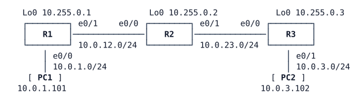

# LAB-001 — Evidence first

**Module:** 01 Operations toolkit and campus switching · **Type:** F/A (Foundation / Analysis) · **Guidance tier:** G3 (guided) · **Estimated time:** 75 min · **Blueprint objectives:** 4.1:I (diagnose problems with debugs, conditional debugs, traceroute, ping, SNMP and syslog), 5.1.a:I (lines and local user authentication), 3.3.a:I (interpret NTP configurations)

## Scenario

It is your first day on Veridian's network team. Before you may change anything in production, your team lead wants proof that you gather evidence properly. A small router bench has been set up for you: three routers in a chain, a user PC at each end, static routing, and a time service. One router (R3) was racked in a hurry and nobody can log in to it remotely yet.

Work through the tasks in order. Gather evidence first, change only what a task asks for, and keep the outputs you capture: the analysis questions refer to them.

## Objectives

After this lab you can:
- use extended ping options (source, size, DF bit) and traceroute to measure and explain a path;
- find the hop that limits the largest unfragmented packet on a path;
- read the local log buffer and interpret message severity and timestamps;
- limit debug output to one host's traffic before enabling it, and remove all debugging afterwards;
- enable SSH version 2 with local authentication on a router and restrict remote access to SSH;
- read an NTP configuration and predict each router's stratum and synchronisation.

## Available Information

### Topology

### Cabling and addressing

| Device | Interface | Peer | Address |
|---|---|---|---|
| R1 | Ethernet0/0 | PC1 eth0 | 10.0.1.1/24 |
| R1 | Ethernet0/1 | R2 Ethernet0/0 | 10.0.12.1/24 |
| R1 | Loopback0 | — | 10.255.0.1/32 |
| R2 | Ethernet0/0 | R1 Ethernet0/1 | 10.0.12.2/24 |
| R2 | Ethernet0/1 | R3 Ethernet0/0 | 10.0.23.2/24 |
| R2 | Loopback0 | — | 10.255.0.2/32 |
| R3 | Ethernet0/0 | R2 Ethernet0/1 | 10.0.23.3/24 |
| R3 | Ethernet0/1 | PC2 eth0 | 10.0.3.3/24 |
| R3 | Loopback0 | — | 10.255.0.3/32 |
| PC1 | eth0 | R1 Ethernet0/0 | 10.0.1.101/24, gateway 10.0.1.1 |
| PC2 | eth0 | R3 Ethernet0/1 | 10.0.3.102/24, gateway 10.0.3.3 |

Routing is static: every router has routes to every subnet and loopback in the lab. Ethernet0/2 and Ethernet0/3 on the routers are unused (administratively down).

### Time service

| Item | Value |
|---|---|
| NTP authentication key | key 1, `hmac-sha2-256`, `NTPKEY123` |
| Design | R1 is the lab's time source; R2 takes time from R1's loopback; R3 takes time from R2's loopback |

### Access

- Router consoles open in privileged mode. Local user `admin` / `Cisco123!` (privilege 15), enable secret `Cisco123!`, domain name `veridian.example` (Veridian standard).
- PC1/PC2 (Alpine Linux): CML console, login `cisco` / `cisco` if asked; use `sudo` for privileged commands. PC1 has an OpenSSH client.
- Log messages and debug output go to the local buffer (`show logging`) as well as the console.

### Platform notes (CML iol-xe routers)

- Alpine's `ping` cannot set the DF bit, so run the path-MTU measurement from **R1**, sourced from its PC1-facing interface (Ethernet0/0, 10.0.1.1): the packets then take the same path as PC1's traffic.
- In IOS `ping`, `size` is the whole IP packet (header included), not only the payload. A sweep of sizes is available in the interactive extended ping (type `ping` with no arguments).
- `debug condition ip <address>` and `debug condition interface <interface>` are accepted on this image, but they do **not** restrict packet debugs such as `debug ip icmp` or `debug ip packet` (conditions do restrict some protocol debugs, for example `debug ip ospf adj` with an interface condition, which later modules use). Limit a packet debug with an access list instead (`debug ip packet <access-list number> [detail]`, numbered ACLs only). That is the conditional debug used in this lab. Read debug output with `show logging`.
- A router forwards transit traffic in CEF without involving the CPU, so packet debugs show only traffic to or from the router itself.
- Shutting down an interface in CML does not take the link down on the neighbour: the far end stays up/up.
- `ntp master` needs about 15 minutes after boot before it serves time, and a client needs a few more minutes. Do the NTP confirmation (R6) last.

## Starting State

- PC1, PC2 and all loopbacks reach each other.
- R3 refuses remote logins: nobody can reach its command line except through the console.
- The time configuration is in place on all three routers. Do not change it (except in the optional part of R6).
- No debugging is enabled anywhere.

## Requirements / Change Requests

R1. **Path MTU.** From R1, sourced from Ethernet0/0, find the largest packet that reaches PC2 **without fragmentation** (DF bit set). Use a sweep of sizes that crosses the boundary, then confirm the boundary with two single sizes. Name the router and interface that limits it, and show the evidence that locates it (not only the configuration).

R2. **Traceroute.** Capture a traceroute from R1 to PC2 sourced from R1's Loopback0. Explain what each line of the output is and which device sent it. Capture the same traceroute from PC1 and explain why it has one more line.

R3. **Conditional debug.** On R2, set up a debug that shows only ICMP to or from PC1, **before** you turn any debugging on. Generate traffic: PC1 and PC2 each ping one of R2's addresses. Show that only PC1's packets appear in R2's log buffer. Then turn off all debugging and check that none remains active.

R4. **Log reading.** Shut down R2 Ethernet0/1, check what PC1 experiences (ping and traceroute to PC2), then re-enable the interface. From R2's log buffer, collect every message the change produced and record, for each one: facility, severity number and name, mnemonic and timestamp. Confirm PC1 reaches PC2 again.

R5. **Remote access to R3.** Configure R3 so that user `admin` can log in remotely with **SSH version 2 only**, authenticated against the local user database (no line password). Telnet to R3 must be refused. Log in from R1 to R3 with SSH and show the session on R3. (If you want a second vantage point, PC1's OpenSSH client can log in too.)

R6. **Time.** From the running configurations alone, answer Q4 before you look at any NTP status command. At the end of the lab (at least 15 minutes after the lab started), confirm your answer with NTP status commands on all three routers. Optional, if time allows: make the smallest change that lets R3 synchronise and watch it happen.

## Verification Criteria

V1. You have R1 ping output in which the largest DF-set size succeeds and the next size up fails, and evidence that names the limiting router and interface.

V2. You have the loopback-sourced traceroute from R1 and the traceroute from PC1 to PC2, each with every hop explained.

V3. R2's log buffer contains debug lines for PC1's ICMP (to or from 10.0.1.101) and none for PC2's pings to R2, which succeeded at the same time. After the test, `show debugging` on R2 lists no active IP debug and no debug condition remains.

V4. You have R2's log messages for the shutdown and for the re-enable, each classified by severity, and PC1 reaches PC2 again after the re-enable.

V5. R3 reports SSH version 2 enabled; an SSH login as `admin` from R1 succeeds and R3 shows the session (for example in `show users` or `show ssh`); a Telnet attempt from R1 to R3 is refused.

V6. At the end of the lab, R2 lists R1 as its selected time source (`*` in `show ntp associations`) at the stratum you predicted, and R3 has no selected time source, as predicted in Q4.

## Analysis Questions

Q1. Why must the condition (or access list) that limits a debug be in place **before** the debug is enabled on a production router? What could happen if you enabled `debug ip packet` without it on a busy router?

Q2. How do the results of your MTU sweep match the path? Using your sweep, explain why a ping just above your boundary succeeds to one address on the limiting link and fails to the other, and what the `M` and `.` characters in a failing ping mean.

Q3. What severity level does each message you captured in R4 have, and why? Why do timestamps matter when you correlate logs from several devices, and what does a leading `*` on a timestamp tell you?

Q4. What stratum will R1 and R2 have once time is established, and will R3 ever synchronise? Justify your answer from the configuration lines alone.

Q5. Why does `transport input ssh` matter even when the VTY lines have a password or use local login?
