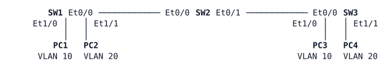

# LAB-002 — Trunk Negotiation

**Module:** 01 Operations toolkit and campus switching · **Type:** F (Foundation) · **Guidance tier:** G3 · **Estimated time:** 75 min · **Blueprint objectives:** 3.1.a:I (static and dynamic 802.1Q trunking: DTP, allowed and native VLANs), X-VTP:I (v1–v3 domains, server/client, revision numbers; taught with 3.1.a)

## Scenario

Veridian Freight is deciding two things before the next campus refresh: whether its switches should ever negotiate trunks on their own, and whether VTP should manage VLANs centrally. Today every Veridian switch runs VTP transparent with its VLANs in its own configuration, and every trunk is configured by hand.

The network team has set up a three-switch test bench: SW1, SW2 and SW3 in a chain, with a VLAN 10 host and a VLAN 20 host at each end. You will run the trunk-negotiation experiments, then build the target design (static trunks, and a VTP version 3 pilot run from SW1) and show that both host pairs can reach each other across the chain.

## Objectives

- Observe which DTP mode combinations form a trunk and read the result with `show dtp interface` and `show interfaces trunk`.
- Configure static 802.1Q trunks with DTP disabled, an unused native VLAN and an explicit allowed-VLAN list.
- Run VTP version 3 with a primary server and clients, and read domain, mode, revision and primary-server information.
- Explain how VTP domain names affect DTP, and how VTP version 3 protects against a switch with a higher revision number.
- Gather evidence with the toolkit from LAB-001: a log message and a sourced ping.

## Available Information

### Topology

All switches are `ioll2-xe` (IOS XE 17.16 L2 image); hosts are Alpine Linux.

### Interfaces and addressing

| Device | Interface | Connects to | VLAN / role | IP address |
|---|---|---|---|---|
| SW1 | Et0/0 | SW2 Et0/0 | inter-switch link | — |
| SW1 | Et1/0 | PC1 eth0 | access VLAN 10 | — |
| SW1 | Et1/1 | PC2 eth0 | access VLAN 20 | — |
| SW1 | Vlan99 | — | management SVI | 10.0.99.1/24 |
| SW2 | Et0/0 | SW1 Et0/0 | inter-switch link | — |
| SW2 | Et0/1 | SW3 Et0/0 | inter-switch link | — |
| SW2 | Vlan99 | — | management SVI | 10.0.99.2/24 |
| SW3 | Et0/0 | SW2 Et0/1 | inter-switch link | — |
| SW3 | Et1/0 | PC3 eth0 | access VLAN 10 | — |
| SW3 | Et1/1 | PC4 eth0 | access VLAN 20 | — |
| SW3 | Vlan99 | — | management SVI | 10.0.99.3/24 |
| PC1 | eth0 | SW1 Et1/0 | VLAN 10 | 10.0.10.101/24 |
| PC2 | eth0 | SW1 Et1/1 | VLAN 20 | 10.0.20.102/24 |
| PC3 | eth0 | SW3 Et1/0 | VLAN 10 | 10.0.10.103/24 |
| PC4 | eth0 | SW3 Et1/1 | VLAN 20 | 10.0.20.104/24 |

Unused switch ports are shut down. There is no router or gateway on the bench: hosts only reach hosts in their own VLAN.

### VLANs (Veridian standard)

| VLAN | Name | Use |
|---|---|---|
| 10 | USERS | user hosts |
| 20 | OPS | operations hosts |
| 99 | MGMT | switch management |
| 999 | NATIVE | native VLAN on trunks (carries no user traffic) |

### Credentials

| Item | Value |
|---|---|
| Switch local user / enable secret | `admin` / `Cisco123!` (privilege 15); enable secret `Cisco123!`. The console opens directly in privileged EXEC |
| Hosts | `cisco` / `cisco` (use `sudo` for interface changes) |
| Domain name | `veridian.example` |

### Platform notes

- **Set 802.1Q encapsulation first.** On this switch image, set `switchport trunk encapsulation dot1q` on both ends of a link before you try any trunk mode. With the encapsulation left at `negotiate`, a negotiated trunk can come up as ISL, which Veridian does not use.
- **Bounce both ends between DTP tests.** Shutting a port on one lab switch does not take the neighbour's port down. After changing a DTP mode, run `shutdown` / `no shutdown` on the interface at *both* ends before you record the result. Otherwise one side can show a stale state from the previous test.
- **Spanning tree.** Ports on this image run at 10 Mb/s, so the short-method STP port cost is 100 (not 19 or 4).
- **VTP state lives outside the configuration file.** In VTP server or client mode, VLANs are kept in `vlan.dat`, not in the running configuration. Wiping the lab in CML returns every switch to the starting state.

## Starting State

- All three switches run VTP transparent mode with no VTP domain name.
- SW1 has VLANs 10, 20, 99 and 999. SW2 and SW3 have VLANs 10, 99 and 999 only: **VLAN 20 is not defined on SW2 or SW3.** SW3 Et1/1 is already assigned to VLAN 20.
- The three inter-switch ports (SW1 Et0/0, SW2 Et0/0 and Et0/1, SW3 Et0/0) are at factory defaults. No trunks exist, and the Vlan99 SVIs cannot reach each other.
- Access ports and host addresses are preconfigured.
- PC1 cannot ping PC3, and PC2 cannot ping PC4.
- Spanning-tree priorities are at their defaults; which switch is root depends on MAC addresses, so find out yourself if you need it.

## Requirements / Change Requests

**R1 — DTP mode matrix (SW1 Et0/0 ↔ SW2 Et0/0).** With `switchport trunk encapsulation dot1q` set on both ends, for each pair of modes below, first write down your prediction (trunk or access on each end, and why) in the Predicted column, using only what you know about DTP. Then configure the pair, bounce both ends, and record the operational mode of each end (`show dtp interface`, `show interfaces <intf> switchport`) and any log messages.

| # | SW1 Et0/0 | SW2 Et0/0 | Predicted (fill in first) | Result (fill in) |
|---|---|---|---|---|
| 1 | `dynamic auto` | `dynamic auto` |  |  |
| 2 | `dynamic desirable` | `dynamic auto` |  |  |
| 3 | `dynamic desirable` | `dynamic desirable` |  |  |
| 4 | `trunk` | `dynamic auto` |  |  |
| 5 | `trunk` | `dynamic desirable` |  |  |
| 6 | `access` | `dynamic auto` |  |  |
| 7 | `access` | `dynamic desirable` |  |  |
| 8 | `trunk` + `nonegotiate` | `dynamic auto` |  |  |
| 9 | `trunk` + `nonegotiate` | `dynamic desirable` |  |  |
| 10 | `dynamic desirable`, VTP domain `VERIDIAN` | `dynamic desirable`, a different VTP domain name (set while still transparent) |  |  |

After row 10, give SW2 the domain name `VERIDIAN` again. For every row where the result differed from your prediction, write one sentence explaining what you had wrong.

**R2 — Static trunks.** Both inter-switch links (SW1–SW2 and SW2–SW3) are 802.1Q trunks that do not depend on DTP and send no DTP frames, with native VLAN 999 and only VLANs 10, 20 and 99 allowed.

**R3 — VTP version 3 pilot.** All three switches run VTP version 3 in domain `VERIDIAN`. SW1 is the VTP server and the primary server for VLANs; SW2 and SW3 are clients. VLAN 20 must appear on SW2 and SW3 through VTP: do not create it on those switches.

**R4 — Reachability.** PC1 and PC3 can ping each other, and PC2 and PC4 can ping each other.

## Verification Criteria

**V1:** The R1 table is complete, with the operational mode of *both* ends for every row and the log message (if any) that rows 8–10 produced.

**V2:** On every switch, `show interfaces trunk` lists each inter-switch port as trunking with mode `on`, 802.1Q encapsulation, native VLAN 999, and VLANs 10, 20 and 99 allowed, active and forwarding. `show dtp interface` on each of those ports shows that the port does not negotiate.

**V3:** `show vtp status` on SW1 shows version 3, domain `VERIDIAN`, operating mode primary server, and SW1 as the primary ID.

**V4:** `show vtp status` on SW2 and SW3 shows version 3, domain `VERIDIAN`, client mode, the same configuration revision and MD5 digest as SW1, and SW1 as primary. `show vlan brief` on SW2 and SW3 lists VLAN 20 `OPS`, and neither switch has a `vlan 20` line in its running configuration.

**V5:** PC1 → PC3 (10.0.10.103) and PC2 → PC4 (10.0.20.104) pings succeed.

**V6 (toolkit):** Show the log message on SW1 that records it becoming the VTP primary server, and a ping from SW3 sourced from its Vlan99 address to 10.0.99.1 that succeeds.

## Analysis Questions

**Q1:** Which DTP combinations formed a trunk, and which did not? Why is `switchport nonegotiate` (or `switchport mode access`) the right setting on a port at an administrative boundary, for example toward a server or another organisation?

**Q2:** Why do VTP domain names matter to DTP? Use what you saw in row 10 of the R1 table.

**Q3:** In VTP version 1 or 2, what would happen if a switch from another bench, carrying the same domain name and a higher configuration revision, were connected to this network? How does the version 3 primary-server role prevent that?

**Q4:** Veridian ships every switch in VTP transparent mode, with its VLANs in its own configuration file. Give two reasons for that policy, one of them about how switch configurations are backed up and restored.
