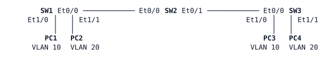

# LAB-003 — Where Did VLAN 20 Go?

**Module:** 01 Operations toolkit and campus switching · **Type:** T (Troubleshooting) · **Guidance tier:** G3 (first troubleshooting lab: affected area named, hints available) · **Estimated time:** 45 min · **Blueprint domains:** 3, 4

## Scenario

Veridian ran a VTP pilot on its three-switch test bench and has now rolled it back. Company policy is back in force: every switch runs VTP transparent mode with its VLANs defined in its own configuration, and trunks are static. The rollback was done by hand on each switch.

The next morning the operations team opened a ticket: the VLAN 20 hosts at the two ends of the bench cannot reach each other. You are the engineer on call. Find out why, fix it within Veridian's policy, and explain what you found.

## Objectives

- Follow a structured troubleshooting method: reproduce the problem, list the candidate causes, then confirm or eliminate each one with evidence.
- Compare VLAN and trunk state across every switch and at both ends of every link.
- Fix the problem with the smallest set of changes that keeps the bench within Veridian policy.
- Use the LAB-001 toolkit to gather evidence (a sourced ping from a switch).

## Available Information

### Topology

All switches are `ioll2-xe` (IOS XE 17.16 L2 image); hosts are Alpine Linux.

### Interfaces and addressing

| Device | Interface | Connects to | VLAN / role | IP address |
|---|---|---|---|---|
| SW1 | Et0/0 | SW2 Et0/0 | trunk | — |
| SW1 | Et1/0 | PC1 eth0 | access VLAN 10 | — |
| SW1 | Et1/1 | PC2 eth0 | access VLAN 20 | — |
| SW1 | Vlan99 | — | management SVI | 10.0.99.1/24 |
| SW2 | Et0/0 | SW1 Et0/0 | trunk | — |
| SW2 | Et0/1 | SW3 Et0/0 | trunk | — |
| SW2 | Vlan99 | — | management SVI | 10.0.99.2/24 |
| SW3 | Et0/0 | SW2 Et0/1 | trunk | — |
| SW3 | Et1/0 | PC3 eth0 | access VLAN 10 | — |
| SW3 | Et1/1 | PC4 eth0 | access VLAN 20 | — |
| SW3 | Vlan99 | — | management SVI | 10.0.99.3/24 |
| PC1 | eth0 | SW1 Et1/0 | VLAN 10 | 10.0.10.101/24 |
| PC2 | eth0 | SW1 Et1/1 | VLAN 20 | 10.0.20.102/24 |
| PC3 | eth0 | SW3 Et1/0 | VLAN 10 | 10.0.10.103/24 |
| PC4 | eth0 | SW3 Et1/1 | VLAN 20 | 10.0.20.104/24 |

There is no router on the bench: hosts only reach hosts in their own VLAN.

### Veridian bench standard (the intended design)

| Item | Standard |
|---|---|
| VLANs on every switch | 10 USERS, 20 OPS, 99 MGMT, 999 NATIVE |
| VTP | transparent mode, domain `VERIDIAN`, VLANs defined in each switch's configuration |
| Inter-switch links | static 802.1Q trunks, no DTP (`nonegotiate`), native VLAN 999, allowed VLANs exactly 10, 20, 99 |
| Host ports | access ports with PortFast |

### Credentials

| Item | Value |
|---|---|
| Switch local user / enable secret | `admin` / `Cisco123!`; the console opens directly in privileged EXEC |
| Hosts | `cisco` / `cisco` |

Platform note: ports on this switch image run at 10 Mb/s (STP port cost 100).

## Starting State

- The VTP rollback is complete on all three switches: each runs VTP transparent mode in domain `VERIDIAN`.
- All inter-switch links are configured as static trunks.
- Host addressing is as in the table above.
- Do **not** re-enable VTP server/client mode: the rollback is Veridian policy, not something to undo.

## Requirements / Change Requests

**R1:** Restore VLAN 20 connectivity between the two ends of the bench, without affecting VLAN 10 or switch management.

**R2:** Fix every cause you find at its source, with the smallest set of changes that brings the bench back to the Veridian bench standard above. Do not add VLANs, trunks or features that the standard does not list.

**R3:** For your ticket notes, record each cause you found (device, what was wrong, the evidence that showed it) and at least three other plausible causes you ruled out, with the evidence that ruled each one out.

## Reported Problems

Ticket from the operations team:

> "PC2 and PC4 (VLAN 20) cannot ping each other. PC1 and PC3 (VLAN 10) are fine. The problem is somewhere in the switches or links between them."

Hints, in order (use them only if you are stuck):

1. Compare what each switch knows about VLAN 20.
2. Compare what each trunk carries.
3. Check both ends of every link.

## Verification Criteria

**V1:** PC2 can ping PC4 (10.0.20.104), and PC4 can ping PC2 (10.0.20.102).

**V2:** PC1 can still ping PC3 (10.0.10.103).

**V3:** Every switch runs VTP transparent mode and lists VLANs 10, 20, 99 and 999 as active, defined in its own running configuration.

**V4:** On every switch, each inter-switch port is a static trunk (mode `on`), native VLAN 999, with exactly VLANs 10, 20 and 99 allowed, active and forwarding, checked at both ends of each link.

**V5 (toolkit):** A ping from SW1, sourced from its Vlan99 address, to SW3's management address (10.0.99.3) succeeds.

**V6:** Your ticket notes meet R3.

## Analysis Questions

**Q1:** Which VLANs carried traffic and which did not at the start, and what did that comparison tell you about where to look and what to rule out?

**Q2:** Which single show command, run on both ends of each trunk, gives the fastest view of what every link carries? Why must it be run on both ends?

**Q3:** (Answer after fixing.) Which change-control rule would have prevented each cause you found, and what operational risk does that rule address?
