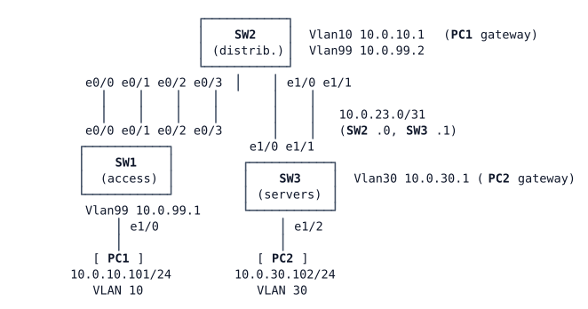

# LAB-004 — EtherChannel bundles

**Module:** 01 Operations toolkit and campus switching · **Type:** F (Foundation) · **Guidance tier:** G3 (guided) · **Estimated time:** 60 min · **Blueprint objectives:** 3.1.b:I (Layer 2 and Layer 3 EtherChannel: LACP, PAgP, static; reinforces 3.1.a trunks)

## Scenario

Veridian's network team is preparing its switching bench for the new campus design. Each switch pair on the bench now has doubled uplinks: four cables between SW1 and SW2, and two cables between SW2 and the server switch SW3. Right now the cables are plugged in, but every port is still at its factory defaults, so the extra capacity is wasted and spanning tree blocks most of it.

Your job is to turn the parallel links into EtherChannel bundles, compare the three ways of forming a bundle (LACP, PAgP and static `on`), and build a routed bundle toward the server switch, so that the user host PC1 can reach the server PC2.

## Objectives

After this lab you can:
- build Layer 2 EtherChannel trunks with LACP (active/passive) and PAgP (desirable/auto);
- explain what happens when only one side of a bundle uses `on` mode;
- build a Layer 3 (routed) EtherChannel and route across it;
- explain why the port-channel interface, not its members, carries the configuration;
- read the load-balancing method and reason which member a flow uses;
- describe how spanning tree sees a bundle, and what happens when one member fails.

## Available Information

### Topology

### Cabling and interfaces

| Device | Interface | Peer | Use in this lab |
|---|---|---|---|
| SW1 | Ethernet0/0, Ethernet0/1 | SW2 Ethernet0/0, Ethernet0/1 | first SW1–SW2 pair (Port-channel1) |
| SW1 | Ethernet0/2, Ethernet0/3 | SW2 Ethernet0/2, Ethernet0/3 | second SW1–SW2 pair (Port-channel2) |
| SW1 | Ethernet1/0 | PC1 eth0 | access port, VLAN 10 |
| SW2 | Ethernet1/0, Ethernet1/1 | SW3 Ethernet1/0, Ethernet1/1 | SW2–SW3 pair (Port-channel3, routed) |
| SW3 | Ethernet1/2 | PC2 eth0 | access port, VLAN 30 |

### Addressing

| Device | Interface | Address | Notes |
|---|---|---|---|
| SW1 | Vlan99 | 10.0.99.1/24 | management; default gateway 10.0.99.2 |
| SW2 | Vlan10 | 10.0.10.1/24 | gateway for VLAN 10 |
| SW2 | Vlan99 | 10.0.99.2/24 | management |
| SW2 | Port-channel3 (to build) | 10.0.23.0/31 | routed link to SW3 |
| SW3 | Port-channel3 (to build) | 10.0.23.1/31 | routed link to SW2 |
| SW3 | Vlan30 | 10.0.30.1/24 | gateway for VLAN 30 |
| PC1 | eth0 | 10.0.10.101/24 | default gateway 10.0.10.1 |
| PC2 | eth0 | 10.0.30.102/24 | default gateway 10.0.30.1 |

Static routes are already in place: SW2 reaches 10.0.30.0/24 via 10.0.23.1; SW3 reaches 10.0.10.0/24 and 10.0.99.0/24 via 10.0.23.0.

### VLANs (all switches)

| VLAN | Name | Use |
|---|---|---|
| 10 | USERS | PC1 |
| 30 | SERVERS | PC2 (local to SW3) |
| 99 | MGMT | switch management |
| 999 | NATIVE | native VLAN on trunks (carries no users) |

Veridian policy: the VTP pilot was rolled back, so every switch runs VTP transparent mode and VLANs are managed per switch.

### Access

- Switch consoles open in privileged mode. Local user `admin` / `Cisco123!` (privilege 15), enable secret `Cisco123!`.
- PC1/PC2 (Alpine Linux): CML console, login `cisco` / `cisco` if asked; use `sudo` for privileged commands.

### Platform notes (CML ioll2-xe switches)

- Set `switchport trunk encapsulation dot1q` before `switchport mode trunk`, on both ends.
- Ports run at 10 Mb/s, so the spanning-tree cost of one port is 100 (not 19 or 4 as on Fast/Gigabit hardware), and a two-member bundle gets a lower cost of its own.
- `show pagp` and `test etherchannel load-balance` do not exist on this platform. Use the `show etherchannel` family (`summary`, `detail`, `port-channel`, `load-balance`) and `show lacp`.
- Removing a Port-channel interface (`no interface Port-channelN`) leaves its member ports administratively down: `no shutdown` them afterwards.
- Unused switch ports show as `connected`: that is normal in CML.
- Shutting down a port in CML does not take the link down on the neighbour: the far end stays up/up and only notices through its control protocols (for example LACP timeouts). On real hardware the neighbour would see the link go down at once.
- IOS warns `use /31 mask on non point-to-point interface cautiously` when you put a /31 on a port-channel; the address works.

## Starting State

- All three switches have their VLANs, SVIs, the two gateway addresses and the static routes.
- Every inter-switch port (SW1–SW2 Ethernet0/0–0/3, SW2–SW3 Ethernet1/0–1/1) is at its default: not trunking, not bundled, in VLAN 1.
- PC1 cannot reach its gateway or PC2. PC2 reaches its own gateway only.
- Spanning-tree priorities are at their defaults: which switch is the root bridge depends on the switches' MAC addresses, so find out yourself.

## Requirements / Change Requests

R1. Bundle SW1–SW2 Ethernet0/0–0/1 into **Port-channel1** using **LACP**, with SW1 actively negotiating and SW2 only responding. Po1 is an 802.1Q trunk with native VLAN 999 that carries only VLANs 10 and 99.

R2. Bundle SW1–SW2 Ethernet0/2–0/3 into **Port-channel2** using **PAgP**, with SW1 actively negotiating and SW2 only responding. Po2 has the same trunk settings as Po1.

R3. Experiment: change **SW1's** Po2 members to the static `on` mode while SW2 keeps PAgP (IOS does not let you switch a member directly from one bundling protocol to another). Watch both switches for at least two minutes after the change and record what each reports: bundle and member flags, log messages, spanning-tree port roles, and whether PC1 still reaches its gateway. Then restore R2 exactly and make sure every Po2 port on both switches is back in service.

R4. Bundle SW2–SW3 Ethernet1/0–1/1 into a **routed Port-channel3** using **LACP** (both sides actively negotiating), addressed 10.0.23.0/31 on SW2 and 10.0.23.1/31 on SW3. PC1 must reach PC2.

R5. EtherChannel load balancing must use the **source and destination IP address** on all three switches. Find out which method each switch uses now, and change it only where needed.

## Verification Criteria

V1. On SW1 and SW2, Po1 and Po2 are Layer 2 bundles in use, with both members bundled; Po1 is negotiated by LACP and Po2 by PAgP. On SW2 and SW3, Po3 is a Layer 3 bundle in use negotiated by LACP, with both members bundled.

V2. Po1 and Po2 trunk with native VLAN 999 and carry only VLANs 10 and 99.

V3. For VLAN 10, spanning tree lists Po1 and Po2 as single ports (no member interfaces appear), and exactly one of the two bundles is blocking on one switch.

V4. PC1 reaches PC2 (ping), and a traceroute from PC1 shows the path SW2 → SW3 → PC2.

V5. A ping from SW3 sourced from its VLAN 30 gateway address reaches PC1.

V6. All three switches report source-and-destination-IP load balancing, and you can state whether you had to change it.

V7. For R3 you have recorded, from both switches, the bundle state and at least one log message the mismatch produced.

V8. Failure test: start a continuous ping from PC1 to PC2, then shut down Ethernet0/0 on SW1 (one member of Po1). Po1 stays up with one member, and PC1 keeps reaching PC2 (record any loss). Record Po1's bandwidth and the VLAN 10 spanning-tree roles on both switches before and after, and the log messages on SW1. Check SW2's view of Po1 over the next two minutes. Then bring the member back and confirm it rejoins the bundle.

## Analysis Questions

Q1. Why does spanning tree block a whole port-channel rather than one of its members? What would happen without the bundle?

Q2. `test etherchannel load-balance` is not available on this platform. Using `show etherchannel load-balance`, reason which member of Po3 a PC1→PC2 flow could hash to, and explain why one flow never uses both links.

Q3. What does `on` mode risk when the far end is not set up the same way? Base your answer on what you observed in R3.

Q4. When would you choose LACP over PAgP in a network with switches from several vendors, and why?

Q5. Before V8, predict the effect of losing one member on Po1's bandwidth, its spanning-tree cost and the bundle that forwards VLAN 10. After V8, explain what you actually saw and why. How long did SW2 take to notice the missing member, and what told it?
