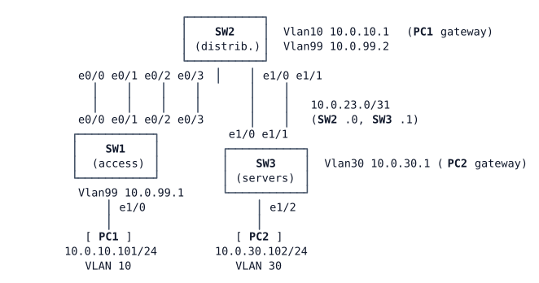

# LAB-005 — Half the uplink is missing

**Module:** 01 Operations toolkit and campus switching · **Type:** T (Troubleshooting) · **Guidance tier:** G2 · **Estimated time:** 45 min · **Blueprint domains:** 3, 4

## Scenario

Last night the network team ran a change window on the switching bench you built in LAB-004. The change record says only "port cleanup on the bench switches; no design changes". This morning two tickets are waiting for you. Find the causes, fix them with the smallest changes that restore the documented design, and explain what you found.

## Objectives

- Work from symptoms to root cause, collecting evidence before changing anything.
- Rule out the plausible causes that are not responsible, with evidence for each.
- Restore the documented design with minimal changes, and prove each fix resolves its ticket.

## Available Information

### Topology

### Documented design (as built in LAB-004)

| Link | Logical interface | Members | Negotiation | Type |
|---|---|---|---|---|
| SW1–SW2 | Port-channel1 | Ethernet0/0, Ethernet0/1 | LACP: SW1 active, SW2 passive | 802.1Q trunk, native VLAN 999, VLANs 10 and 99 |
| SW1–SW2 | Port-channel2 | Ethernet0/2, Ethernet0/3 | PAgP: SW1 desirable, SW2 auto | 802.1Q trunk, native VLAN 999, VLANs 10 and 99 |
| SW2–SW3 | Port-channel3 | Ethernet1/0, Ethernet1/1 | LACP: both active | routed, 10.0.23.0/31 (SW2 .0, SW3 .1) |

Load balancing: source and destination IP on all switches.

### Addressing

| Device | Interface | Address | Notes |
|---|---|---|---|
| SW1 | Vlan99 | 10.0.99.1/24 | management; default gateway 10.0.99.2 |
| SW2 | Vlan10 | 10.0.10.1/24 | gateway for VLAN 10 |
| SW2 | Vlan99 | 10.0.99.2/24 | management |
| SW2 | Port-channel3 | 10.0.23.0/31 | to SW3 |
| SW3 | Port-channel3 | 10.0.23.1/31 | to SW2 |
| SW3 | Vlan30 | 10.0.30.1/24 | gateway for VLAN 30 |
| PC1 | eth0 | 10.0.10.101/24 | default gateway 10.0.10.1 |
| PC2 | eth0 | 10.0.30.102/24 | default gateway 10.0.30.1 |

Static routes: SW2 reaches 10.0.30.0/24 via 10.0.23.1; SW3 reaches 10.0.10.0/24 and 10.0.99.0/24 via 10.0.23.0.

### VLANs (all switches, VTP transparent)

| VLAN | Name | Use |
|---|---|---|
| 10 | USERS | PC1 |
| 30 | SERVERS | PC2 (local to SW3) |
| 99 | MGMT | switch management |
| 999 | NATIVE | trunk native VLAN |

### Access

- Switch consoles open in privileged mode. Local user `admin` / `Cisco123!` (privilege 15), enable secret `Cisco123!`.
- PC1/PC2 (Alpine Linux): CML console, login `cisco` / `cisco` if asked.

### Platform notes (CML ioll2-xe switches)

- Ports run at 10 Mb/s: one port has spanning-tree cost 100, and bundles cost less according to their bandwidth.
- `show pagp` and `test etherchannel load-balance` do not exist on this platform; use the `show etherchannel` family and `show lacp`.
- Removing a Port-channel interface leaves its member ports administratively down.
- Shutting down a port in CML does not take the link down on the neighbour.
- Spanning-tree priorities are at their defaults, so which switch is the root bridge depends on MAC addresses.

## Starting State

The bench is running with last night's change applied. Nothing has been changed since. The switches' log buffers still hold the messages from the switches' latest start.

## Requirements / Change Requests

R1. Resolve ticket T1 and ticket T2 so that the network matches the documented design again.

R2. Make the smallest changes that do this. Do not change addressing, static routes, VLANs or the negotiation methods in the design table, and do not remove any logical interface.

R3. For each ticket, record the root cause, the device and interface involved, and the evidence (at least one output and one log message) that proves it. Also record the evidence that rules out at least two other plausible causes.

R4. Fix one cause at a time and record which ticket each fix resolved.

## Reported Problems

**T1 (user, 08:05):** "PC1 cannot reach the server PC2 since the change window. PC1 still reaches its gateway 10.0.10.1."

**T2 (monitoring, 07:40):** "Link capacity between SW1 and SW2 dropped overnight. No port is reported down."

## Verification Criteria

V1. PC1 reaches PC2 by ping, and a traceroute from PC1 shows the path through 10.0.23.1.

V2. SW3 reaches PC1 with a ping sourced from its VLAN 30 gateway address.

V3. On every switch, every inter-switch member port is in service in its logical interface, and each SW1–SW2 logical link reports its full two-port bandwidth.

V4. The network matches its documented design in every respect listed under Available Information.

V5. Your record for R3 and R4 names, for each ticket, the log message that pointed to the cause.

## Analysis Questions

Q1. (Answer after fixing.) Which device's own view of its interfaces was most misleading during your diagnosis, and why did it report that state?

Q2. Which log message pointed to each cause, and on which switch did it appear?

Q3. (Answer after fixing.) For each cause you found, which part of the documented design, applied on both ends, would have prevented it, and why?
