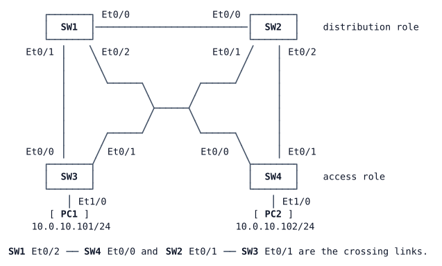

# LAB-006 — Spanning tree by design

**Module:** 01 Operations toolkit and campus switching · **Type:** I (Implementation) · **Guidance tier:** G3 (guided) · **Estimated time:** 90 min · **Blueprint objectives:** 3.1.c:I (RSTP and MST: root placement, port roles, PortFast, BPDU guard, root guard; reinforces 3.1.a trunks and 3.1.b concepts)

## Scenario

Veridian's switching bench now mimics the new campus layout: a distribution pair (SW1, SW2) and two access switches (SW3, SW4), each access switch dual-homed to both distribution switches. The trunks work and the two test hosts can talk, but nobody has designed the spanning tree: every switch still runs its factory settings, so the root bridge and the blocked links are whatever the switches' MAC addresses decided.

The design review wants the tree engineered: roots at the distribution layer, traffic for different VLANs spread over both distribution switches, edge ports that come up at once but shut themselves if a switch is plugged in, and distribution downlinks that refuse a rogue root. After that, the team wants to see the same design built with MST, the standard the campus will move to.

## Objectives

After this lab you can:
- find the root bridge and every port's role and state, and explain the election;
- place Rapid PVST+ primary and secondary roots per VLAN and share load across two distribution switches;
- predict which access-switch uplink blocks for each VLAN, then prove it;
- protect edge ports with PortFast and BPDU guard, and distribution downlinks with root guard, and prove both guards;
- configure an MST region with two instances and migrate to it;
- measure how fast the tree reroutes after a link failure, and explain what an MST region mismatch does.

## Available Information

### Topology

### Cabling and interfaces

| Device | Interface | Peer | Use |
|---|---|---|---|
| SW1 | Ethernet0/0 | SW2 Ethernet0/0 | trunk, distribution interlink |
| SW1 | Ethernet0/1 | SW3 Ethernet0/0 | trunk, downlink to SW3 |
| SW1 | Ethernet0/2 | SW4 Ethernet0/0 | trunk, downlink to SW4 |
| SW2 | Ethernet0/1 | SW3 Ethernet0/1 | trunk, downlink to SW3 |
| SW2 | Ethernet0/2 | SW4 Ethernet0/1 | trunk, downlink to SW4 |
| SW3 | Ethernet1/0 | PC1 eth0 | access port, VLAN 10 |
| SW4 | Ethernet1/0 | PC2 eth0 | access port, VLAN 10 |

All other switch ports are unused.

### Addressing

| Device | Interface | Address |
|---|---|---|
| SW*n* (n = 1–4) | Vlan10 | 10.0.10.*n*/24 |
| SW*n* (n = 1–4) | Vlan20 | 10.0.20.*n*/24 |
| PC1 | eth0 | 10.0.10.101/24 |
| PC2 | eth0 | 10.0.10.102/24 |

The switches do not route (`no ip routing`); the SVIs are test addresses only.

### VLANs (all switches)

| VLAN | Name | Use |
|---|---|---|
| 10 | USERS | PC1, PC2 |
| 20 | OPS | second user group (no hosts yet) |
| 99 | MGMT | management |
| 999 | NATIVE | native VLAN on trunks (carries no users) |

Every inter-switch link is a static 802.1Q trunk (no DTP) with native VLAN 999, allowing only VLANs 10, 20 and 99. Veridian policy: the VTP pilot was rolled back, so every switch runs VTP transparent mode and VLANs are managed per switch.

### Access

- Switch consoles open in privileged mode. Local user `admin` / `Cisco123!` (privilege 15), enable secret `Cisco123!`.
- PC1/PC2 (Alpine Linux): CML console, login `cisco` / `cisco` if asked. Use `sudo` for privileged commands; `sudo ping -i 0.2 <address>` sends five pings per second, which makes lost-packet counts easy to turn into seconds.

### Platform notes (CML ioll2-xe switches)

- Ports run at 10 Mb/s: the short-method spanning-tree cost of a port is **100**, and under MST (long method) it is **2,000,000**. Do not expect 19 or 4.
- Use `spanning-tree portfast` on host ports; this image rejects `spanning-tree portfast edge`.
- This image already runs Rapid PVST+ by default, and shows `spanning-tree mode rapid-pvst` in the running configuration even when nobody typed it.
- The `root primary` / `root secondary` macros are stored as plain `priority` lines.
- Bridge MAC addresses are assigned when the lab is imported, so the root in your copy of the lab may differ from a classmate's.
- Shutting down a port in CML does not take the link down on the neighbour: the far end stays up/up and only notices through its control protocols (for spanning tree: three missed hellos, about 6 s). On real hardware the neighbour would see the link go down at once. Where the tasks ask you to fail a link, shut **both** ends unless told otherwise.
- Unused switch ports show as `connected`: that is normal in CML.

## Starting State

- VLANs, trunks and test SVIs are configured on all four switches; PC1 reaches PC2 and every switch SVI in VLAN 10.
- Every spanning-tree setting is at its default: no priorities, no PortFast, no guards, no MST configuration.
- Which switch is the root bridge depends on the switches' MAC addresses: find out yourself.

## Requirements / Change Requests

R1. Before changing anything, record for VLANs 10, 20 and 99: the root bridge, each switch's root port, and every blocked port. Explain why that switch won the election and why each blocked port is the one that blocks.

R2. Run Rapid PVST+ on all four switches (make the mode explicit in each configuration). SW1 is the root for VLANs 10 and 99 with SW2 as the backup root; SW2 is the root for VLAN 20 with SW1 as the backup root. Use the primary/secondary root mechanism rather than guessing priority values.

R3. Before you check, write down which uplink of SW3 and of SW4 you expect to block for each of VLANs 10, 20 and 99. Then verify.

R4. The host ports (SW3 Ethernet1/0, SW4 Ethernet1/0) must go straight to forwarding when a host connects and must shut themselves down if they ever receive a BPDU. The distribution switches' downlinks to the access switches (SW1 and SW2 Ethernet0/1 and Ethernet0/2) must never accept a better root from below.

R5. Prove the downlink protection: make SW4 claim to be the root for VLAN 10 (bridge priority 0). Record what SW1 and SW2 log and report, and what happens to PC1↔PC2 traffic. Then remove the change and confirm that the protection releases the ports by itself.

R6. Prove the edge protection. A host cannot send BPDUs, so use a switch-facing test port: enable the edge-port BPDU protection on **SW4 Ethernet0/1** (the uplink to SW2). Record what happens, then remove the protection from that port and bring it back into service.

R7. Migrate the bench to MST: region name `VERIDIAN`, revision 1, instance 1 = VLANs 10 and 99 with SW1 as root (SW2 backup), instance 2 = VLAN 20 with SW2 as root (SW1 backup). Instance 0 (the IST, carrying every other VLAN) must also be rooted at the distribution layer: SW1 root, SW2 backup. Compare the blocked ports per instance with your R3 results.

## Verification Criteria

V1. Your R1 notes name the root bridge, every root port and every blocked port for VLANs 10, 20 and 99, with the tie-breaker that decided each one.

V2. After R2, every switch runs Rapid PVST+; SW1 is the root for VLANs 10 and 99 and SW2 for VLAN 20, and each backup root has the second-best priority for its VLANs.

V3. After R3, the blocked ports you observe on SW3 and SW4 match your written prediction for every VLAN, and no port blocks on SW1 or SW2.

V4. The two host ports are edge ports with BPDU guard; root guard is active on the four distribution downlinks; no port is inconsistent or err-disabled, and PC1 reaches PC2.

V5. For R5 you have the log line that reported the blocked downlink(s), the port state shown for them, the PC1↔PC2 result during the test, and the log line that reported the release.

V6. For R6 you have the log lines that disabled SW4 Ethernet0/1 and the reason shown by the switch; afterwards the port is up, forwarding or alternate as the design expects, and nothing is err-disabled.

V7. After R7, all four switches report the same MST region (name, revision, and configuration digest); SW1 is root for instances 0 and 1 and SW2 for instance 2; no port is inconsistent or err-disabled; PC1 reaches PC2.

V8. Failure test (do the Rapid PVST+ half **before** you start R7): run `sudo ping -i 0.2 10.0.10.102` on PC1, then shut down the SW1–SW3 link (SW3 Ethernet0/0 first, then SW1 Ethernet0/1). Record the number of lost pings and which SW3 port takes over. Bring the link back. Repeat the test after R7 with MST. Then, in the MST design (after R7), repeat it once shutting **only** SW1 Ethernet0/1 and explain the difference in loss.

V9. Region test (after R7): change the MST revision on SW4 to 2. Record the port flags on SW4 and on the distribution side, which switch SW4 now believes is the root of instances 1 and 2, and which SW4 uplink forwards VLAN 20. Restore revision 1 and confirm that SW4 is back in the region.

## Analysis Questions

Q1. Why was the default root in the starting state a poor design? What would happen to the root placement if one more switch with a lower MAC address were added to the bench?

Q2. What did Rapid PVST+ load sharing (R2/R3) achieve that the MST instances (R7) also achieve, and what does each cost in configuration, CPU and BPDUs as the number of VLANs grows?

Q3. What happens to a switch whose MST revision differs from its neighbours'? Use your V9 observations: which instance does the boundary follow, and what did that do to VLAN 20's path from SW4?

Q4. Where do root guard and BPDU guard belong in a campus, and why not the other way round? What would BPDU guard on a distribution downlink have done in this lab?

Q5. Why did R7 have to place the instance 0 root explicitly, given that root guard was already configured on the downlinks? What would you have seen if an access switch had the lowest bridge ID for the IST?
