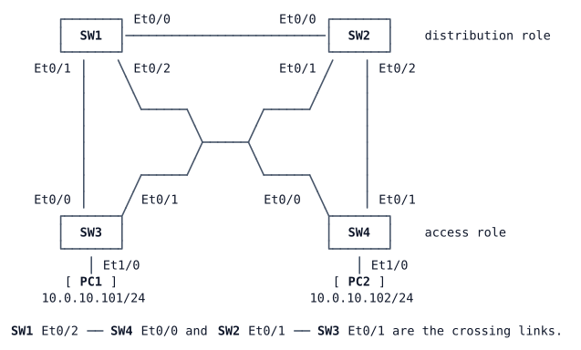

# LAB-007 — Loop protection

**Module:** 01 Operations toolkit and campus switching · **Type:** F (Foundation) · **Guidance tier:** G3 (guided) · **Estimated time:** 60 min · **Blueprint objectives:** X-L2guards:I (BPDU filter, loop guard, UDLD, errdisable recovery), 3.1.c:P (RSTP)

## Scenario

The spanning-tree design from LAB-006 is in place on Veridian's switching bench: SW1 is the root for VLANs 10 and 99, SW2 for VLAN 20, host ports are edge ports with BPDU guard, and the distribution downlinks refuse a rogue root. A design review now asks the opposite question: what protects the tree when BPDUs **stop** arriving, or are filtered by mistake? A port that stops hearing BPDUs assumes nobody is there and starts forwarding, which on a redundant link means a loop.

Your job is to add and test the protections the campus standard lists (BPDU filtering for edge ports, loop guard, UDLD and automatic errdisable recovery), and to prove that a filtered BPDU stream no longer causes a loop.

## Objectives

After this lab you can:
- explain the difference between the global PortFast BPDU filter and interface-level BPDU filtering;
- enable loop guard and recognise a loop-inconsistent port;
- show that loop guard contains a BPDU-stopping failure that would otherwise create a loop;
- run UDLD in aggressive mode and read its neighbour state;
- configure errdisable recovery and describe when it helps and when it hurts.

## Available Information

### Topology

### Cabling and interfaces

| Device | Interface | Peer | Use |
|---|---|---|---|
| SW1 | Ethernet0/0 | SW2 Ethernet0/0 | trunk, distribution interlink |
| SW1 | Ethernet0/1 | SW3 Ethernet0/0 | trunk, downlink to SW3 |
| SW1 | Ethernet0/2 | SW4 Ethernet0/0 | trunk, downlink to SW4 |
| SW2 | Ethernet0/1 | SW3 Ethernet0/1 | trunk, downlink to SW3 |
| SW2 | Ethernet0/2 | SW4 Ethernet0/1 | trunk, downlink to SW4 |
| SW3 | Ethernet1/0 | PC1 eth0 | access port, VLAN 10 |
| SW4 | Ethernet1/0 | PC2 eth0 | access port, VLAN 10 |

All other switch ports are unused.

### Addressing

| Device | Interface | Address |
|---|---|---|
| SW*n* (n = 1–4) | Vlan10 | 10.0.10.*n*/24 |
| SW*n* (n = 1–4) | Vlan20 | 10.0.20.*n*/24 |
| PC1 | eth0 | 10.0.10.101/24 |
| PC2 | eth0 | 10.0.10.102/24 |

The switches do not route (`no ip routing`); the SVIs are test addresses only.

### VLANs (all switches)

| VLAN | Name | Use |
|---|---|---|
| 10 | USERS | PC1, PC2 |
| 20 | OPS | second user group (no hosts yet) |
| 99 | MGMT | management |
| 999 | NATIVE | native VLAN on trunks (carries no users) |

Every inter-switch link is a static 802.1Q trunk (no DTP) with native VLAN 999, allowing only VLANs 10, 20 and 99. Veridian policy: the VTP pilot was rolled back, so every switch runs VTP transparent mode and VLANs are managed per switch.

### Access

- Switch consoles open in privileged mode. Local user `admin` / `Cisco123!` (privilege 15), enable secret `Cisco123!`.
- PC1/PC2 (Alpine Linux): CML console, login `cisco` / `cisco` if asked. Use `sudo` for privileged commands; `sudo ping -i 0.2 <address>` sends five pings per second, which makes lost-packet counts easy to turn into seconds.

### Platform notes (CML ioll2-xe switches)

- Ports run at 10 Mb/s: the spanning-tree cost of a port is 100.
- UDLD neighbours can show `Unknown` for up to about a minute after you enable UDLD, before they show `Bidirectional`. The `Device Name` column of `show udld neighbors` shows a numeric ID; `show udld <interface>` shows the neighbour's name.
- CML cannot make a link fail in one direction only, so a true unidirectional failure cannot be produced; the closest thing is a one-sided shutdown (next point).
- Shutting down a port in CML does not take the link down on the neighbour: the far end stays up/up and only notices through its control protocols (spanning-tree BPDUs, UDLD). On real hardware the neighbour would see the link go down at once.
- `sudo ping -i 0.2 <address>` on a PC sends five pings per second; count lost replies to measure an outage.
- Unused switch ports show as `connected`: that is normal in CML.

**Safety rule for this lab.** Never apply interface-level BPDU filtering to a redundant link unless loop guard is already active on the port that receives from it. A real bridging loop in CML floods the virtual switches and can make the lab unusable until you shut a link.

## Starting State

- LAB-006's Rapid PVST+ design is configured: SW1 is the root for VLANs 10 and 99 (SW2 backup), SW2 is the root for VLAN 20 (SW1 backup). SW3 and SW4 each block one uplink per VLAN.
- SW3 and SW4 Ethernet1/0 are PortFast edge ports with BPDU guard. SW1 and SW2 Ethernet0/1 and Ethernet0/2 have root guard.
- No BPDU filtering, loop guard, UDLD or errdisable recovery is configured.
- No port is inconsistent or err-disabled; PC1 reaches PC2.

## Requirements / Change Requests

R1. On the access switches (SW3, SW4), enable BPDU filtering as a global default for PortFast ports. Show which ports it affects and what it changes on them (compare an edge port with an uplink), and explain from the switch's own port details what the switch does if a BPDU ever arrives on a filtered PortFast port.

R2. Enable loop guard on both uplinks of each access switch (SW3 and SW4 Ethernet0/0 and Ethernet0/1), whatever their current role.

R3. Simulate a failure that stops BPDUs: on SW2, filter BPDUs on Ethernet0/1 (the port toward SW3) at interface level. First confirm that loop guard is active on SW3 Ethernet0/1 (safety rule). Show that SW3's port stops forwarding and is reported as loop-inconsistent instead of taking over, and that PC1 keeps reaching PC2. Then remove the filter and confirm that SW3 recovers by itself.

R4. Run UDLD in aggressive mode on the SW1–SW3 and SW2–SW3 links (both ends). Both SW3 uplinks must see their neighbour as bidirectional.

R5. On all four switches, ports disabled by BPDU guard or by UDLD must recover automatically after 30 seconds. Prove it with the BPDU-guard test port from LAB-006: enable BPDU guard on SW4 Ethernet0/1 (the uplink to SW2), watch at least two recovery attempts, then remove the BPDU guard from that port and watch it return to service without any manual `shutdown` / `no shutdown`.

## Verification Criteria

V1. For R1 you show that the global default is active on SW3 and SW4; that the host ports report filtering by default while the uplinks do not; and that a host port's sent-BPDU counter stops increasing while BPDUs keep being exchanged on the uplinks (on an access switch's uplink it is the received counter that rises, since the upstream switch sends them). Your explanation of what happens when a filtered PortFast port receives a BPDU is based on what the port details show.

V2. Loop guard is reported as enabled on all four access uplinks, including the ones currently forwarding.

V3. For R3 you have: the confirmation that loop guard was active before you applied the filter; the log line that blocked SW3 Ethernet0/1 and the list of inconsistent ports; SW2's view of its Ethernet0/1 (role, state, filter); the result of a continuous ping from PC1 to PC2 running across the whole test; and, after the filter is removed, the log line that released the port and an empty inconsistent-port list.

V4. `show udld neighbors` on SW3 lists both uplinks as bidirectional, and SW1 and SW2 each list SW3 as bidirectional.

V5. The recovery settings show both causes enabled with a 30-second interval. The log shows the test port being disabled, a recovery attempt about every 30 seconds while the cause remains, and the port coming up after you removed the cause. At the end nothing is err-disabled.

V6. Observation: with a continuous ping from PC1 to PC2 running, shut down **only** SW1 Ethernet0/1 for about 90 seconds, then bring it back. Record, with timestamps, what SW3 logs for its Ethernet0/0 and in which order, and whether PC1 lost any pings. At the end both UDLD neighbours are bidirectional again and no port is inconsistent or err-disabled.

V7. End state: global PortFast BPDU filter, loop guard, UDLD aggressive and errdisable recovery are in place; no port is inconsistent or err-disabled; PC1 reaches PC2; the SW3/SW4 blocked ports are the same as in the starting state.

## Analysis Questions

Q1. Why is interface-level BPDU filtering dangerous, and what would have happened in R3 without loop guard on SW3? Trace which ports would have forwarded for VLAN 10.

Q2. Which unidirectional failures does UDLD catch that loop guard does not, and the reverse? (Analysis only: CML cannot produce a one-way link. Use V6 as the closest observation.)

Q3. When is errdisable auto-recovery a bad idea? Base part of your answer on what the R5 test port did while the cause was still present.
