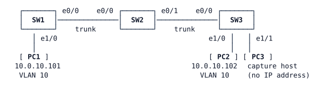

# LAB-008 — Seeing the wire

**Module:** 01 Operations toolkit and campus switching · **Type:** F (Foundation) · **Guidance tier:** G3 (guided) · **Estimated time:** 45 min · **Blueprint objectives:** 4.3:I (configure and verify SPAN/RSPAN/ERSPAN), 3.1.a:R (trunks, allowed VLANs)

## Scenario

Veridian's security team is investigating a user workstation and wants packet evidence from its switch port, without installing anything on the user's PC. A capture laptop (PC3) is already plugged into the server-room switch SW3. First, the team wants a copy of the traffic of a user on SW3 itself. Then it wants the traffic of a user on SW1, at the far end of the bench, delivered to the same capture laptop across the switch chain.

## Objectives

After this lab you can:
- configure a local SPAN session (source port, direction, destination port) and verify it;
- explain what happens to a port while it is a SPAN destination;
- configure RSPAN with a remote-span VLAN carried across several switches;
- work out what an intermediate switch needs so that RSPAN traffic reaches the destination switch;
- capture mirrored traffic on a Linux host with tcpdump.

## Available Information

### Topology

### Cabling and interfaces

| Device | Interface | Peer | Configuration |
|---|---|---|---|
| SW1 | Ethernet0/0 | SW2 Ethernet0/0 | 802.1Q trunk, native VLAN 999, allowed VLANs 10, 99, DTP off |
| SW1 | Ethernet1/0 | PC1 eth0 | access port VLAN 10, PortFast |
| SW2 | Ethernet0/0 | SW1 Ethernet0/0 | trunk as above |
| SW2 | Ethernet0/1 | SW3 Ethernet0/0 | trunk as above |
| SW3 | Ethernet0/0 | SW2 Ethernet0/1 | trunk as above |
| SW3 | Ethernet1/0 | PC2 eth0 | access port VLAN 10, PortFast |
| SW3 | Ethernet1/1 | PC3 eth0 | access port VLAN 10, PortFast |

### Addressing

| Device | Interface | Address |
|---|---|---|
| SW1 | Vlan99 | 10.0.99.1/24 |
| SW2 | Vlan99 | 10.0.99.2/24 |
| SW3 | Vlan99 | 10.0.99.3/24 |
| PC1 | eth0 | 10.0.10.101/24 (no gateway needed) |
| PC2 | eth0 | 10.0.10.102/24 (no gateway needed) |
| PC3 | eth0 | interface up, no IP address |

The switches are Layer 2 only (no IP routing).

### VLANs (all switches)

| VLAN | Name | Use |
|---|---|---|
| 10 | USERS | PC1, PC2, PC3 |
| 99 | MGMT | switch management |
| 999 | NATIVE | native VLAN on trunks (carries no users) |
| 950 | (to create) | remote-span VLAN reserved for RSPAN by Veridian's VLAN plan |

Veridian policy: the VTP pilot was rolled back, so every switch runs VTP transparent mode and VLANs are created on each switch.

### Access

- Switch consoles open in privileged mode. Local user `admin` / `Cisco123!` (privilege 15), enable secret `Cisco123!`.
- PC1/PC2/PC3 (Alpine Linux): CML console, login `cisco` / `cisco` if asked. Use `sudo` for privileged commands.
- Capture on PC3 with `sudo tcpdump -nni eth0` (add `icmp` as a filter to hide other frames). Stop it with Ctrl+C. If you prefer to keep the console free, run it in the background with a time limit and read the file afterwards, for example `(sudo timeout 40 tcpdump -nni eth0 icmp > /tmp/cap.txt 2>&1 &)` then `cat /tmp/cap.txt`.

### Platform notes (CML ioll2-xe switches)

- Unused switch ports show as `connected`: that is normal in CML.
- Shutting down a port in CML does not take the link down on the neighbour: the far end stays up/up.
- Mirrored RSPAN copies can arrive at the capture host twice, a few microseconds apart. That is a quirk of this platform; count distinct ICMP sequence numbers.

## Starting State

- VLANs, trunks and access ports are configured on all three switches. PC1 reaches PC2.
- No SPAN or RSPAN session exists anywhere, and VLAN 950 does not exist.
- PC3's port is an ordinary access port. PC3's interface is up but has no address.

## Requirements / Change Requests

R1. **Local SPAN.** On SW3, mirror PC2's port in both directions to PC3's port. While PC1 pings PC2, capture on PC3 and keep the output. Before and after you create the session, note what PC3's port reports (interface status and spanning tree for VLAN 10).

R2. **RSPAN.** Remove the local session. Mirror PC1's port on SW1 (both directions) into remote-span VLAN 950, and deliver VLAN 950 to PC3's port on SW3. Capture the same PC1→PC2 ping on PC3. Verify the RSPAN path end to end, switch by switch: if PC3 sees nothing, find out why before you change anything else.

R3. **The switch in the middle.** SW2 has no SPAN session of its own. Decide whether SW2 needs anything for R2 to work: record everything you configure on SW2, or justify why nothing is needed, and explain why each item was needed.

R4. **Failure test.** With R2 working, remove VLAN 950 from the allowed list of the SW2–SW3 trunk (on SW2 only) and show that PC3 stops receiving the mirrored traffic while PC1 still reaches PC2. Put it back and show the capture resumes.

## Verification Criteria

V1. For R1 you have a PC3 capture that shows PC1's echo requests and PC2's echo replies, and SW3 reports the session as a local session with PC2's port as a source in both directions and PC3's port as the destination.

V2. For R2, VLAN 950 exists as a remote-span VLAN on SW1, SW2 and SW3 and is allowed on both trunks. SW1 reports a remote source session into VLAN 950; SW3 reports a remote destination session from VLAN 950 to PC3's port. No local session remains.

V3. For R2 you have a PC3 capture that shows PC1's ICMP in both directions while PC3's port is the destination.

V4. Before configuring SW2, you wrote down what PC3 would receive when RSPAN is configured on SW1 and SW3 only, and you tested it. If PC3 received nothing at any point, you can name which switch and setting caused it; if your first attempt worked, you can explain which setting made it work.

V5. For R4 you have one capture without PC1's ICMP (VLAN 950 removed from the SW2–SW3 trunk, PC1 still reaching PC2) and one with it again after the fix.

V6. For R4 you have the log line from SW2's log buffer that records your configuration change, and its timestamp fits the moment the capture on PC3 went quiet.

## Analysis Questions

Q1. Why does a SPAN destination port stop forwarding normal traffic? What did PC3's port report, and what would a user plugged into it experience?

Q2. What is the bandwidth risk of using a whole VLAN or a trunk as a SPAN source instead of one access port? Consider both directions and the destination port's speed.

Q3. Compare RSPAN with ERSPAN: how does each carry the copied traffic, what does each require from the switches between source and destination, and when would you choose ERSPAN?

Q4. PC3 has no IP address, yet it sees PC1's traffic. Why is that normal, and why is it good practice for a capture host?
