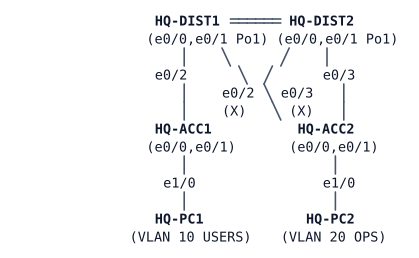

# LAB-009 — HQ two-tier build-out

**Module:** 01 Operations toolkit and campus switching · **Type:** X (Expansion) · **Guidance tier:** G2 · **Estimated time:** 90 min · **Blueprint objectives:** 3.1.a:P, 3.1.b:P, 3.1.c:R, 1.1.a:I

## Scenario

Veridian Freight's head office is being re-cabled. The network team has decided the two new distribution switches in the server room will act as a collapsed core for two access-closet switches, replacing a flat, unmanaged network. The cabling is already run. Your job is to turn the network team's requirements into a working configuration.

## Objectives

- Build a two-tier (collapsed-core) campus from a set of behavioural requirements.
- Configure VLANs, trunks, an EtherChannel, SVI-based routing and Rapid PVST+ so that the requirements below are all met.
- Verify the result from both the switches and the end hosts.

## Available Information

**Topology** (cabling already in place):

Full cable table:

| Link | A | B |
|---|---|---|
| Po1 member 1 | HQ-DIST1 e0/0 | HQ-DIST2 e0/0 |
| Po1 member 2 | HQ-DIST1 e0/1 | HQ-DIST2 e0/1 |
| ACC1 uplink 1 | HQ-DIST1 e0/2 | HQ-ACC1 e0/0 |
| ACC2 uplink 1 | HQ-DIST1 e0/3 | HQ-ACC2 e0/0 |
| ACC1 uplink 2 | HQ-DIST2 e0/2 | HQ-ACC1 e0/1 |
| ACC2 uplink 2 | HQ-DIST2 e0/3 | HQ-ACC2 e0/1 |
| PC1 | HQ-ACC1 e1/0 | HQ-PC1 eth0 |
| PC2 | HQ-ACC2 e1/0 | HQ-PC2 eth0 |

**Addressing plan (from the network team):**

| Device | Interface | Address |
|---|---|---|
| HQ-DIST1 | Vlan10 | 10.10.10.1/24 |
| HQ-DIST1 | Vlan20 | 10.10.20.1/24 |
| HQ-DIST1 | Vlan99 | 10.10.99.11/24 |
| HQ-DIST2 | Vlan99 | 10.10.99.12/24 |
| HQ-ACC1 | Vlan99 | 10.10.99.21/24 |
| HQ-ACC2 | Vlan99 | 10.10.99.22/24 |
| HQ-PC1 | eth0 | 10.10.10.101/24, gateway 10.10.10.1 |
| HQ-PC2 | eth0 | 10.10.20.102/24, gateway 10.10.20.1 |

VLANs: 10 USERS, 20 OPS, 99 MGMT, 999 NATIVE (unused, black hole).

**Credentials:** local user `admin` / `Cisco123!` (priv 15); enable secret `Cisco123!`. Console opens in privileged mode; VTY/SSH keep normal authentication. Domain `veridian.example`.

**Company policy:** Veridian's earlier VTP pilot was rolled back after an incident; VLANs are now managed per switch (`vtp mode transparent` everywhere — this is already set).

### Platform notes (CML ioll2-xe switches)

- Set `switchport trunk encapsulation dot1q` before `switchport mode trunk`, on both ends of every trunk. Use `spanning-tree portfast` on host ports, not `portfast edge` (this platform rejects the `edge` keyword).
- These switches route by default: `ip routing` is on even with no other Layer 3 configuration. An access switch that only needs `ip default-gateway` must disable it first (`no ip routing`) or the gateway is silently ignored and off-subnet traffic (including management pings and SSH) never leaves the switch.
- Configure `interface Port-channel1` itself (trunk settings, `nonegotiate`) before adding its member interfaces to it with `channel-group`. Bundling members into a port-channel that is not yet fully configured suspends the bundle on both ends; if that happens, recover by shutting and re-enabling the member interfaces on both switches.
- Ports run at 10 Mb/s, so a port's spanning-tree cost is 100 (not 19 or 4 as on Fast/Gigabit hardware).
- The first pings from a host to a freshly-configured switch SVI can lose 1-2 replies while ARP resolves; use a repeat count of 5 or more and judge on the later replies, not the first one.

## Starting State

- Cabling is as shown above; all four switches are powered up with only a hostname and the standard device baseline (no VLANs, no trunks, `vtp mode transparent` already set).
- HQ-PC1 and HQ-PC2 are addressed and configured with their gateway, but nothing is reachable yet — not each other, not any switch.

## Requirements / Change Requests

R1. VLANs 10 (USERS), 20 (OPS), 99 (MGMT) and 999 (NATIVE) exist with these names on every switch. VTP is already transparent everywhere (company policy), so create the VLANs locally on each switch and leave VTP as it is.

R2. Every inter-switch link is a trunk that never negotiates its mode. Each trunk carries only VLANs 10, 20 and 99, with VLAN 999 as the native VLAN.

R3. The two links between the distribution switches operate as a single logical link, using the standards-based (non-Cisco-proprietary) negotiation protocol. The bundle must keep working if either physical member fails.

R4. HQ-DIST1 is the default gateway (address ending in `.1`) for VLANs 10 and 20, and also hosts the management gateway address 10.10.99.11. Every switch is reachable at its management address in the table above, and every switch can reach every other switch's management address.

R5. HQ-DIST1 is the spanning-tree root for every VLAN in use; HQ-DIST2 takes over as root only if HQ-DIST1 fails. Convergence uses the rapid (not classic 802.1D) protocol. Ports facing HQ-PC1/HQ-PC2 come up immediately after a link comes up, and shut down automatically if another switch is plugged into them.

R6. HQ-PC1 and HQ-PC2 can reach each other and every switch's management address.

## Verification Criteria

V1. Every switch's VLAN table lists 10 (USERS), 20 (OPS), 99 (MGMT) and 999 (NATIVE); `show vtp status` on every switch shows transparent mode, so each VLAN table was built locally.

V2. Every inter-switch link shows as a trunk with a statically forced (non-negotiated) mode, native VLAN 999, and only VLANs 10/20/99 permitted.

V3. The distribution-to-distribution bundle shows as one logical interface using the standard link-aggregation protocol, with both members active.

V4. From HQ-PC1 and HQ-PC2, extended/sourced pings or traceroutes reach: their own gateway, the other host, and all four switch management addresses.

V5. Show-command evidence (not just a diagram) identifies which switch is the current spanning-tree root for VLAN 10, and that the protocol in use is the rapid one.

V6 (toolkit). Capture at least one piece of evidence for R3 and R5 using extended/sourced pings, a switch log line, or a `show` command timestamp — not just "it works."

V7 (failure/recovery). Fail one member of the distribution bundle. Confirm host traffic continues with no more than a few lost pings, then restore it.

V8 (failure/recovery). Fail one of HQ-ACC1's two uplinks. Confirm HQ-ACC1 and HQ-PC1 stay reachable over the other uplink, then restore it.

V9 (failure/recovery). Save the configuration on every switch (`copy running-config startup-config`) before this test: a stopped node restarts from its startup configuration, not its running configuration, so anything not saved is lost. Stop HQ-DIST1 entirely and observe what happens to HQ-PC1 and HQ-PC2. Restore it and confirm recovery. (This result is expected — keep your observations for the next module.)

## Analysis Questions

Q1. What makes this design "two-tier", and which functions does the distribution pair collapse that would otherwise need a separate tier?

Q2. Identify every single point of failure in this design. Specifically, what happens to HQ-PC2 if HQ-DIST1 fails, and why?

Q3. What would adding a third tier bring to this design, and at what point would Veridian's growth justify it?

Q4. Why does it make sense for the spanning-tree root to be on the same switch that acts as the default gateway?
