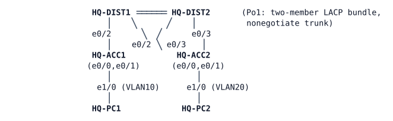

# LAB-010 — Monday Morning at HQ

**Module:** 01 Operations toolkit and campus switching · **Type:** T (Troubleshooting) · **Guidance tier:** G2 · **Estimated time:** 75 min · **Blueprint domains:** 3, 4

## Scenario

A contractor worked in Veridian HQ's wiring closets over the weekend, re-terminating some cabling and "tidying up" ports and configuration that looked unused. On Monday morning, two tickets are waiting for you. Find the causes, fix them with the smallest changes that restore the documented design, and confirm nothing else was left broken.

## Objectives

- Work from symptoms to root cause, gathering evidence from both switches and end hosts before changing anything.
- Rule out plausible-but-wrong causes with evidence, not guesswork.
- Restore the documented HQ two-tier design with minimal changes, and prove each fix resolves its ticket.
- Confirm the design's built-in redundancy actually works again once you are done, not just that the symptom is gone.

## Available Information

### Topology (HQ two-tier campus, as built in LAB-009)

Each access switch has two uplinks, one to each distribution switch (dual-homed). HQ-DIST1 is the gateway for VLANs 10/20 and hosts the management gateway. Both distribution switches, and both access switches, have a management address in VLAN 99.

Full cable table:

| Link | A | B |
|---|---|---|
| Po1 member 1 | HQ-DIST1 e0/0 | HQ-DIST2 e0/0 |
| Po1 member 2 | HQ-DIST1 e0/1 | HQ-DIST2 e0/1 |
| ACC1 uplink 1 | HQ-DIST1 e0/2 | HQ-ACC1 e0/0 |
| ACC2 uplink 1 | HQ-DIST1 e0/3 | HQ-ACC2 e0/0 |
| ACC1 uplink 2 | HQ-DIST2 e0/2 | HQ-ACC1 e0/1 |
| ACC2 uplink 2 | HQ-DIST2 e0/3 | HQ-ACC2 e0/1 |
| PC1 | HQ-ACC1 e1/0 (VLAN 10) | HQ-PC1 eth0 |
| PC2 | HQ-ACC2 e1/0 (VLAN 20) | HQ-PC2 eth0 |

### Addressing

| Device | Interface | Address |
|---|---|---|
| HQ-DIST1 | Vlan10 | 10.10.10.1/24 |
| HQ-DIST1 | Vlan20 | 10.10.20.1/24 |
| HQ-DIST1 | Vlan99 | 10.10.99.11/24 |
| HQ-DIST2 | Vlan99 | 10.10.99.12/24 |
| HQ-ACC1 | Vlan99 | 10.10.99.21/24 |
| HQ-ACC2 | Vlan99 | 10.10.99.22/24 |
| HQ-PC1 (VLAN 10, first-floor closet) | eth0 | 10.10.10.101/24, gateway 10.10.10.1 |
| HQ-PC2 (VLAN 20, second-floor closet) | eth0 | 10.10.20.102/24, gateway 10.10.20.1 |

### Documented design

- VLANs 10 (USERS), 20 (OPS), 99 (MGMT) and 999 (NATIVE, unused) exist identically on all four switches, managed per switch (`vtp mode transparent`).
- Every inter-switch link is a statically forced 802.1q trunk: native VLAN 999, allowed VLANs 10, 20 and 99, no DTP negotiation.
- HQ-DIST1 and HQ-DIST2 are joined by a two-member LACP EtherChannel that should tolerate the loss of either member.
- Each access switch has two independent uplinks, one to each distribution switch, so it should tolerate the loss of either uplink.
- Rapid PVST+ runs on all four switches; HQ-DIST1 is the intended root for every VLAN, with HQ-DIST2 as the documented backup.
- Host-facing ports are access mode with PortFast and BPDU guard.

### Access

- Switch consoles open in privileged mode. Local user `admin` / `Cisco123!` (privilege 15), enable secret `Cisco123!`.
- HQ-PC1/HQ-PC2 (Alpine Linux): CML console, login `cisco` / `cisco` if asked.

### Platform notes

- Give the campus a minute or two after the lab starts before you begin collecting evidence.
- Shutting down a port in CML does not take the link down on the neighbouring switch's side. To simulate pulling a cable, shut the interface on both ends.
- Spanning-tree costs on these platforms are higher than on real hardware links; that does not change which path is preferred.
- The first pings to a switch's management address after it has been idle can lose a reply or two while ARP resolves; use a repeat count of 5 or more and judge on the later replies.

## Starting State

The campus has been running unattended since the contractor's Saturday visit. Nothing has been touched since. The switches' log buffers still hold whatever they logged after their most recent restart.

## Requirements / Change Requests

R1. Resolve both reported problems below so that the campus matches its documented design again.

R2. Make the smallest changes that do this. Do not change addressing, VLAN numbering, the negotiation methods, or which switch is the intended root.

R3. For each problem, record the root cause, the device and interface involved, and the evidence (at least one command output and one log message) that proves it. Also record the evidence that ruled out at least two other plausible causes before you found the real one.

R4. Fix each cause on its own and record which symptom cleared when you fixed it.

R5. Once both problems are resolved, confirm the campus's built-in redundancy: it must keep working when either of an access switch's two uplinks is lost, and when the distribution bundle loses one member.

## Reported Problems

**T1 (user, Monday 08:10):** "Operations staff on the second floor can't reach anything on the network — this has been the case since Saturday. The NOC says they can still ping the second-floor closet switch itself, so they don't think the switch is down."

**T2 (NOC, Monday 07:45):** "Overnight log review flagged a warning message on the distribution layer that keeps recurring. While you're in there, check the rest of the campus against the standard design too — don't stop at whatever the logs happen to show you."

## Verification Criteria

V1. The second-floor users' host reaches its gateway and every switch's management address.

V2. That reachability survives the loss of **either** of the affected closet's two uplinks on its own — test both, one at a time.

V3. After your fixes, the distribution layer's logs show a clean period with no further recurrence of the warning message that had been repeating. For every warning you attribute to a cause, confirm with a `show` command — not just log silence — that the condition it reported has actually cleared.

V4. Show-command evidence confirms the running network matches every item under "Documented design" above, not just the two tickets' symptoms.

V5. The first-floor users' host (HQ-PC1) and every switch's management address (HQ-DIST1, HQ-DIST2, HQ-ACC1, HQ-ACC2) were never affected, before or after your fixes (baseline evidence, not assumption).

V6 (toolkit). At least one of your R3 records cites a sourced/extended ping, a `show` command's counters, or a log timestamp — not only a single unsourced ping.

## Analysis Questions

Q1. Why did the NOC's successful ping to the affected closet's own switch not prove that its users were fine? What does that tell you about picking a monitoring target?

Q2. For each of today's two reported problems, which log line or `show` output first pointed you toward a cause, and which device did it appear on?

Q3. (Answer after fixing.) Of the protections you configured in the earlier bench labs this module, which one — had it been part of the standard campus build — would have prevented one of today's causes from taking effect, or at least made it obvious immediately? Explain the mechanism, not just the name.

Q4. (Answer after fixing.) For each cause you found, which check from an earlier lab came back normal although the cause was present, and which output finally showed it?
