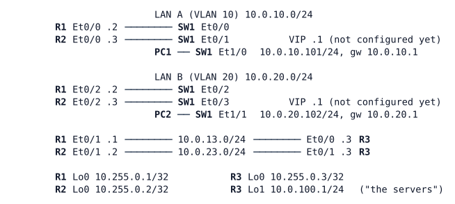

# LAB-011 — First-hop redundancy on routers

**Module:** 02 Gateway redundancy · **Type:** F (Foundation) · **Guidance tier:** G3 · **Estimated time:** 90 min · **Blueprint objectives:** 3.3.c:I, 1.1.b:I

## Scenario

HQ's user VLANs currently depend on a single distribution switch as their default gateway — a single point of failure the network team flagged after the LAB-009 campus build. Before touching the production campus, the team rehearses first-hop gateway redundancy on an isolated router bench that mirrors two user segments (LAN A and LAN B) sitting behind a pair of routers, with a third router standing in for the rest of the network.

## Objectives

Using this bench, you will configure and observe:
- **HSRP version 1**, then migrate the same group to **HSRP version 2**, on LAN A.
- Priority-based active-router selection and **preemption** (including `preempt delay`).
- **VRRPv3** on LAN B, including its default preemption behaviour.
- **Interface tracking** so each gateway group reacts to an uplink failure.
- Failover and recovery behaviour when a link or a router itself fails.

## Available Information

- OSPF process 1, area 0, runs on every router interface (R1, R2 and R3 all peer with each other across LAN A and LAN B, in addition to the point-to-point links to R3).
- SW1 is a pure Layer 2 switch (VTP transparent, VLANs 10/20, no trunks); it does not route.
- Credentials on every router and SW1: `admin` / `Cisco123!` (enable and login). Use the console; VTY access is not part of this lab. PC1/PC2 (Alpine): `cisco` / `cisco`.

## Starting State

- Cabling, addressing and OSPF are already in place as shown above; SW1 forwards VLAN 10 and VLAN 20 as plain access ports.
- No first-hop redundancy protocol is configured anywhere: address `.1` does not exist on either LAN.
- PC1 and PC2 are each configured with a default gateway of `.1` on their segment. Since that address does not yet exist, each host can reach its own segment's physical router addresses but nothing beyond (including R3's loopback network, `10.0.100.0/24`).
- **Platform note:** in this lab environment, stopping a link does not bring the far interface down — it stays up/up while silently dropping traffic. A real "cable pull" is modelled as `shutdown` on **both** ends of a link; shutting down only one end leaves the peer's interface up/up.

## Requirements / Change Requests

R1. Configure HSRP version 1 on LAN A, group 10, virtual IP 10.0.10.1, with no priority configured on either router. Determine and record which router becomes active and why, the hello/hold timers in use, the virtual MAC address, and the multicast address HSRP hellos are sent to.

R2. Change LAN A so R1 is the active router (priority 110). First show that R1 does not take over without `preempt` configured, even though its priority is higher. Then configure `preempt delay minimum 30` on both routers and show R1 taking over.

R3. Migrate the LAN A group to HSRP version 2, with hello 1 second / hold 3 seconds. Record the new virtual MAC address and hello destination, and confirm from PC1's ARP cache that the host has followed the change.

R4. Configure VRRPv3 on LAN B, group 20, virtual IP 10.0.20.1, with R2 as master (priority 120). Record the virtual MAC address, whether preemption is enabled by default, and the advertisement interval.

R5. Make each gateway group aware of its router's uplink to R3: R1 tracks its uplink for the LAN A HSRP group; R2 tracks its uplink for the LAN B VRRP group. Each tracked router must lower its own priority enough that the other router in the pair takes over if the tracked uplink fails.

R6. Prove failover and recovery for both LAN A and LAN B. Fail R1's uplink to R3 with a full "cable pull" (both ends shut); confirm PC1 keeps reaching 10.0.100.1 with minimal loss, and that R1 reclaims the active role once the uplink and the configured preempt delay allow it. Then fail only R3's end of the same link (a one-ended shutdown); determine what the tracking mechanism does and does not detect in this case, and how PC1's traffic to 10.0.100.1 is actually restored.

## Verification Criteria

V1. For each gateway group (LAN A HSRP and LAN B VRRP), `show standby brief` / `show vrrp brief` identify the correct active/master router at each stage of R1-R5, and a host on that segment can reach both its own gateway VIP and 10.0.100.1.

V2. The device logs show a state-change message (HSRP or VRRP) at each transition described in R1-R5, and the virtual MAC address changes exactly when expected (HSRPv1 to HSRPv2 migration) and stays constant otherwise.

V3. `show track` (or equivalent) confirms each tracked object's state, and the tracked router's own priority reflects the configured decrement whenever the tracked object is down.

V4. OSPF stays fully adjacent between all three routers throughout, except for the deliberate link failures in R6, and reconverges after each one without manual intervention.

V5. Both failure scenarios in R6 are demonstrated from PC1's point of view (not just from router show commands), with the observed recovery time and mechanism recorded for each.

## Analysis Questions

Q1. HSRP v1 vs v2: list the differences you observed between the two versions (state which you saw on the bench and which you took from documentation) and give one reason Veridian would standardise on v2.

Q2. Why is preemption off by default in HSRP but on by default in VRRP, and what does `preempt delay` protect against when a real switch reloads? In the R6 both-ended test, how long after R1's track went Down did R2 take over, and why?

Q3. What is the smallest tracking decrement that would still cause R5's failover to happen, and what happens if the decrement leaves the tracking router's priority exactly equal to the other router's?

Q4. In the one-ended failure test in R6, which mechanism actually restored PC1's traffic, and roughly how long did it take? Which kind of Veridian failure would interface tracking never detect at all?

Q5. What does a VRRP "address owner" (priority 255) change about a router's behaviour, and why would VRRP be the right choice when the two gateway devices are not both Cisco?

Q6. Which failures does a first-hop redundancy protocol protect end hosts from, and which does it not protect against (think about the host's own NIC, the access switch, and the far side of the network)?
