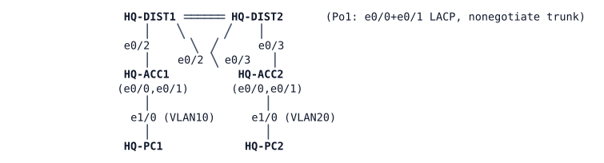

# LAB-012 — The redundant distribution block

**Module:** 02 Gateway redundancy · **Type:** I (Implementation) · **Guidance tier:** G2 · **Estimated time:** 105 min · **Blueprint objectives:** 3.3.c:P, 3.1.c:R, 1.1.b:P, X-GLBP:I, X-L2guards:R

## Scenario

After the HQ re-cabling (LAB-009), the network team signs off the "redundant gateway" project: either distribution switch must be able to fail without users losing their gateway or the NOC losing switch management, and both distribution switches should carry user traffic rather than one sitting idle.

## Objectives

- Give every VLAN a redundant default gateway across the two distribution switches, with automatic failover and automatic fail-back.
- Have both distribution switches actively forward user traffic for at least one VLAN, rather than one switch idling as a pure backup.
- Align each VLAN's spanning-tree root with whichever switch is meant to be its active gateway, and protect the access layer from becoming a root or a loop source.
- Verify the result from the switches and from both end hosts, including failure and recovery.

## Available Information

**Topology** (cabling unchanged from LAB-009):

Full cable table:

| Link | A | B |
|---|---|---|
| Po1 member 1 | HQ-DIST1 e0/0 | HQ-DIST2 e0/0 |
| Po1 member 2 | HQ-DIST1 e0/1 | HQ-DIST2 e0/1 |
| ACC1 uplink 1 | HQ-DIST1 e0/2 | HQ-ACC1 e0/0 |
| ACC2 uplink 1 | HQ-DIST1 e0/3 | HQ-ACC2 e0/0 |
| ACC1 uplink 2 | HQ-DIST2 e0/2 | HQ-ACC1 e0/1 |
| ACC2 uplink 2 | HQ-DIST2 e0/3 | HQ-ACC2 e0/1 |
| PC1 | HQ-ACC1 e1/0 | HQ-PC1 eth0 |
| PC2 | HQ-ACC2 e1/0 | HQ-PC2 eth0 |

**Target addressing plan (from the network team):**

| Device | Vlan10 | Vlan20 | Vlan99 | Other |
|---|---|---|---|---|
| HQ-DIST1 | 10.10.10.2/24 | 10.10.20.2/24 | 10.10.99.11/24 | routing enabled |
| HQ-DIST2 | 10.10.10.3/24 | 10.10.20.3/24 | 10.10.99.12/24 | routing enabled; remove the old default route to HQ-DIST1 |
| Virtual gateway | 10.10.10.1 | 10.10.20.1 | 10.10.99.1 | |
| HQ-ACC1 / HQ-ACC2 | — | — | .21 / .22 (unchanged) | `ip default-gateway 10.10.99.1` |
| HQ-PC1 / HQ-PC2 | 10.10.10.101 gw .1 (unchanged) | 10.10.20.102 gw .1 (unchanged) | | |

**Veridian's gateway-redundancy standard (from the network team):**
- Redundancy group number = VLAN ID. Version 2 where the protocol supports it.
- Hello 1 second, hold 3 seconds.
- The backup only takes back its role automatically once the primary has been stable for **30 seconds** — no flapping back the instant the primary returns.
- The switch meant to be primary for a VLAN is configured with priority 110; the other keeps the default (100).
- VLAN 10 is a special case: Veridian wants **both** switches actively forwarding VLAN 10 traffic at the same time (load sharing), not a strict primary/backup pair. HQ-DIST1 coordinates the group.
- Spanning-tree root priority **24576**, secondary **28672** (headroom below both, not the lowest valid priority).

VLANs: 10 USERS, 20 OPS, 99 MGMT, 999 NATIVE (unused, black hole).

**Credentials:** local user `admin` / `Cisco123!` (priv 15); enable secret `Cisco123!`. Console opens in privileged mode. VTY access is SSH-only (`admin` / `Cisco123!`); the switches already generate their own host keys.

### Platform notes (CML ioll2-xe switches)

- All LAB-009 platform notes still apply (hidden `ip routing` default, Port-channel-before-members day-0 order, 10 Mb/s port cost, first-ping ARP loss).
- On ioll2-xe (this platform): the redundant-gateway protocols reach an active/standby state correctly, but one candidate protocol (VRRP) never actually forwards traffic through its virtual address; it is not Veridian's standard here for that reason. This is a limit of this image, not of VRRP on hardware.
- On ioll2-xe: there is no interface/route "tracking" feature, so a gateway cannot lower its own priority when it loses some other link; treat every candidate gateway as untracked for this lab. On hardware: Catalyst distribution switches can track an interface or route for HSRP/GLBP (**(derived)**, not measurable on this bench).
- A VLAN interface (SVI) you create on these switches starts administratively down. Check `show ip interface brief` after you create one.
- After a cold boot, allow about a minute for the 30-second stability timer (above) to complete before reading final roles — a switch can briefly show an interim state right after booting.
- A stopped switch's link to a still-running neighbour does not go link-down on the neighbour's side; failover is detected by protocol timers, not by an interface changing state.

## Starting State

- Exactly the LAB-009 solved configuration (`environments/HQ/H0/`): HQ-DIST1 is the only Layer-3 gateway (physical addresses `.1` in VLANs 10/20, `.11` in VLAN 99) and the spanning-tree root for every VLAN. HQ-DIST2 and both access switches route nothing.
- SSH access and host keys are already present on all four switches as background (not something you need to configure).

## GLBP in brief

HSRP (LAB-011) gives one active gateway per group: the standby forwards nothing until the active fails. The Cisco **Gateway Load Balancing Protocol (GLBP)** keeps the single virtual gateway address but lets several routers forward at once:

- One router in the group is elected the **AVG** (active virtual gateway) by priority (highest wins; preempt works as in HSRP). The AVG owns the virtual IP and answers every host's ARP request for it.
- Up to four group members act as **AVFs** (active virtual forwarders). Each AVF has its own virtual MAC. The AVG hands out these MACs in its ARP replies, by default in round-robin order, so different hosts (or the same host after a fresh ARP) end up sending to different physical switches while all use the same gateway IP.
- Each AVF can take over the virtual MAC of a failed peer, so one surviving member forwards for everyone. The AVG role can fail over separately from the forwarder roles.
- Per-forwarder **weighting** (with tracking, where the platform supports it) and the load-balancing method (round-robin, host-dependent, weighted) decide how load is shared.
- Configuration mirrors HSRP: a `glbp <group> ...` command family on the interface (virtual IP, priority, preempt, timers). Entry `show` commands: `show glbp brief` (AVG and AVF states, forwarder MACs) and `show glbp` (detail, load-balancing method, weighting).

## Requirements / Change Requests

R1. Both distribution switches route between VLANs 10, 20 and 99 using the physical addresses in the table above. HQ-PC1 and HQ-PC2 keep `10.10.10.1` / `10.10.20.1` as their gateway throughout the migration — their configuration never changes.

R2. VLAN 20 (OPS) and VLAN 99 (MGMT) each have one virtual gateway address. HQ-DIST2 is normally the active gateway for VLAN 20; HQ-DIST1 is normally active for VLAN 99. Whichever switch is backup takes over within 10 seconds of the primary failing, and the primary takes its role back automatically once it has been stable for 30 seconds — no manual intervention either way.

R3. VLAN 10 (USERS) traffic is forwarded by **both** distribution switches at the same time through the single gateway address `10.10.10.1`. Either switch alone is able to carry all of VLAN 10's traffic if the other fails. HQ-DIST1 coordinates the group.

R4. For every VLAN, the switch that is normally the active gateway is also the spanning-tree root for that VLAN; the other switch is the secondary root, with headroom below both priorities for a future scenario (do not use the lowest valid priority).

R5. HQ-ACC1 and HQ-ACC2 send their own management traffic to the virtual management gateway, so switch management survives the loss of either distribution switch.

R6. The distribution ports facing the access layer never accept an access switch as the spanning-tree root for any VLAN. The access switches' uplinks never start forwarding onto each other just because BPDUs stop arriving from above.

R7 (failure/recovery). Save every switch's configuration first (a stopped switch restarts from its saved configuration, not its running configuration). Stop each distribution switch in turn: HQ-PC1, HQ-PC2 and the management address of every switch still running must stay reachable within 10 seconds, and roles must return automatically once the stopped switch is back and stable. Also test losing one interconnect link member (both ends) and one access-switch uplink (both ends): neither should cost more than a few lost pings, and reachability must not depend on which specific path carries the traffic.

## Verification Criteria

V1. `show` command output on both distribution switches (redundancy-protocol brief output, spanning-tree root, EtherChannel summary) matches the roles in R1–R4: HQ-DIST1 root/active for VLANs 10 and 99, HQ-DIST2 root/active for VLAN 20, both members of the interconnect bundled and in use.

V2. `show spanning-tree inconsistentports` is empty on both distribution switches during normal operation.

V3. From HQ-PC1 and HQ-PC2: every switch management address and the other host are reachable.

V4. Two consecutive fresh ARP resolutions of the VLAN 10 gateway from a host (clear the cached entry between them) return two different physical forwarding addresses, confirming R3's load sharing.

V5. HQ-ACC1 and HQ-ACC2's default gateway configuration points at the virtual management address, and management reachability survives either distribution switch being stopped.

V6 (failure/recovery). R7's three failure tests all meet their stated targets, and every role/reachability item returns to the R1–R6 state afterward with no manual reconfiguration beyond restarting the stopped device.

V7. For each R7 failover, the surviving switch's log shows the state-change lines (redundancy-protocol and spanning-tree) that account for the takeover, captured alongside the host pings.

## Analysis Questions

Q1. Trace two flows from HQ-PC2 (to HQ-PC1, and to its own gateway address 10.10.20.1) and count how many times each crosses the Po1 interconnect in the actual design and in a hypothetical design where the OPS gateway is active on HQ-DIST1 while HQ-DIST2 stays the spanning-tree root for VLAN 20. Which flow does the misalignment penalise, if any? Then explain whether keeping the active gateway and the root on the same switch matters more on real hardware than in this simulator, and why.

Q2. HQ-PC1 resolves the VLAN 10 gateway to HQ-DIST2's forwarding address at some point. Which physical path do its frames take from HQ-ACC1 to reach HQ-DIST2, and why? Is load sharing still worth having in a topology that is already fully looped and redundant?

Q3. In what order did you move the VLAN 99 gateway from HQ-DIST1's physical address to the virtual address, and roughly how long were the access switches without a working gateway during the change? How could that window be made shorter?

Q4. Root guard sits on the distribution switches' downlinks and loop guard sits on the access switches' uplinks. Why those placements and not the reverse? What do you predict root guard would do to the non-root distribution switch's downlinks if the interconnect between the two distribution switches failed completely? (Give a prediction; you are not asked to test it in this lab.)

Q5. What prevents HQ-DIST1 from lowering its own gateway priority if it later loses an upstream link on this platform? Where could Veridian add that kind of protection, and how would it differ on real Catalyst hardware?
