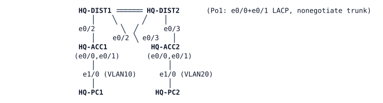

# LAB-013 — Redundancy by design

**Module:** 02 Gateway redundancy · **Type:** A (Analysis) · **Guidance tier:** G2 · **Estimated time:** 90 min · **Blueprint objectives:** 1.1.b:A, 1.1.a:P, X-GLBP:A

## Scenario

Veridian's IT director wants a one-page redundancy assessment of the new HQ distribution block before signing off the budget for a three-tier redesign: what is redundant today, what is not, how long users actually notice a failure, and whether paying for chassis redundancy (dual supervisors) or a virtual-switching pair would be worth it before adding a core layer.

## Objectives

- Produce a redundancy inventory of the HQ block, layer by layer, naming the mechanism and the platform's real failure-detection behaviour for each.
- Measure, from the end hosts, the actual outage caused by six realistic failure scenarios.
- Explain fully what happens when the distribution interconnect is lost completely, including which addresses stop responding and why.
- Use vendor reference material for two mechanisms this platform cannot demonstrate (chassis redundancy and stacking) to say what they would and would not have prevented here.
- Recommend one concrete next step for the three-tier project, backed by your own evidence.

## Available Information

**Topology** (unchanged from LAB-012 — the H1 baseline):



Full cable table:

| Link | A | B |
|---|---|---|
| Po1 member 1 | HQ-DIST1 e0/0 | HQ-DIST2 e0/0 |
| Po1 member 2 | HQ-DIST1 e0/1 | HQ-DIST2 e0/1 |
| ACC1 uplink 1 | HQ-DIST1 e0/2 | HQ-ACC1 e0/0 |
| ACC2 uplink 1 | HQ-DIST1 e0/3 | HQ-ACC2 e0/0 |
| ACC1 uplink 2 | HQ-DIST2 e0/2 | HQ-ACC1 e0/1 |
| ACC2 uplink 2 | HQ-DIST2 e0/3 | HQ-ACC2 e0/1 |
| PC1 | HQ-ACC1 e1/0 | HQ-PC1 eth0 |
| PC2 | HQ-ACC2 e1/0 | HQ-PC2 eth0 |

**Documented design (from the network team's as-built record):**

| Device | Vlan10 (USERS) | Vlan20 (OPS) | Vlan99 (MGMT) |
|---|---|---|---|
| HQ-DIST1 | 10.10.10.2/24 | 10.10.20.2/24 | 10.10.99.11/24 |
| HQ-DIST2 | 10.10.10.3/24 | 10.10.20.3/24 | 10.10.99.12/24 |
| Virtual gateway | 10.10.10.1 (both switches forward) | 10.10.20.1 (HQ-DIST2 normally active) | 10.10.99.1 (HQ-DIST1 normally active) |
| HQ-ACC1 mgmt | — | — | 10.10.99.21 |
| HQ-ACC2 mgmt | — | — | 10.10.99.22 |
| HQ-PC1 | 10.10.10.101, gw .1 | | |
| HQ-PC2 | | 10.10.20.102, gw .1 | |

Redundancy convention: group number = VLAN ID; hello 1 s / hold 3 s; `preempt delay minimum 30` on both switches; the switch normally active for a VLAN's gateway is also that VLAN's spanning-tree root (priority 24576), the other is secondary (28672). The distribution-to-access downlinks carry root guard; the access-to-distribution uplinks carry loop guard.

**Credentials:** local user `admin` / `Cisco123!` (priv 15), enable secret `Cisco123!`. VTY is SSH-only. HQ-PC1 / HQ-PC2 (Alpine): `cisco` / `cisco`.

### Platform notes

- Stopping a CML link does not bring the far interface down; it stays up/up while silently dropping traffic. Failure of a real physical link is modelled here as `shutdown` on **both** ends.
- A stopped switch restarts from its last **saved** configuration, not from whatever was running when it stopped. Save (`copy running-config startup-config`) on every switch you are about to test before stopping it.
- A stopped switch's link to a still-running peer stays up/up; the peer detects the failure by protocol timers (spanning tree, the gateway-redundancy protocol, LACP), not by the interface going down.
- A ping's first reply or two can be lost purely to ARP resolution against a gateway the host has not talked to recently — this is not outage, and your measurements should account for it.
- Losing a single member of the two-link distribution interconnect is only a fair single-link-failure test when it is shut down on **both** ends; shutting only one end leaves the other switch's port bundled and can pin a whole conversation onto a now-dead path for far longer than a real link failure would take to detect.

### Reference material — chassis and stack redundancy `(derived)`

This CML platform has no dual-supervisor or stacking hardware model, so the outputs below were not captured from this lab. They are illustrative reference output consistent with Cisco's published documentation for the named platforms and features (full source citations in SOLUTION.md). Use them only to answer the objectives above — do not treat them as commands you can run in this topology.

**(a) Dual-supervisor Catalyst 9400 in Stateful Switchover (SSO), before and after a supervisor switchover:**

*Before (steady state, both supervisors up):*

```
REF-C9400-1# show redundancy states
       my state = 13 -ACTIVE
     peer state = 8  -STANDBY HOT
           Mode = Duplex
           Unit = Primary
        Unit ID = 1

Redundancy Mode (Operational) = Stateful Switchover
Redundancy Mode (Configured)  = Stateful Switchover
Redundancy State              = Stateful Switchover
     Maintenance Mode = Disabled
    Manual Swact = enabled
```

*After a switchover (the standby supervisor takes over; a chassis pair in SSO shares one hostname and one management identity, so the prompt is unchanged):*

```
REF-C9400-1# show redundancy states
       my state = 13 -ACTIVE
     peer state = 1  -DISABLED
           Mode = Simplex
           Unit = Primary
        Unit ID = 2
```

`show version` on the newly active supervisor reports an unchanged system uptime for line cards and forwarding, and interface counters are not reset — SSO synchronises Layer 2 and forwarding state (CEF, MAC/ARP tables) between the two supervisors with hardware-assisted checkpointing, so forwarding continues across the switchover.

**(b) An OSPF neighbour's view of a graceful-restart (NSF) event on the restarting router's peer:**

```
REF-PEER# show ip ospf neighbor
Neighbor ID     Pri   State           Dead Time   Address         Interface
10.255.0.9        1   FULL/BDR        00:00:33    10.1.1.9        Gi0/1

! restarting router's supervisor switches over; NSF-capable peer keeps the adjacency:
! no %OSPF-5-ADJCHG message: the helper keeps the neighbour FULL through the grace period
! (IETF graceful restart, RFC 3623 Grace-LSA, `nsf ietf`; Cisco NSF, `nsf cisco`, uses LLS/OOB resync instead)

REF-PEER# show ip ospf neighbor
Neighbor ID     Pri   State           Dead Time   Address         Interface
10.255.0.9        1   FULL/BDR        00:00:38    10.1.1.9        Gi0/1
```

The peer's routing table and forwarding entries for routes learned from the restarting router are **not withdrawn** during the grace period (default 120 s): the peer keeps forwarding to it as if nothing happened, provided the restarting router re-establishes its adjacency and re-advertises the same routes before the grace period expires.

**(c) `show stackwise-virtual` on a two-member StackWise Virtual (SVL) pair acting as one logical switch:**

```
REF-SVL-ACTIVE# show stackwise-virtual
StackWise Virtual Configuration:
--------------------------------
StackWise Virtual                       : Enabled
Domain Number                           : 1
Switch    Stackwise Virtual Link
--------  -----------------------
1         SVL1 (Te1/0/1)
2         SVL1 (Te2/0/1)
```

The two chassis run as one StackWise Virtual pair: one control plane, one configuration and one hostname, joined by the SVL links shown above.

## Starting State

The HQ H1 baseline exactly (`environments/HQ/H1/`) — nothing is broken and nothing needs to be built. HQ-DIST1 and HQ-DIST2 are both routing; the gateway roles, spanning-tree roots and guard placement match the documented design table above. This lab is entirely measurement and analysis: you will deliberately fail things yourself (and restore them) to gather evidence, not repair a fault.

## Requirements / Change Requests

R1. Produce a redundancy table for HQ H1, one row per layer (host NIC, access switch, access uplinks, distribution switches, the distribution interconnect, the gateway protocols themselves). For each row, record: what provides redundancy (if anything), how a failure in that layer is actually detected on this platform, and the user-visible impact you measured or can reasonably infer.

R2. Measure, from both HQ-PC1 and HQ-PC2, the outage caused by each of the following (save every switch's configuration first). If you recorded numbers for the same failures during LAB-012 R7, you may reuse them for b–d, as long as you state where they came from and from which host; spend the fresh measurement effort on a2, e and the cross-check against the logs:
  a. an access-switch uplink cable pull (both ends of one HQ-ACCx–HQ-DISTx link),
  a2. the same uplink instead failing silently (the link keeps passing no traffic but both ends stay up — a different failure mode from (a), detected differently),
  b. stopping HQ-DIST1,
  c. stopping HQ-DIST2,
  d. losing one member of the distribution interconnect (both ends of the same member),
  e. losing **both** members of the distribution interconnect (both ends of both members).

R3. For scenario (e), explain every effect you observed — including which addresses became completely unreachable and why, not just which hosts noticed something. Based on your evidence, is the distribution interconnect a single point of failure in this design? For what, exactly?

R4. Using the reference material above, state in your own words what SSO by itself preserves across a supervisor switchover, what graceful restart / NSF adds on top of SSO, and which of the failures you measured in R2 each mechanism would have shortened or eliminated if HQ's distribution switches had dual supervisors. Would a StackWise Virtual distribution pair still need a gateway-redundancy protocol like the one in use here? Why or why not?

R5. Recommend one specific change for the upcoming three-tier project — for example adding a core layer, making the distribution interconnect a routed link, adding dual supervisors, or moving to virtual switching — and justify it with evidence from R1–R4. State the specific trigger (a business or technical condition) that would make a third tier necessary for Veridian, as opposed to merely nice to have.

## Verification Criteria

V1. The R1 table has one row per layer with no blank "detection" or "impact" column, and every entry not directly measured is labelled as such.

V2. All six R2 measurements (including a2) are present with a specific number (or range) of seconds or lost pings for each, from both hosts, the method used to measure is stated, and the measured outage is cross-checked against the surviving switch's state-change log timestamps.

V3. The R3 explanation accounts for every address that became unreachable in scenario (e) — including any management address — with a mechanism cited for each, not just "it stopped working."

V4. The R4 answer correctly distinguishes what SSO preserves from what only graceful restart/NSF adds, and ties each of the R2(b)/(c) results to whether dual supervisors would have changed the measured outcome.

V5. The R5 recommendation cites at least two pieces of your own R1–R3 evidence and states a concrete trigger condition for R5's third-tier question.

## Analysis Questions

Q1. Which of your measured outages in R2 would be much shorter on real hardware than what you measured here, and what specifically sets the time in each case (a protocol timer, a software polling interval, a platform limitation)?

Q2. HQ-DIST1 and HQ-DIST2 use different gateway-redundancy protocols for VLAN 10 versus VLANs 20/99. Did the two protocols recover from a distribution-switch failure in about the same time, or differently? Explain what you observed.

Q3. Without stateful switchover, what exactly do a router's OSPF neighbours experience during a supervisor failure, and why does that matter more once HQ has a routed core than it does in today's two-tier, mostly-Layer-2 design?

Q4. List every single point of failure you can identify in HQ H1 today, ranked by how many users or how much of the network each one would affect if it failed.

Q5. Looking ahead to the three-tier design: which of the distribution pair's current jobs will most likely move to a new core layer, and which will the distribution pair keep doing regardless?
