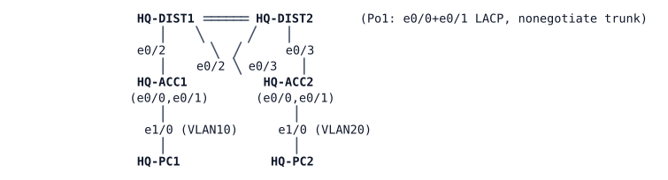

# LAB-014 — The OPS floor is cut off

**Module:** 02 Gateway redundancy · **Type:** T (Troubleshooting) · **Guidance tier:** G2 · **Estimated time:** 75 min · **Blueprint domains:** 3, 4

## Scenario

Over the weekend a contractor "finished the redundant-gateway project" and tidied the second-floor closet. On Monday morning, two tickets are waiting for you.

## Objectives

- Restore full connectivity for the reported problem, proving the cause with evidence rather than guessing at fixes.
- Confirm the campus matches its documented redundant-gateway design.
- Run the quarterly failover test and confirm it passes for both distribution switches.

## Available Information

**Topology** (unchanged since the redundancy project):

Full cable table:

| Link | A | B |
|---|---|---|
| Po1 member 1 | HQ-DIST1 e0/0 | HQ-DIST2 e0/0 |
| Po1 member 2 | HQ-DIST1 e0/1 | HQ-DIST2 e0/1 |
| ACC1 uplink 1 | HQ-DIST1 e0/2 | HQ-ACC1 e0/0 |
| ACC2 uplink 1 | HQ-DIST1 e0/3 | HQ-ACC2 e0/0 |
| ACC1 uplink 2 | HQ-DIST2 e0/2 | HQ-ACC1 e0/1 |
| ACC2 uplink 2 | HQ-DIST2 e0/3 | HQ-ACC2 e0/1 |
| PC1 | HQ-ACC1 e1/0 | HQ-PC1 eth0 |
| PC2 | HQ-ACC2 e1/0 | HQ-PC2 eth0 |

**Documented design** (from the redundant-gateway project's sign-off):

| VLAN | Active gateway address | Normally active switch | Spanning-tree root | Secondary root |
|---|---|---|---|---|
| 10 USERS | 10.10.10.1 (both switches forward) | both (load sharing, coordinated by HQ-DIST1) | HQ-DIST1 | HQ-DIST2 |
| 20 OPS | 10.10.20.1 | HQ-DIST2 | HQ-DIST2 | HQ-DIST1 |
| 99 MGMT | 10.10.99.1 | HQ-DIST1 | HQ-DIST1 | HQ-DIST2 |

- Full addressing:

| Device | Vlan10 | Vlan20 | Vlan99 | Other |
|---|---|---|---|---|
| HQ-DIST1 | 10.10.10.2/24 | 10.10.20.2/24 | 10.10.99.11/24 | routes between VLANs |
| HQ-DIST2 | 10.10.10.3/24 | 10.10.20.3/24 | 10.10.99.12/24 | routes between VLANs |
| Virtual gateway | 10.10.10.1 | 10.10.20.1 | 10.10.99.1 | |
| HQ-ACC1 / HQ-ACC2 | — | — | .21 / .22 | default gateway is the virtual management address |
| HQ-PC1 / HQ-PC2 | 10.10.10.101 gw .1 | 10.10.20.102 gw .1 | | |

- Redundancy convention: group number = VLAN ID; HSRP version 2 where the protocol supports it; hello 1 s / hold 3 s; `preempt delay minimum 30` on both switches; the switch normally active for a VLAN has priority 110, the other keeps the default (100).
- Distribution ports facing the access layer are protected against becoming root; access-switch uplinks are protected against a stopped-neighbour port defaulting to forwarding.
- VLANs: 10 USERS, 20 OPS, 99 MGMT, 999 NATIVE (unused, black hole).
- **Credentials:** local user `admin` / `Cisco123!` (priv 15); enable secret `Cisco123!`. Console opens in privileged mode. VTY access is SSH-only.
- **Failover target:** either distribution switch can be taken out of service; the other floor and the management addresses of every switch still running must stay reachable within 10 seconds, and roles must return once the recovered switch has been stable for 30 seconds.

### Platform notes

- A stopped switch's link to a still-running neighbour does not go link-down on the neighbour's side; failover is by protocol timers, not by an interface changing state.
- The first ping to a freshly-resolved address can lose a reply while ARP resolves; use a repeat count of several pings and judge on the later replies.
- Before stopping any switch for the failover test, save its configuration (`copy running-config startup-config`): a stopped switch restarts from its saved configuration, not its running configuration.

## Starting State

The HQ campus as left by the weekend work. Both distribution switches are up. Do not assume the redundant-gateway project's design was implemented correctly everywhere — that is what you are here to confirm.

## Requirements / Change Requests

R1. Resolve both reported problems below so that the campus matches its documented design again.

R2. Make the smallest changes that do this. Do not change addressing, VLAN numbering, which switch is normally active for each VLAN, or the guard placements described in "Documented design".

## Reported Problems

- **T1 (helpdesk):** "Since the weekend, OPS staff on the second floor can't reach anything outside their own floor: not the first-floor PCs, not the switch management pages. First-floor users are fine. The NOC says the second-floor switch answers pings."
- **T2 (NOC):** "Before we close the project, run the quarterly failover test: take each distribution switch out of service in turn and confirm that both floors and the management addresses of the remaining switches stay reachable within the 10-second target."

## Verification Criteria

V1. From the second floor, the OPS host reaches the first-floor host, its default gateway and every switch's management address.

V2. The running configuration of every switch matches every item under "Documented design" and the addressing table above.

V3. T2's failover test passes for **each** distribution switch in turn (save configuration first): both hosts and the management addresses of the switches still running stay reachable within 10 seconds, and roles return once the recovered switch has been stable for 30 seconds.

V4. Losing a single member of the distribution interconnect (both ends) costs no more than a few lost pings.

V5. For each cause you find, capture one piece of toolkit evidence (a log line, a sourced ping, or a `show` command) from before and after the fix.

## Analysis Questions

Q1. In what order did you rule candidates in or out, and which single piece of evidence decided each step?

Q2. For each cause you found, which evidence (a log line or `show` output) identified it, and how would you have found it if it had logged nothing?

Q3. How do you measure a distribution switch failover's user impact on this platform, and why can your result differ from physical hardware?

Q4 (answer after fixing). What would a change-review checklist for the weekend work have needed to catch each cause before it reached users?
