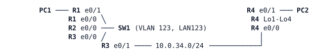

# LAB-015 — OSPF adjacencies and network types

**Module:** 03 OSPF and routing design · **Type:** F (Foundation) · **Guidance tier:** G3 · **Estimated time:** 90 min · **Blueprint objectives:** 3.2.b:I

## Scenario

HQ's planned three-tier upgrade will route between the core and distribution switches with OSPF, over shared segments and over point-to-point links. Before that happens, the network team rehearses adjacency control on a small bench that has both kinds of segment: a shared LAN with three routers (LAN123), and a branch router (R4) behind a point-to-point link that is the branch's only path.

## Objectives

- Bring up single-area OSPFv2 and read the neighbour states and the DR/BDR roles.
- Control the DR and BDR election with priorities, and see when a change takes effect.
- Use network types (broadcast, point-to-point, loopback) deliberately, and see what a one-sided setting does.
- Keep hellos off user-facing interfaces, authenticate adjacencies with a key chain, and tune hello/dead timers.
- Measure how fast OSPF detects a silent failure and a cable pull.

## Available Information

| Device | Interface | Peer | Address |
|---|---|---|---|
| R1 | Et0/0 | SW1 Et0/0 (LAN123) | 10.0.123.1/24 |
| R1 | Et0/1 | PC1 | 10.0.1.1/24 |
| R2 | Et0/0 | SW1 Et0/1 (LAN123) | 10.0.123.2/24 |
| R3 | Et0/0 | SW1 Et0/2 (LAN123) | 10.0.123.3/24 |
| R3 | Et0/1 | R4 Et0/0 | 10.0.34.3/24 |
| R4 | Et0/0 | R3 Et0/1 | 10.0.34.4/24 |
| R4 | Et0/1 | PC2 | 10.0.4.1/24 |
| R4 | Lo1-Lo4 | branch subnets | 10.0.40.1, 10.0.41.1, 10.0.42.1, 10.0.43.1 (each /24) |
| R1-R4 | Lo0 | router ID | 10.255.0.n/32 |
| PC1 | eth0 | R1 | 10.0.1.101/24, gateway 10.0.1.1 |
| PC2 | eth0 | R4 | 10.0.4.102/24, gateway 10.0.4.1 |

- SW1 is a pure Layer 2 switch (VLAN 123, no routing) and needs no configuration. R2 Et0/1 is unused.
- Credentials on every router and SW1: `admin` / `Cisco123!`. Consoles open directly in privileged mode. PC1/PC2 (Alpine): `cisco` / `cisco`.
- OSPF process 1, area 0. Router ID = the Lo0 address, set explicitly. Key chain authentication uses the key string `ROUTEKEY123` with `hmac-sha-256`.
- **Timing:** after a broadcast segment comes up, DR/BDR election waits up to 40 seconds. Read roles only after that.
- Log messages and debug output also go to the local log buffer (`logging buffered`). If they do not appear in your session, read them with `show logging`; the output of an interface-conditioned `debug ip ospf adj` is there too. LAB-001 showed that `debug condition interface` does not restrict `debug ip icmp`; for the OSPF debugs used here, set the condition first (`debug condition interface <interface>`), then turn the OSPF debug on, and confirm what is active with `show debugging` before you rely on the output. Packet debugs of other protocols still need an access list (LAB-001).
- **Failure methods used in this lab (never mixed):** a *silent failure* is stopping the link in CML (Lab → link → Stop); both interfaces stay up/up and only protocol timers detect it. A *cable pull* is `shutdown` on both ends of the link. A *node stop* (stop the node in CML, after `write memory`) is a silent failure for every neighbour.

## Starting State

- Cabling and IPv4 addressing are as above, every interface is up, and R4's four branch loopbacks exist.
- No routing protocol runs on any router. PC1 and PC2 can reach only their own gateway.

## Requirements / Change Requests

R1. Enable OSPF area 0 on every router interface, with Lo0 as the router ID. Every subnet in the table must be reachable from PC1 and PC2.

R2. On LAN123, make R3 the DR and R1 the BDR, and make sure R2 can never become DR or BDR. Show that raising a priority above the sitting DR's does not move the DR, and record what does.

R3. Run the R3-R4 link as network type point-to-point on both ends. Then set it on one end only, record the effect on the adjacency state and on the routing tables of R1, R3 and R4, and restore both ends.

R4. R4's branch subnets must appear in the other routers' routing tables with their configured /24 masks.

R5. No OSPF hellos may be sent towards the PCs, while the PC subnets stay advertised.

R6. Authenticate LAN123 and the R3-R4 link with a key chain (`hmac-sha-256`, key string `ROUTEKEY123`). Introduce a key mismatch on one router, record the symptom and the log or debug line that names it, and fix it.

R7. Test failures of the R3-R4 link, which is the branch's only path:
- (a) silent failure: measure the time from the link stop to R3's `%OSPF-5-ADJCHG` message and to PC1's pings to PC2 failing with "unreachable" instead of timing out. Then set hello 1 second / dead 4 seconds on both ends of that link and measure again;
- (b) cable pull: shut R3's end (Et0/1) first, then R4's, and measure the same two times. Record which message R3 logs; with 1/4 s timers the order of the two `shutdown` commands changes it;
- restore the link after each test.

R8. Save R3's configuration, stop R3 (the DR) and record the DR/BDR roles that remain on LAN123. Start R3 again and record its role.

## Verification Criteria

V1. `show ip ospf neighbor` on R3 lists R1 (FULL/BDR), R2 (FULL/DROTHER) and R4 (FULL with no DR role); R3's LAN123 interface is the DR.
V2. PC1 reaches PC2 and every branch loopback address (10.0.40.1 to 10.0.43.1), and `show ip route ospf` on R1 shows 10.0.40.0/24 to 10.0.43.0/24 with /24 masks.
V3. Interface `Ethernet0/1` on R1 and R4 reports that no hellos are sent, and PC subnets 10.0.1.0/24 and 10.0.4.0/24 are in the other routers' tables.
V4. The R3-R4 link and LAN123 interfaces report cryptographic authentication; all three adjacencies on LAN123 and the R3-R4 adjacency are FULL.
V5. You can show, with an `%OSPF-5-ADJCHG` log line or an interface-conditioned `debug ip ospf adj` line, the exact reason an adjacency was lost in R6 and in R7.
V6. Your R7 measurements are recorded for both timer settings and both failure methods.
V7. The LAN123 DR/BDR roles while R3 is stopped, and R3's role after it starts again (R8), are recorded.

## Analysis Questions

Q1. List the neighbour states you saw and what each proves about the hello exchange. Which parameters must match before 2WAY, and which before FULL?
Q2. Why does a new router with a higher priority not take over as DR? What did you have to do, and what would that cost in production?
Q3. What happened with a one-sided point-to-point setting, and why can an adjacency reach FULL while routes are missing or wrong?
Q4. Why are loopbacks advertised as /32 by default, and when does that matter (R4's /24s; the HQ DIST loopbacks in module 03's later labs)?
Q5. In R7, which mechanism detected each failure and how long did each take? Why does a cable pull not wait for the dead timer?
Q6. What does `passive-interface default` change on a router with many user subnets, and what is the risk if you forget `no passive-interface` on a transit link?
