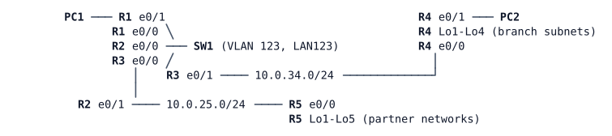

# LAB-016 — Multi-area OSPF

**Module:** 03 OSPF and routing design · **Type:** I (Implementation) · **Guidance tier:** G3 · **Estimated time:** 90 min · **Blueprint objectives:** 3.2.b:P, SK-RM:I

## Scenario

The bench now has a branch router (R4) and a partner router (R5) attached to the HQ routers. Every route they own is flooded through the whole network, and any change in a branch makes every router run SPF. Veridian's design standard is area 0 for the core, one area per site, and summaries at the area border. You apply that standard on the bench before the real branches join in module 07, and you add two policies: one partner network stays private to the partner's area, and HQ's user router must not use the partner summary.

## Objectives

- Split a working single-area OSPF network into areas and identify the ABRs and the LSA types in each area.
- Summarise a site's subnets at its area border and explain the discard route the ABR installs.
- Filter an inter-area route at the ABR with a prefix-list, and filter a route from one router's routing table with a distribute-list. Compare what each does to the link-state database.
- Write prefix-list entries with `ge` and `le`.

## Available Information

| Device | Interface | Peer | Address |
|---|---|---|---|
| R1 | Et0/0 | SW1 Et0/0 (LAN123) | 10.0.123.1/24 |
| R1 | Et0/1 | PC1 | 10.0.1.1/24 |
| R2 | Et0/0 | SW1 Et0/1 (LAN123) | 10.0.123.2/24 |
| R2 | Et0/1 | R5 Et0/0 | 10.0.25.2/24 |
| R3 | Et0/0 | SW1 Et0/2 (LAN123) | 10.0.123.3/24 |
| R3 | Et0/1 | R4 Et0/0 | 10.0.34.3/24 |
| R4 | Et0/0 | R3 Et0/1 | 10.0.34.4/24 |
| R4 | Et0/1 | PC2 | 10.0.4.1/24 |
| R4 | Lo1-Lo4 | branch subnets | 10.0.40.1, 10.0.41.1, 10.0.42.1, 10.0.43.1 (each /24) |
| R5 | Et0/0 | R2 Et0/1 | 10.0.25.5/24 |
| R5 | Lo1-Lo4 | partner systems | 10.0.52.1, 10.0.53.1, 10.0.54.1, 10.0.55.1 (each /24) |
| R5 | Lo5 | partner lab | 10.0.59.1/24 |
| R1-R5 | Lo0 | router ID | 10.255.0.n/32 |
| PC1 | eth0 | R1 | 10.0.1.101/24, gateway 10.0.1.1 |
| PC2 | eth0 | R4 | 10.0.4.102/24, gateway 10.0.4.1 |

- SW1 is a pure Layer 2 switch (VLAN 123, no routing) and needs no configuration.
- Credentials on every router and SW1: `admin` / `Cisco123!`. Consoles open directly in privileged mode. PC1/PC2 (Alpine): `cisco` / `cisco`.
- OSPF process 1. Router IDs are the Lo0 addresses. OSPF is enabled per interface (`ip ospf 1 area N`) and user-facing interfaces are passive.
- A router removed from an area can leave its old LSAs in the other routers' databases until they age out (up to one hour). Look at the advertising router and at whether it is still reachable before drawing conclusions from an LSA. Do not clear the OSPF process to get rid of them; check the advertising router, or wait for the LSA to age out.
- **Timing:** after a broadcast segment comes up, DR/BDR election waits up to 40 seconds. Read roles only after that.
- **Failure methods used in this lab (never mixed):** a *cable pull* is `shutdown` on both ends of the link; OSPF reacts to the interface event at once. A *silent failure* (stopping the link in CML) is not used here.

## Starting State

- Every interface is up. OSPF runs in a single area 0 on all five routers. On LAN123, R3 is the DR and R1 the BDR, and R2 has priority 0.
- The R3-R4 link is point-to-point, and all loopbacks are advertised with their configured masks.
- Every router holds every /24 on the bench. PC1 can reach PC2 and every partner network.

## Requirements / Change Requests

R1. Re-design the network into three areas: area 0 for LAN123 and the Lo0 of R1, R2 and R3; area 1 for the R3-R4 link and every interface of R4; area 2 for the R2-R5 link and every interface of R5. Name the ABRs and show each router's link-state database per area.

R2. Routers outside area 1 must see the branch as the single route 10.0.40.0/22, and routers outside area 2 must see the partner systems as the single route 10.0.52.0/22. Show and explain the route to Null0 that each ABR carries for its summary.

R3. The partner lab network 10.0.59.0/24 must not leave area 2: no router outside area 2 may learn it, and filtering must be done on the ABR with a prefix-list. R5 and R2 must still reach it.

R4. Company policy for the bench: R1, the HQ users' router, must not use the partner summary 10.0.52.0/22, while R3, R4 and the branch still reach the partner systems. Use a filter that acts on R1 only. Show what R1's link-state database still contains for that prefix.

R5. PC1 and PC2 must still reach each other. PC2 must reach the partner systems; PC1 must not.

## Verification Criteria

V1. `show ip ospf border-routers` on R1 lists two area border routers, and a router outside area 0 lists the ABR of its own area.
V2. R1's routing table holds 10.0.40.0/22 as one inter-area route and none of the four branch /24s. R3's table holds the four /24s plus a Null0 route for the summary.
V3. No router outside area 2 has a route to 10.0.59.0/24, while R2 and R5 can ping 10.0.59.1.
V4. R1's routing table has no route for 10.0.52.0/22 or any partner subnet, R1's database still holds the type-3 LSA for 10.0.52.0, and R3 and R4 hold the route and can ping 10.0.52.1.
V5. PC1 can ping PC2; PC2 can ping 10.0.52.1 and 10.0.55.1; PC1 cannot ping 10.0.52.1, and a traceroute from PC1 to 10.0.52.1 gets a host-unreachable reply from R1 (10.0.1.1).
V6. Toolkit: on R4, the sequence "shut Lo1 only" and "shut all four branch loopbacks" is observed in the routing tables of R3 and R1 (summary kept, then withdrawn). While only Lo1 is shut, a ping from R1 sourced from its Loopback0 to 10.0.40.1 shows where that traffic is dropped. The network is restored afterwards.
V7. A cable pull of the R2-R5 link (shutdown on both ends) removes the partner summary from R3's and R1's tables, and it returns after the link is restored.

## Analysis Questions

Q1. Which LSA types exist in area 0, area 1 and area 2 now, and which router originates each?

Q2. What happens to the 10.0.40.0/22 summary if all of R4's subnets go down? If only one does? Why does the ABR install a route to Null0?

Q3. For each of your two filters, show with link-state database and routing table output whether the LSA, the route or both disappeared, and on which routers; explain the difference. Why can a filter that acts on a transit router's routing table black-hole traffic for the routers behind it?

Q4. Write the prefix-list entries that match exactly 10.0.52.0/22, any subnet inside 10.0.52.0/22, and any route with a mask of /24 or longer inside 10.0.0.0/16. Which of the three did the R1 distribute-list (requirement R4) need, and which did the R2 filter (requirement R3) need?

Q5. Veridian will add areas 21-23 for branches. Where would you summarise, and what does a summary cost you in troubleshooting?
