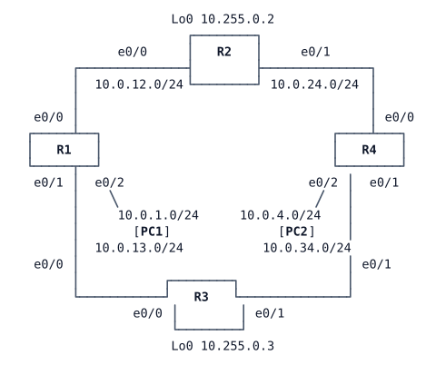

# LAB-017 — Two protocols, one topology

**Module:** 03 OSPF and routing design · **Type:** A/F (Analysis / Foundation) · **Guidance tier:** G3 (guided) · **Estimated time:** 90 min · **Blueprint objectives:** 3.2.a:I

## Scenario

A vendor has proposed EIGRP for Veridian's branch routers, promising "faster failover and unequal-cost load sharing". Before the architecture board meets, you will run both protocols on one small routed diamond and report with evidence. OSPF is already in place and is the incumbent. You will add EIGRP beside it, read what each protocol knows about the same prefix, test the vendor's two claims, and measure how each protocol reacts to two kinds of failure.

Keep every output you capture: the analysis questions refer to them.

## Objectives

After this lab you can:
- enable EIGRP (AS 100) beside OSPF and explain which protocol's routes the router installs, and why;
- read an EIGRP topology table: successor, feasible distance (FD), reported distance (RD) and feasible successors, and apply the feasibility condition with real numbers;
- compare that view with OSPF's link-state view of the same prefix;
- use `variance` to share traffic unequally and read the result in the routing table and in CEF;
- measure failover time for a cable pull and for a silent failure, in both protocols, and tie each number to a timer or mechanism;
- describe what an EIGRP stub router changes for its neighbours.

## Available Information

### Topology

R1 Lo0 10.255.0.1, R4 Lo0 10.255.0.4. Router `n` has host address `.n` on each diamond link. R1 e0/2 and R4 e0/2 are the user LANs.

### Cabling and addressing

| Device | Interface | Peer | Address |
|---|---|---|---|
| R1 | Ethernet0/0 | R2 Ethernet0/0 | 10.0.12.1/24 |
| R1 | Ethernet0/1 | R3 Ethernet0/0 | 10.0.13.1/24 |
| R1 | Ethernet0/2 | PC1 eth0 | 10.0.1.1/24 |
| R2 | Ethernet0/0 | R1 Ethernet0/0 | 10.0.12.2/24 |
| R2 | Ethernet0/1 | R4 Ethernet0/0 | 10.0.24.2/24 |
| R3 | Ethernet0/0 | R1 Ethernet0/1 | 10.0.13.3/24 |
| R3 | Ethernet0/1 | R4 Ethernet0/1 | 10.0.34.3/24 |
| R4 | Ethernet0/0 | R2 Ethernet0/1 | 10.0.24.4/24 |
| R4 | Ethernet0/1 | R3 Ethernet0/1 | 10.0.34.4/24 |
| R4 | Ethernet0/2 | PC2 eth0 | 10.0.4.1/24 |
| R1–R4 | Loopback0 | — | 10.255.0.1–4/32 |
| PC1 | eth0 | R1 Ethernet0/2 | 10.0.1.101/24, gateway 10.0.1.1 |
| PC2 | eth0 | R4 Ethernet0/2 | 10.0.4.102/24, gateway 10.0.4.1 |

### Access

- Router consoles open in privileged mode. Local user `admin` / `Cisco123!` (privilege 15), enable secret `Cisco123!`, domain name `veridian.example`.
- PC1/PC2 (Alpine Linux): CML console, login `cisco` / `cisco` if asked.
- Log messages carry millisecond timestamps and go to the local buffer (`show logging`).

### Platform notes (CML iol-xe routers)

- Ethernet interfaces report `BW 10000 Kbit/sec`. Two interfaces carry a configured `delay` (EIGRP's delay is in tens of microseconds; OSPF ignores it).
- OSPF has no EIGRP-style distance table to read. Use `show ip ospf database` and `show ip ospf rib <prefix>` (or `show ip route <prefix>`) to see OSPF's view.
- Alpine `ping` accepts `-c <count>` and `-i <seconds>`; `-i 0.2` gives a 0.2 s measurement resolution. Run a long ping in the background so you can keep typing, for example `(ping -c 400 -i 0.2 10.0.4.1 > /tmp/p.txt 2>&1 &)`, then read the last lines of the file when it ends. Lost packets multiplied by 0.2 s is the outage.
- **Failure methods** used in R5. A **cable pull** is `shutdown` on both ends of the link. A **silent failure** is stopping the link in CML (Lab → link → Stop), which leaves both interfaces up/up so that only protocol timers can notice. Shutting down one end only is a third, different case: do not use it here.
- Typing two `shutdown` commands on two consoles takes you several seconds, and that delay shows up as extra loss. Read the two `LINK-5-CHANGED` timestamps in `show logging` on R1 and R2 and subtract the gap from your count. Allow about a minute of reconvergence after each of the four failure cases before the next one.
- For R5, test with the destination **10.0.4.1** (R4's LAN address). Confirm with a traceroute from PC1 that under each protocol its path crosses R2, otherwise the R1–R2 failure will not touch it. (10.0.4.102 can hash onto the R3 path under OSPF.)
- After a link or process is restored, wait about a minute: OSPF elects a DR on the broadcast links and waits 40 s before the adjacency is FULL.

## EIGRP in brief

EIGRP is not part of CCNA 200-301, so this is the vocabulary the lab uses. It is a distance-vector protocol: a router learns a destination's metric from each neighbour rather than the whole topology, and keeps every learned path in its **topology table** before choosing one for the routing table.

- **Metric, FD and RD.** For each destination and each neighbour that advertises it, the router stores two numbers. The **reported distance (RD)**, also called advertised distance, is the metric the *neighbour* itself has to the destination. The **feasible distance (FD)** is the best total metric the *local router* has to the destination, so it is the metric of the current best path.
- **Successor and feasible successor.** The neighbour on the best path is the **successor**; it is installed in the routing table. A neighbour is a **feasible successor** (a pre-computed backup) if its RD is lower than the FD of the current successor. That is the **feasibility condition**: a neighbour that is closer to the destination than we are cannot be routing through us, so its path is loop-free.
- **Passive and active.** If the successor is lost and a feasible successor exists, the router switches to it at once and the route stays **passive**. If none exists, the route goes **active**: the router queries its neighbours and waits for replies. A **stub** router tells its neighbours that it is not a transit path, so they do not query it.
- **variance** is a multiplier that lets feasible successors whose metric is within `variance` times the best metric be installed as well, which gives unequal-cost load sharing. Only feasible successors qualify.
- Entry commands: `show ip eigrp neighbors`, `show ip eigrp topology`, `show ip eigrp topology all-links` (also lists paths that fail the feasibility condition), `show ip protocols` and `show ip route eigrp`.

## Starting State

- OSPF process 1, area 0, runs on every router and every interface (user LAN ports are passive). All four diamond links are FULL, and R1 reaches R4's LAN over two equal-cost paths.
- PC1 and PC2 reach each other.
- Two interfaces have a non-default `delay` (for EIGRP). No EIGRP is configured anywhere.

## Requirements / Change Requests

R1. **Enable EIGRP.** Enable EIGRP AS 100 (classic or named mode) on all four routers for every link, both loopback and LAN prefixes, beside OSPF. Use each router's Loopback0 address as its router ID and keep the user LAN interfaces passive. Record which protocol's routes the routers install for R4's LAN and why, with the administrative distance.

R2. **Read the EIGRP view.** On R1, for 10.0.4.0/24, read the topology table: which neighbour is the successor, the FD, each neighbour's RD and the metric of each path. State whether the path through R3 is a feasible successor and show the feasibility-condition arithmetic. Do the same on R4 for 10.0.1.0/24.

R3. **Compare with OSPF.** Show OSPF's view of 10.0.4.0/24 on R1 (RIB or database plus cost). Explain why OSPF uses both paths and EIGRP does not.

R4. **Unequal-cost sharing.** Make R1 send traffic to 10.0.4.0/24 over both paths in proportion to their metrics, using `variance`. Show the traffic-share counts in the routing table and the next hops in the CEF entry. Keep the setting only until R5 starts, then remove it so each failover test starts from a single successor.

R5. **Failure comparison.** Measure the loss seen by PC1 pinging 10.0.4.1 (see platform notes) in four cases, and restore the lab and wait for full convergence after each:
  1. EIGRP in use (OSPF still running beside it), **cable pull** of R1–R2;
  2. EIGRP taken out of R1 (shut down the EIGRP process there, so OSPF carries R1's traffic), **cable pull** of R1–R2;
  3. EIGRP in use again, **silent failure** of R1–R2;
  4. EIGRP out of R1 again, **silent failure** of R1–R2.
  For each case record packets sent and received, the outage in seconds, and the log message on R1 that shows how each protocol detected the failure.

R6. **Stub observation (no change kept).** On R4, declare it an EIGRP stub that advertises only connected routes. Record what R2 and R3 now show for R4 (`show ip eigrp neighbors detail`), which routes R4 still advertises, and what disappears from R2's topology table. Then remove the stub setting and confirm both paths to 10.0.1.0/24 are back in R4's topology table.

## Verification Criteria

V1. EIGRP AS 100 neighbours are up on all four diamond links, and OSPF neighbours are still FULL.
V2. You have R1's topology-table output for 10.0.4.0/24 showing the successor and the other path, with FD and RD for each, and your arithmetic for the feasibility condition.
V3. You have the routing-table entries for 10.0.4.0/24 with EIGRP only, and with `variance` in place (two next hops with traffic-share counts), plus the CEF entry.
V4. You have OSPF's RIB or database evidence for 10.0.4.0/24 on R1 and its total cost.
V5. Four failover measurements (sent, received, outage in seconds, detection log line) are recorded, and each case was restored and reconverged before the next.
V6. The stub observation from R2 and R3 is recorded, and at the end R4 is not a stub and EIGRP and OSPF both run on all routers with R1's EIGRP process enabled.

## Analysis Questions

Q1. What does R1 know about R4's LAN in each protocol? Use the EIGRP topology table and the OSPF database to argue "distance vector versus link state".
Q2. Why was the feasible successor installed without any query, and under what circumstances would EIGRP have to query its neighbours instead?
Q3. What did `variance` change in the routing table and in the CEF table? Why can OSPF not do unequal-cost load sharing?
Q4. From your R5 measurements, which protocol recovered faster for each type of failure, and which timer or mechanism explains each number?
Q5. Judge the vendor's claims. Give two technical reasons Veridian should keep OSPF (think of standards, areas and summarisation, and the IPv6 plan), and one situation where EIGRP would really be the better choice.
Q6. What did R4's stub setting change for its neighbours, and why does a stub router limit the scope of queries after a failure?
