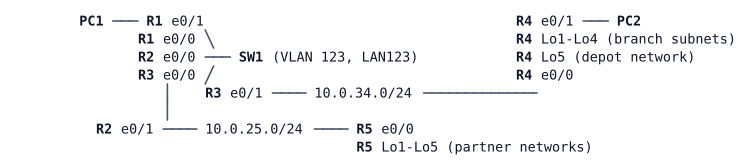

# LAB-018 — Area types

**Module:** 03 OSPF and routing design · **Type:** F (Foundation) · **Guidance tier:** G2 · **Estimated time:** 75 min · **Blueprint objectives:** 3.2.a:P, X-StubNSSA:I

## Scenario

The partner router R5 and the branch router R4 carry routes they never need: Internet ranges and other sites' externals. The branch has also taken over a small depot network that must stay reachable from HQ. Veridian wants the smallest routing tables at the edges without losing reachability.

## Objectives

- Explain why a router that redistributes routes cannot sit in some area types, and read the router's own warning.
- Shrink a remote area's routing table while keeping full reachability.
- Keep a redistributed network reachable from a site whose area does not carry external routes.
- Decide how a default route reaches an area, and justify the choice.
- Tabulate which LSA types exist in each area, who originates them and who translates between them.

## Available Information

| Device | Interface | Peer | Address |
|---|---|---|---|
| R1 | Et0/0 | SW1 Et0/0 (LAN123) | 10.0.123.1/24 |
| R1 | Et0/1 | PC1 | 10.0.1.1/24 |
| R2 | Et0/0 | SW1 Et0/1 (LAN123) | 10.0.123.2/24 |
| R2 | Et0/1 | R5 Et0/0 | 10.0.25.2/24 |
| R3 | Et0/0 | SW1 Et0/2 (LAN123) | 10.0.123.3/24 |
| R3 | Et0/1 | R4 Et0/0 | 10.0.34.3/24 |
| R4 | Et0/0 | R3 Et0/1 | 10.0.34.4/24 |
| R4 | Et0/1 | PC2 | 10.0.4.1/24 |
| R4 | Lo1-Lo4 | branch subnets | 10.0.40.1 - 10.0.43.1 (each /24) |
| R4 | Lo5 | depot network | 172.16.4.1/24 |
| R5 | Et0/0 | R2 Et0/1 | 10.0.25.5/24 |
| R5 | Lo1-Lo5 | partner networks | 10.0.52.1 - 10.0.55.1, 10.0.59.1 (each /24) |
| R1-R5 | Lo0 | router ID | 10.255.0.n/32 |
| PC1 | eth0 | R1 | 10.0.1.101/24, gateway 10.0.1.1 |
| PC2 | eth0 | R4 | 10.0.4.102/24, gateway 10.0.4.1 |

- SW1 is a pure Layer 2 switch (VLAN 123, no routing) and needs no configuration.
- Credentials on every router and SW1: `admin` / `Cisco123!`. Consoles open directly in privileged mode. PC1/PC2 (Alpine): `cisco` / `cisco`.
- OSPF process 1, router IDs are the Lo0 addresses. R1 carries the static "Internet range" 198.51.100.0/24 (pointing at Null0) and R4 carries the depot network; both are already redistributed into OSPF and are not part of what you are asked to change.
- Link-state database entries from a router that has left an area can remain until they age out. Check the advertising router before drawing conclusions. Do not clear the OSPF process to get rid of them; check the advertising router, or wait for the LSA to age out.
- **Failure methods used in this lab (never mixed):** a *one-ended mismatch* is a configuration change on one router only. A *node stop* (stopping the node in CML) is a silent failure for its neighbours: their links stay up and they only notice when the dead timer expires. Save the configuration of a node (`write memory`) before stopping it, because a stop/start restarts from the saved configuration.
- On this platform a plain `show ip route <address>` for a destination covered only by a default route answers "Network not in table". Use `show ip cef <address>` or a traceroute to prove the path.

## Starting State

- Areas as at the end of LAB-016: area 0 (LAN123), area 1 (R3-R4 link and R4), area 2 (R2-R5 link and R5), with the branch and partner summaries and the earlier filters.
- R1 and R4 each redistribute one external network into OSPF (the Internet range and the depot network). Every other router sees both as external routes (R1 and R4 hold their own as local routes). No router has a default route.
- PC1 and PC2 can reach each other and the depot network.

## Requirements / Change Requests

R1. R5 must hold no external routes and no routes of other areas, only what it needs to reach everything. First reduce its area in the less drastic way and record how the link-state database changes, then take it to the minimum.

R2. R4 must not hold the Internet range as an external route, but the depot network must stay reachable from PC1 and from R5.

R3. R4 must still be able to route towards the Internet range (R1 discards it, so the proof is a route lookup on R4 and a traceroute from PC2 that reaches R1). Decide how a default route reaches R4's area, and justify the choice.

R4. Draw the LSA table: which of LSA types 1, 2, 3, 4, 5 and 7 exist in each area after R1 to R3, who originates them, and who translates type 7.

R5. PC1 and PC2 must still reach each other, and the depot network must still be reachable from PC1.

R6. Failure tests, each restored before the next: (a) one-ended mismatch: on R4 only, change its area setting for R4's area to a different area type for a moment, record what the adjacency to R3 does and what the routers log or debug, then restore; (b) save R3's configuration, stop R3 (node stop), record what R4's area and R1 lose, start R3 and record the recovery.

## Verification Criteria

V1. R5's routing table contains no external routes, no inter-area routes and only a default route; R5 can still ping the depot network and PC1's gateway (sourced from its Lo0).
V2. R5's link-state database holds no external LSAs, and its area contains a single summary LSA, the default.
V3. R4's routing table contains no O E2 route for the Internet range and no external routes at all; the depot network is reachable from PC1 and from R5.
V4. A route lookup for 198.51.100.1 on R4 resolves through a default route via R3, and a traceroute from PC2 to 198.51.100.1 reaches R1 (the last reply is R1's "unreachable").
V5. R1 holds the depot network as an external route learned from R3's area boundary.
V6. PC1 can ping PC2.
V7. For R6 you have the log or interface-conditioned debug line that names the reason for the adjacency failure in (a), and the routes R4 and R1 lost and regained in (b).

## Analysis Questions

Q1. Which area type did you choose for each of R4's and R5's areas, and what did the router tell you about the options you rejected?
Q2. What changed in R5's link-state database and routing table with each area type you tried, and what can R5 no longer do?
Q3. How did a default route get into R4's area, and why did you choose that way?
Q4. Which router translates type 7 to type 5, and what happens if there are two border routers (Veridian's dual-core HQ in LAB-021)?
Q5. Compare how OSPF area types and EIGRP stub (observed in LAB-017) each shrink a remote router's routing table.
