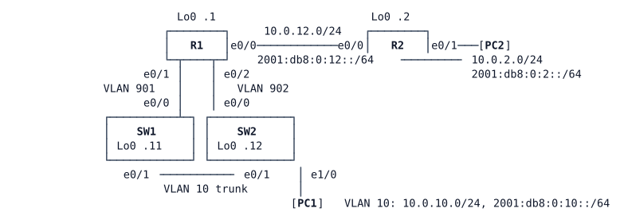

# LAB-019 — OSPFv3 and dual-stack routing

**Module:** 03 OSPF and routing design · **Type:** F/I (Foundation / Implementation) · **Guidance tier:** G2 (requirements) · **Estimated time:** 90 min · **Blueprint objectives:** 3.2.b:P, IPv6:I

## Scenario

Veridian must be dual-stack before the HQ three-tier cut-over. The team rehearses on a bench shaped like the future HQ: one core router (R1), two layer-3 switches (SW1, SW2) on transit VLANs, one user VLAN behind both switches, and a remote LAN behind a second router (R2). IPv4 already works end to end. You add IPv6 to every routed interface, route it with the same design as IPv4, and give the user VLAN an IPv6 default gateway that survives the loss of a switch.

Keep the outputs you capture: the analysis questions refer to them. Consoles open in privileged mode.

## Objectives

After this lab you can:
- apply an IPv6 addressing plan and identify the link-local address a neighbour uses as next hop;
- enable IPv6 routing on routers and layer-3 switches, including subinterfaces and SVIs;
- run OSPFv3 in address-family form with the same areas, passive, network-type and timer design as OSPFv2;
- read OSPFv3 neighbour, interface, database and route output;
- provide a default gateway to IPv6 hosts from two routers with router advertisements, and prefer one of them;
- measure host recovery time after a gateway failure and relate it to RA and neighbour-discovery timers;
- observe what OSPFv3's IPv4 address family needs and carries.

## Available Information

### Topology

R1–SW1 and R1–SW2 are 802.1Q trunks carrying only the transit VLAN shown. The SW1–SW2 trunk carries VLAN 10 (native VLAN 999). PC1 is on SW2. VLAN 10's IPv4 gateway is HSRP group 10 (virtual address 10.0.10.1), SW1 active.

### Cabling and IPv4 addressing (already configured)

| Device | Interface | Peer | IPv4 |
|---|---|---|---|
| R1 | Ethernet0/0 | R2 Ethernet0/0 | 10.0.12.1/24 |
| R1 | Ethernet0/1.901 | SW1 Vlan901 | 10.0.255.2/31 |
| R1 | Ethernet0/2.902 | SW2 Vlan902 | 10.0.255.4/31 |
| R2 | Ethernet0/0 | R1 Ethernet0/0 | 10.0.12.2/24 |
| R2 | Ethernet0/1 | PC2 eth0 | 10.0.2.1/24 |
| SW1 | Vlan901 | R1 Ethernet0/1.901 | 10.0.255.3/31 |
| SW1 | Vlan10 | VLAN 10 | 10.0.10.2/24 (HSRP VIP 10.0.10.1) |
| SW2 | Vlan902 | R1 Ethernet0/2.902 | 10.0.255.5/31 |
| SW2 | Vlan10 | VLAN 10 | 10.0.10.3/24 |
| PC1 | eth0 | SW2 Ethernet1/0 | 10.0.10.101/24, gateway 10.0.10.1 |
| PC2 | eth0 | R2 Ethernet0/1 | 10.0.2.102/24, gateway 10.0.2.1 |

Loopback0: R1 10.255.0.1, R2 10.255.0.2, SW1 10.255.0.11, SW2 10.255.0.12 (all /32).

### IPv6 addressing plan (to be configured)

| Device | Interface | IPv6 |
|---|---|---|
| R1 | Ethernet0/0 | 2001:db8:0:12::1/64 |
| R1 | Ethernet0/1.901 | 2001:db8:0:ffff::2/127 |
| R1 | Ethernet0/2.902 | 2001:db8:0:ffff::4/127 |
| R2 | Ethernet0/0 | 2001:db8:0:12::2/64 |
| R2 | Ethernet0/1 | 2001:db8:0:2::1/64 |
| SW1 | Vlan901 | 2001:db8:0:ffff::3/127 |
| SW1 | Vlan10 | 2001:db8:0:10::2/64 |
| SW2 | Vlan902 | 2001:db8:0:ffff::5/127 |
| SW2 | Vlan10 | 2001:db8:0:10::3/64 |
| PC1 | eth0 | 2001:db8:0:10::101/64 (already set; it also accepts router advertisements) |
| PC2 | eth0 | 2001:db8:0:2::102/64 (already set; it also accepts router advertisements) |

Loopback0 IPv6: `2001:db8:ffff:0::<n>/128` where n is the loopback's last IPv4 octet (R1 1, R2 2, SW1 11, SW2 12).

### OSPF design in place for IPv4 (process 1)

Router ID is the Loopback0 address. Area 0: R1 e0/0, R2 e0/0 and e0/1, both Loopback0s of R1 and R2. Area 10: both transit VLANs, both SVI pairs, the VLAN 10 SVIs and the switch loopbacks (R1 is the ABR). All interfaces are passive except the four routed links between routers and switches. Every routed link between devices is point-to-point with cost 10, hello 1 s and dead 4 s.

### Credentials

Console: privileged mode. VTY: `admin` / `Cisco123!`. PC consoles: `cisco` / `cisco`.

## Starting State

OSPFv2 and HSRP are running and converged (allow about 90 seconds after the switches boot before reading HSRP roles). IPv6 is not configured on any router or switch: only the PCs hold their static IPv6 addresses. Failure tests in this lab name their method: "cable pull" is `shutdown` on both ends of the link; "node stop" is stopping the node in CML after saving its configuration, which is a silent failure for its neighbours (their link stays up and only protocol timers notice). Measure with the default router-advertisement timers before you change them. After a switch restarts from its saved configuration, check its router-advertisement values again before the next measurement.

## Requirements / Change Requests

R1. Every router interface, switch SVI and loopback in the plan carries its IPv6 address, and IPv6 routing is enabled on all four infrastructure devices. Record the link-local address R1 uses as next hop towards the VLAN 10 prefix.

R2. IPv6 routes are exchanged by OSPFv3 in the same areas as IPv4, using one OSPFv3 process in address-family form with the same passive, point-to-point, cost and timer design as OSPFv2 (router IDs unchanged). PC1 and PC2 reach each other over IPv6.

R3. PC1 learns an IPv6 default gateway from both switches. SW1 is preferred while it is up (matching the IPv4 active side). The router advertisement timers are chosen so that, after a node stop of SW1, PC1's IPv6 traffic to PC2 recovers in 15 seconds or less.

R4. Show that the IPv6 gateway redundancy needs no virtual address: record what PC1's IPv6 routing table holds and which address PC1 uses as next hop for off-link destinations.

R5. Observation only (remove or discard it afterwards): enable OSPFv3's IPv4 address family between R1 and R2 and record what the interface needs and which routes it carries.

## Verification Criteria

V1. All planned IPv6 addresses are present and `ping` succeeds between every pair of directly connected IPv6 neighbours.
V2. R1 has three FULL OSPFv3 IPv6 adjacencies. On each interface the network type is point-to-point, cost 10, hello 1 s and dead 4 s, and the OSPFv3 router ID equals the OSPFv2 router ID on every device.
V3. PC1 and PC2 reach each other over IPv6 and IPv4 (ping and traceroute) and the IPv6 path matches the IPv4 path.
V4. PC1's routing table shows two IPv6 default routes (one per switch), and its traceroute to PC2 leaves through SW1 every time.
V5. You have captured PC1's IPv6 outage, in seconds, for a node stop of SW1 under the default router advertisement timers and under your chosen timers, and the chosen timers meet the 15-second target. The IPv4 outage for the same failure is recorded too.
V6. A sourced IPv6 ping from R2's loopback to SW2's loopback succeeds, and the OSPFv3 database on R1 shows the four LSA types you identify for each area.
V7. After a cable pull of the R1–R2 link, PC1 loses both IPv4 and IPv6 reachability to PC2, and both recover after the link is restored.
V8. The IPv4 address family observation from R5 is recorded and the final configuration contains none of it.

## Analysis Questions

Q1. List three differences between OSPFv2 and OSPFv3 that you observed in your own output.
Q2. Why does this design use router advertisements instead of an IPv6 first-hop redundancy protocol on the switches, and what would a real network weigh in that choice?
Q3. What decided PC1's IPv6 failover time, and how did the RA interval and lifetime change it? Compare it with the IPv4 failover on the same failure.
Q4. Could one OSPFv3 process carry both stacks (R5)? What would Veridian gain and risk by moving IPv4 into it?
Q5. PC1 also has a second global IPv6 address that nobody configured. Why does this lab document only the static one?
