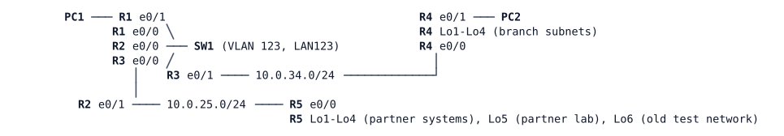

# LAB-020 — Routes That Never Arrive

**Module:** 03 OSPF and routing design · **Type:** T (Troubleshooting) · **Guidance tier:** G2 · **Estimated time:** 75 min · **Blueprint domains:** 3, 4

## Scenario

You are on call for Veridian's bench network. On Friday two unrelated changes were made by different teams. It is now Monday and two tickets are open. Find the causes, fix them with the smallest change that keeps the documented design intact, and capture the evidence for each ticket.

## Objectives

- Isolate a routing fault to a device and a mechanism, with evidence for each step.
- Use a limited (conditional) debug to capture evidence without flooding the log.
- Prove that a fix restores the whole documented design, not only the symptom in the ticket.

## Available Information

| Device | Interface | Peer | Address |
|---|---|---|---|
| R1 | Et0/0 | SW1 Et0/0 (LAN123) | 10.0.123.1/24 |
| R1 | Et0/1 | PC1 | 10.0.1.1/24 |
| R2 | Et0/0 | SW1 Et0/1 (LAN123) | 10.0.123.2/24 |
| R2 | Et0/1 | R5 Et0/0 | 10.0.25.2/24 |
| R3 | Et0/0 | SW1 Et0/2 (LAN123) | 10.0.123.3/24 |
| R3 | Et0/1 | R4 Et0/0 | 10.0.34.3/24 |
| R4 | Et0/0 | R3 Et0/1 | 10.0.34.4/24 |
| R4 | Et0/1 | PC2 | 10.0.4.1/24 |
| R4 | Lo1-Lo4 | branch subnets | 10.0.40.1, 10.0.41.1, 10.0.42.1, 10.0.43.1 (each /24) |
| R5 | Et0/0 | R2 Et0/1 | 10.0.25.5/24 |
| R5 | Lo1-Lo4 | partner systems | 10.0.52.1, 10.0.53.1, 10.0.54.1, 10.0.55.1 (each /24) |
| R5 | Lo5 | partner lab | 10.0.59.1/24 |
| R5 | Lo6 | partner's old test network (still announced) | 10.0.48.1/24 |
| R1-R5 | Lo0 | router ID | 10.255.0.n/32 |
| PC1 | eth0 | R1 | 10.0.1.101/24, gateway 10.0.1.1 |
| PC2 | eth0 | R4 | 10.0.4.102/24, gateway 10.0.4.1 |

**Documented design**

- OSPF process 1, router IDs are the Lo0 addresses, OSPF enabled per interface, user-facing interfaces passive. On LAN123 R3 is DR, R1 BDR and R2 has priority 0.
- Area 0: LAN123, the Lo0 of R1-R3 and PC1's LAN. Area 1: the R3-R4 link and all of R4. Area 2: the R2-R5 link and all of R5. R3 and R2 are the ABRs.
- Summaries at the ABRs: 10.0.40.0/22 (area 1) and 10.0.52.0/22 (area 2), each announced by its ABR.
- Partner area policy: the partner lab 10.0.59.0/24 and the retired test network 10.0.48.0/24 do not leave area 2 (an inter-area filter at the area 2 border). Every other partner network is reachable from HQ and from the branch. The branch router carries no filter of its own.
- HQ's router R1 also keeps Thursday's interim local rule that keeps 10.0.48.0/24 out of its routing table.
- Every link carries full-size (1500-byte) packets, unfragmented. Per-link standard on every router interface that carries a link: IP MTU 1500, OSPF point-to-point or broadcast as in the topology, default hello/dead timers, no authentication, no cost overrides.

Other information:
- SW1 is a pure Layer 2 switch (VLAN 123) and needs no changes.
- Credentials on every router and SW1: `admin` / `Cisco123!`. Consoles open in privileged mode. PC1/PC2 (Alpine): `cisco` / `cisco`.
- Test each design property end to end with the tool that can prove it. The Alpine hosts' `ping` cannot set the Don't Fragment bit, so a full-size unfragmented path test must be sent from a router.
- Failure methods in this lab (never mixed): a *cable pull* is `shutdown` on both ends of a link. A *node stop* is a silent failure for its neighbours.
- A fixed adjacency is only visible once it forms again: after a change on an interface, bounce that interface (shutdown, no shutdown) and wait for the neighbour state.
- Do not clear the OSPF process. Boot-time `%OSPF-5-ADJCHG` lines on every router are normal.

## Starting State

Every interface is up and the nodes have just booted. Both tickets below are open. Console access is available on all devices.

## Requirements / Change Requests

R1. Restore the branch (PC2) so that it reaches HQ and the partner, and HQ reaches the branch, as the documented design requires.

R2. Restore HQ's and the branch's access to the partner's systems, as the documented design requires, without making the retired test network 10.0.48.0/24 or the partner lab 10.0.59.0/24 reachable from outside area 2.

R3. Change nothing that the documented design requires: do not remove a filter, summary or area, and do not change the SW1 or host configuration.

R4. For each ticket, capture one piece of evidence before the fix and the same evidence after it (a log line, a conditional debug or a sourced ping).

R5. Save the final configuration of every router you changed.

## Reported Problems

**T1 (branch manager):** "Since Friday the branch PCs can't reach HQ or the partner. The branch router is up and its uplink lights are on. The NOC says the HQ-side router lists the branch router as a neighbour."

**T2 (HQ helpdesk):** "Since Friday HQ users can't reach any of the partner's systems, not only the retired test network. The partner says they announce everything, and their router can reach us."

## Verification Criteria

V1. PC1 and PC2 reach each other. PC1 and PC2 reach the partner systems. Neither PC reaches the retired test network or the partner lab. State your evidence from both sites.

V2. The network matches every item of the documented design (state your evidence).

V3. Every property in the documented design (routes, filters, segment roles, link properties) is demonstrated with a live test, not only read from configuration, in both directions and from every site where it applies.

V4. For each ticket, one piece of toolkit evidence is captured before and after the fix (log line, conditional debug or sourced ping).

## Analysis Questions

Q1. (Answer after fixing.) For each ticket, which piece of evidence showed that the obvious "routing is fine" observation was misleading?

Q2. (Answer after fixing.) Which OSPF neighbour states can a pair of routers stay in short of FULL, and what usually causes each?

Q3. How do you prove whether a missing route was removed before or after the routing database? Which commands separate the two, and where does each answer send you next?

Q4. Which conditional debug did you use, how did you limit it, and what would an unconditioned debug have cost on a busy router?

Q5. (Answer after fixing.) What configuration should the change have contained, and what check should a change review run before it is applied?

Q6. Which routers lacked the routes you needed, and how did that list narrow down where to look?
