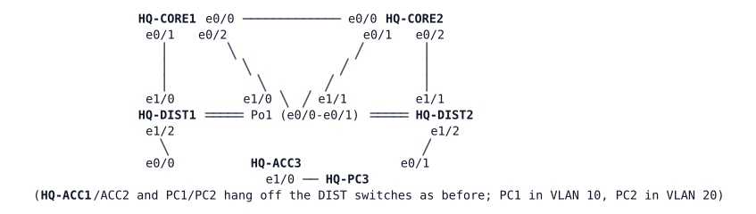

# LAB-021 — HQ goes three-tier

**Module:** 03 OSPF and routing design · **Type:** X (Expansion) · **Guidance tier:** G2 (requirements) · **Estimated time:** 150 min · **Blueprint objectives:** 3.2.b:R, 3.3.c:R, 3.1.a:R, 1.1.a:P, IPv6:P

## Scenario

HQ is outgrowing its collapsed core. The server floor is moving in (switch HQ-ACC3, VLAN 50 HQ-SERVERS), and the OPS and server VLANs must be routed by a new pair of core routers, so that inter-VLAN traffic no longer depends only on the interconnect between the two distribution switches. The vendor has racked and staged HQ-CORE1 and HQ-CORE2 and patched every cable; the server-floor contractor has connected HQ-ACC3 and HQ-PC3 at layer 2. Your team integrates the cores, moves the VLAN 20 gateway without touching any host, gives VLAN 50 its gateway, and makes the campus dual-stack. Then you test how the new design behaves when parts of it fail.

Take a `write memory` on every device before the failure tests (R5): a node stop followed by a start restarts from the saved configuration. After the restart, check that the settings you made are still in effect, in particular the router-advertisement values. Console access is in privileged mode; the credentials are `admin` / `Cisco123!` (VTY lines accept SSH only).

## Objectives

- Integrate routed cores over 802.1Q transit VLANs (router subinterface to switch SVI).
- Run multi-area OSPF with the cores as ABRs, with equal-cost paths from the distribution switches to the cores.
- Move a gateway from switch SVIs to the core routers without changing host gateways, and give a new VLAN a gateway.
- Provide first-hop redundancy at the cores and dual-stack gateways for the hosts.
- Predict and explain what a total loss of the distribution interconnect does in a three-tier design.

## Available Information

### Topology

Cabling (every cable is patched; all trunks are dot1q, native VLAN 999, `nonegotiate`, explicit allowed lists):

| Link | A | B | Must carry |
|---|---|---|---|
| Core interconnect | HQ-CORE1 e0/0 | HQ-CORE2 e0/0 | routed 10.10.255.0/31 |
| CORE1-DIST1 (straight) | HQ-CORE1 e0/1 | HQ-DIST1 e1/0 | VLANs 901, 20, 50 |
| CORE1-DIST2 (cross) | HQ-CORE1 e0/2 | HQ-DIST2 e1/0 | VLAN 902 |
| CORE2-DIST1 (cross) | HQ-CORE2 e0/1 | HQ-DIST1 e1/1 | VLAN 903 |
| CORE2-DIST2 (straight) | HQ-CORE2 e0/2 | HQ-DIST2 e1/1 | VLANs 904, 20, 50 |
| ACC3 uplinks | HQ-DIST1 e1/2, HQ-DIST2 e1/2 | HQ-ACC3 e0/0, e0/1 | VLANs 50, 99 |
| Po1 | HQ-DIST1 e0/0-e0/1 | HQ-DIST2 e0/0-e0/1 | VLANs 10, 20, 50, 99 |

Transit VLANs (a /31 each, IDs fixed by the design, names are your choice): **901** CORE1-DIST1, **902** CORE1-DIST2, **903** CORE2-DIST1, **904** CORE2-DIST2.

### Addressing

| Device | Interface | IPv4 | IPv6 | OSPF area |
|---|---|---|---|---|
| HQ-CORE1 | Lo0 / e0/0 | 10.255.10.1/32 / 10.10.255.0/31 | 2001:db8:ffff:10::1/128 / 2001:db8:10:ffff::0/127 | 0 / 0 |
| HQ-CORE1 | e0/1.901 / e0/2.902 | 10.10.255.2/31 / 10.10.255.4/31 | 2001:db8:10:ffff::2/127 / ::4/127 | 10 / 10 |
| HQ-CORE1 | e0/1.20 / e0/1.50 | 10.10.20.2/24 / 10.10.50.2/24 | 2001:db8:10:20::2/64 / 2001:db8:10:50::2/64 | 0 (no adjacency) |
| HQ-CORE2 | Lo0 / e0/0 | 10.255.10.2/32 / 10.10.255.1/31 | 2001:db8:ffff:10::2/128 / 2001:db8:10:ffff::1/127 | 0 / 0 |
| HQ-CORE2 | e0/1.903 / e0/2.904 | 10.10.255.6/31 / 10.10.255.8/31 | ::6/127 / ::8/127 (prefix 2001:db8:10:ffff) | 10 / 10 |
| HQ-CORE2 | e0/2.20 / e0/2.50 | 10.10.20.3/24 / 10.10.50.3/24 | 2001:db8:10:20::3/64 / 2001:db8:10:50::3/64 | 0 (no adjacency) |
| HQ-DIST1 | Lo0 / Vlan901 / Vlan903 | 10.255.10.11/32 / 10.10.255.3/31 / 10.10.255.7/31 | 2001:db8:ffff:10::11/128 / ::3/127 / ::7/127 | 10 |
| HQ-DIST1 | Vlan10 / Vlan99 | 10.10.10.2/24 / 10.10.99.11/24 | 2001:db8:10:10::2/64 / none | 10 (no adjacency) |
| HQ-DIST2 | Lo0 / Vlan902 / Vlan904 | 10.255.10.12/32 / 10.10.255.5/31 / 10.10.255.9/31 | 2001:db8:ffff:10::12/128 / ::5/127 / ::9/127 | 10 |
| HQ-DIST2 | Vlan10 / Vlan99 | 10.10.10.3/24 / 10.10.99.12/24 | 2001:db8:10:10::3/64 / none | 10 (no adjacency) |
| HQ-ACC1/2/3 | Vlan99 | 10.10.99.21 / .22 / .23, gateway 10.10.99.1 | none | none |
| HQ-PC1 / PC2 / PC3 | eth0 | 10.10.10.101 / 10.10.20.102 / 10.10.50.103, gateway .1 | 2001:db8:10:10::101 / 10:20::102 / 10:50::103 | none |

Link addresses in the transit IPv6 /127s use the prefix 2001:db8:10:ffff::/64 with the last octet of the IPv4 address as the interface ID. Router IDs are the Lo0 IPv4 addresses. Gateway roles: the VLAN 20 gateway is 10.10.20.1 with HQ-CORE2 as the intended active router; VLAN 50 is 10.10.50.1 with HQ-CORE1 active; the active router for a VLAN is preferred by priority 110 and the other holds the default 100. VLAN 10 (GLBP) and VLAN 99 (HSRP) stay on the distribution switches. STP roots (priority 24576 primary, 28672 secondary): VLAN 10 and 99 HQ-DIST1, VLAN 20 HQ-DIST2 (as today), VLAN 50 on the switch next to its active gateway.

## Starting State

The H1 campus works: VLAN 10 (GLBP) and VLAN 20 (HSRP, HQ-DIST2 active on .2/.3, the addresses the design gives to the core subinterfaces) are routed by the distribution switches, and PC1 and PC2 reach each other. HQ-ACC3 and HQ-PC3 are connected at layer 2 in VLAN 50 with no gateway, so PC3 reaches nothing outside its own VLAN. HQ-CORE1 and HQ-CORE2 hold loopbacks, the core interconnect, OSPFv2 and OSPFv3 area 0 between each other and VRRPv3 enabled globally, nothing else; their e0/1 and e0/2 are up with no addressing. On the distribution switches the ports toward the cores are unconfigured and shut down. The IPv6 addresses of PC1, PC2 and PC3 are configured statically; the PCs get their gateway from router advertisements. Allow about 90 seconds after the nodes boot before reading roles. Which distribution switch is the STP root for VLAN 50 is not stated: it depends on the switch MAC addresses.

## Requirements / Change Requests

R1. Each distribution switch has a routed link to each core over the existing cables, using the transit VLANs and trunk contents in the cabling table. Transit links elect no designated router, have equal OSPF cost (10, set explicitly on both ends of every link) and detect a dead neighbour within 4 seconds, in both OSPFv2 and OSPFv3. The trunks toward the cores forward immediately when they come up.

R2. OSPF follows the design: area 0 on the core interconnect and the core-routed VLANs, area 10 on the transit links and the distribution block, with the cores as ABRs. Add the distribution loopbacks (10.255.10.11 and .12), which are the router IDs and must be reachable from everywhere. Every user subnet is advertised, but no adjacency forms on a user segment. Each distribution switch has two equal-cost paths to every subnet routed by the cores.

R3. VLANs 20 and 50 are routed by the core pair using VRRPv3 (group number equals VLAN ID, preempt delay 30 s, masters per the gateway roles above). Hosts keep gateway .1 and need no change. The distribution switches no longer route VLAN 20. A core carries VLANs 20 and 50 only on the trunk named in the cabling table. The layer-2 path of VLAN 50 to its active gateway is engineered with STP priorities of 24576 and 28672. The VLAN 20 cut-over may interrupt VLAN 20 for up to 2 minutes; plan the order so that no address is ever duplicated.

R4. Dual-stack: every routed interface in the addressing table carries its IPv6 address, and OSPFv3 runs in the same areas with the same passive and point-to-point design. The hosts of each user VLAN learn an IPv6 default gateway from every gateway device of that VLAN and prefer the device that is active for IPv4. Use router-advertisement values of 4 s interval and 12 s lifetime. PC1, PC2 and PC3 reach each other over both stacks.

R5. Failure tests (save the configuration first; test one at a time and restore each before the next):
- (a) Stop HQ-CORE2 (silent failure for its neighbours). Measure how long PC2 loses VLAN 20 to VLAN 50 traffic over IPv4 and over IPv6 separately, and restart the node.
- (b) Cable pull of each CORE-DIST trunk in turn: `shutdown` on both ends. Count the lost pings.
- (c) Total loss of the Po1 interconnect: `shutdown` of both member ports on both distribution switches. Predict first, then record which flows still work, which fail, and which fail only for some host pairs, and how you can still reach HQ-DIST2.

## Verification Criteria

V1. Each DIST shows two FULL OSPFv2 and two FULL OSPFv3 neighbours (one per core); each core shows its neighbours on the interconnect and both transit links with a 4-second dead time; no neighbour exists on any user segment.
V2. Each DIST routing table holds two equal-cost entries for 10.10.20.0/24 and 10.10.50.0/24, and each core has two equal-cost paths to 10.10.10.0/24.
V3. `show vrrp brief` shows CORE2 master for VLAN 20 and CORE1 master for VLAN 50, and the DISTs hold no VLAN 20 SVI.
V4. Each host's IPv6 default routes list both gateways of its VLAN, and a traceroute from PC2 and from PC3 uses the active core of its VLAN as the first hop.
V5. PC1, PC2 and PC3 reach each other and their gateways over IPv4 and IPv6 with no loss in steady state (the first IPv6 ping to a new destination may be lost to neighbour discovery).
V6. R5 (a): both stacks recover without intervention while CORE2 is down, and traffic returns without loss when it restarts; the measured times are recorded and checked against the timestamps of the gateway state-change and routing-adjacency log lines on the surviving core and the distribution switches.
V7. R5 (b): no more than a few pings are lost in each test.
V8. R5 (c): the prediction, the measured results and a stated cause for every failing flow are recorded.

## Analysis Questions

Q1. VLANs 20 and 50 ride only one trunk per core, while the transit VLANs ride all four. Why? What would break if a core carried VLAN 20 on both of its trunks?
Q2. What default OSPF cost did the core subinterfaces and the distribution SVIs derive, and why does the design set the cost explicitly?
Q3. Compare R5 (c) with the same failure in the collapsed-core design. Which dependency on the distribution interconnect did the core remove, which one remains for the core-routed VLANs and why, and how does a loopback change the management answer? What would remove the remaining dependency (design or tracking)?
Q4. The cores are ABRs for area 10. What do the distribution switches gain by being in a separate area, and what would you change if area 10 held 20 switches?
Q5. HQ-DIST2 lost its only active gateway role. What role does it play for VLAN 20 now, and why is its STP root role for VLAN 20 still correct?
Q6. VRRPv3 for IPv4 and router advertisements for IPv6 serve the same VLAN: what does each give the host, and how do their measured failover times compare?
