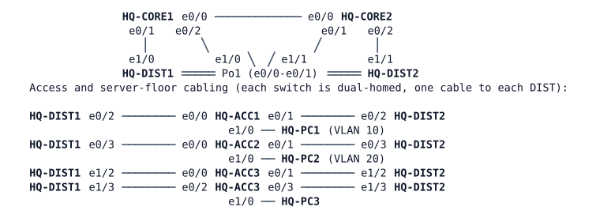

# MS-1 — Campus Checkpoint

**Module:** 03 OSPF and routing design (closes modules 01–03) · **Type:** M (Milestone) · **Guidance tier:** G1 (business outcomes) · **Estimated time:** 180 min · **Blueprint domains:** 1, 3

## Scenario

Veridian Logistics' headquarters campus went three-tier last month and this is its first week of operations. You are the on-shift campus engineer. The change manager has queued four change requests for the maintenance window and the NOC and server team have opened three tickets. Work the queue, record what you do, and prove the campus is healthy before tonight's core maintenance. Nothing in the queue says how to do the work; the constraints and acceptance criteria below are the contract.

## Objectives

- Close tickets on a dual-stack, three-tier campus with evidence from before and after each fix.
- Apply routing, layer-2 and first-hop changes inside a maintenance window, with the outage each one is allowed to cause measured.
- Prove with failure drills that the campus survives the loss of a core, an access uplink and a bundle member.

## Available Information

### Documentation pack

**Topology and cabling.** Every cable below is patched. Trunks are dot1q, native VLAN 999, `nonegotiate`, with explicit allowed lists.



| Link | A | B | Carries |
|---|---|---|---|
| Core interconnect | HQ-CORE1 e0/0 | HQ-CORE2 e0/0 | routed 10.10.255.0/31 |
| CORE1–DIST1 | HQ-CORE1 e0/1 | HQ-DIST1 e1/0 | VLANs 901, 20, 50 |
| CORE1–DIST2 | HQ-CORE1 e0/2 | HQ-DIST2 e1/0 | VLAN 902 |
| CORE2–DIST1 | HQ-CORE2 e0/1 | HQ-DIST1 e1/1 | VLAN 903 |
| CORE2–DIST2 | HQ-CORE2 e0/2 | HQ-DIST2 e1/1 | VLANs 904, 20, 50 |
| DIST interconnect | HQ-DIST1 e0/0-e0/1 | HQ-DIST2 e0/0-e0/1 | Po1: VLANs 10, 20, 50, 99 |
| Server floor uplinks | HQ-DIST1 e1/2, HQ-DIST2 e1/2 | HQ-ACC3 e0/0, e0/1 | VLANs 50, 99 |
| Server floor spare cables ("pre-patched for the server floor") | HQ-DIST1 e1/3, HQ-DIST2 e1/3 | HQ-ACC3 e0/2, e0/3 | admin-down on both ends |
| ACC1 uplinks | HQ-DIST1 e0/2, HQ-DIST2 e0/2 | HQ-ACC1 e0/0, e0/1 | VLANs 10, 20, 99 |
| ACC2 uplinks | HQ-DIST1 e0/3, HQ-DIST2 e0/3 | HQ-ACC2 e0/0, e0/1 | VLANs 10, 20, 99 |

Transit VLANs: **901** CORE1–DIST1, **902** CORE1–DIST2, **903** CORE2–DIST1, **904** CORE2–DIST2.

**Addressing.**

| Device | Interface | IPv4 | IPv6 | OSPF area |
|---|---|---|---|---|
| HQ-CORE1 | Lo0 / e0/0 | 10.255.10.1/32 / 10.10.255.0/31 | 2001:db8:ffff:10::1/128 / 2001:db8:10:ffff::0/127 | 0 / 0 |
| HQ-CORE1 | e0/1.901 / e0/2.902 | 10.10.255.2/31 / 10.10.255.4/31 | 2001:db8:10:ffff::2/127 / ::4/127 | 10 / 10 |
| HQ-CORE1 | e0/1.20 / e0/1.50 | 10.10.20.2/24 / 10.10.50.2/24 | 2001:db8:10:20::2/64 / 2001:db8:10:50::2/64 | 0 (no adjacency) |
| HQ-CORE2 | Lo0 / e0/0 | 10.255.10.2/32 / 10.10.255.1/31 | 2001:db8:ffff:10::2/128 / 2001:db8:10:ffff::1/127 | 0 / 0 |
| HQ-CORE2 | e0/1.903 / e0/2.904 | 10.10.255.6/31 / 10.10.255.8/31 | 2001:db8:10:ffff::6/127 / ::8/127 | 10 / 10 |
| HQ-CORE2 | e0/2.20 / e0/2.50 | 10.10.20.3/24 / 10.10.50.3/24 | 2001:db8:10:20::3/64 / 2001:db8:10:50::3/64 | 0 (no adjacency) |
| HQ-DIST1 | Lo0 / Vlan901 / Vlan903 | 10.255.10.11/32 / 10.10.255.3/31 / 10.10.255.7/31 | 2001:db8:ffff:10::11/128 / 2001:db8:10:ffff::3/127 / ::7/127 | 10 |
| HQ-DIST1 | Vlan10 / Vlan99 | 10.10.10.2/24 / 10.10.99.11/24 | 2001:db8:10:10::2/64 / none | 10 (no adjacency) |
| HQ-DIST2 | Lo0 / Vlan902 / Vlan904 | 10.255.10.12/32 / 10.10.255.5/31 / 10.10.255.9/31 | 2001:db8:ffff:10::12/128 / 2001:db8:10:ffff::5/127 / ::9/127 | 10 |
| HQ-DIST2 | Vlan10 / Vlan99 | 10.10.10.3/24 / 10.10.99.12/24 | 2001:db8:10:10::3/64 / none | 10 (no adjacency) |
| HQ-ACC1 / 2 / 3 | Vlan99 | 10.10.99.21 / .22 / .23, gateway 10.10.99.1 | none | none |
| HQ-PC1 / PC2 / PC3 | eth0 | 10.10.10.101 / 10.10.20.102 / 10.10.50.103, gateway .1 | 2001:db8:10:10::101 / 10:20::102 / 10:50::103 | none |

**Design roles.**

| Item | Design |
|---|---|
| OSPF | Area 0: core interconnect and core-routed user VLANs. Area 10: transit links and the distribution block. Cores are ABRs. OSPFv2 and OSPFv3 in the same areas. Transit links are point-to-point, cost 10, hello 1 s, dead 4 s in both stacks. |
| VLAN 10 gateway | 10.10.10.1 (GLBP/DIST switches); IPv6 router advertisements every 4 s, lifetime 12 s, DIST1 preferred |
| VLAN 20 gateway | 10.10.20.1, VRRPv3 group 20, HQ-CORE2 master (priority 110), HQ-CORE1 backup, preempt delay 30 s; IPv6 router advertisements every 4 s, lifetime 12 s, HQ-CORE2 preferred |
| VLAN 50 gateway | 10.10.50.1, VRRPv3 group 50, HQ-CORE1 master (priority 110), HQ-CORE2 backup, preempt delay 30 s; IPv6 router advertisements every 4 s, lifetime 12 s, HQ-CORE1 preferred |
| Spanning tree | Root HQ-DIST1 for VLANs 10, 50 and 99 (24576); root HQ-DIST2 for VLAN 20 (24576); guards on the DIST downlinks |
| Management | VLAN 99, gateway 10.10.99.1; the NOC reaches every switch on its VLAN 99 address |

**Credentials.** `admin` / `Cisco123!` (console in privileged mode; VTY lines accept SSH only). Routing-protocol key string where one is called for: `ROUTEKEY123` (hmac-sha-256).

**Change log (last two weeks).**

| Date | Entry |
|---|---|
| Friday | Server-floor contractor work on HQ-ACC3 and its uplinks; IPv6 go-live on the campus; core cut-over clean-up |
| Last month | Drill note: with the core router that serves the server VLAN down, the server VLAN went dark |

**Monitoring excerpt (NOC, this morning).**

```
HQ-DIST2 loopback 10.255.10.12              IPv4  UP
HQ-DIST2 loopback 2001:db8:ffff:10::12      IPv6  DOWN  (since go-live)
HQ-ACC3 10.10.99.23                         IPv4  UP
HQ-PC3 (file server) 10.10.50.103           IPv4  not reachable from outside the floor
```

**Operations note.** The distribution and access switches are never restarted (the router-advertisement timers on the distribution switches are set at the campus standard and are checked on the running configuration only). Only the two core routers are ever stopped, and only in the V3 drills.

## Starting State

The campus is running as documented, with the Friday work and the go-live already done. PC1, PC2 and PC3 are in VLANs 10, 20 and 50. Every device's configuration is its saved startup configuration. The spare cables are in place and administratively down on both ends.

## Requirements / Change Requests

R1. **Constraints (all work).** (a) No device is reloaded and no switch is restarted; the V3 drills' node stops of a core router are the only exception, and you save that core's configuration first. (b) Management reachability of every switch is kept throughout. (c) Changes that reset adjacencies are made only in the declared maintenance window (CR1 and CR2), each causing no more than the outage stated in its CR. (d) Every change is recorded in a change log with the measured impact. (e) All configurations are saved at the end.

R2. **Tickets.** Close TK1, TK2 and TK3 (see Reported Problems), each with one piece of before-and-after evidence.

R3. **CR1 (maintenance window).** The distribution switches must hold only the routes of their own area (area 10) plus a default route, for both IPv4 and IPv6, and reach everything else through that default. No host pair may lose reachability for longer than the 4 s OSPF dead interval.

R4. **CR2 (maintenance window).** The security audit requires authenticated routing adjacencies on every campus IPv4 OSPF link (core interconnect and the four transit links), using the standard key above. The change must not take the campus down for longer than a single adjacency reset per link.

R5. **CR3.** Double the server floor's uplink capacity to each distribution switch using the pre-patched spare cables, with no new blocked logical links and the existing protection design preserved on the new logical links.

R6. **CR4.** Before tonight's CORE1 maintenance, move the server VLAN's gateway role (both IP versions) to CORE2 with at most one lost ping (measured as in V3), keep it there for the window, and give it back afterwards. Hosts keep their gateway addresses.

## Reported Problems

- **TK1 (server team):** "Since Friday's server-floor work nobody outside the floor can reach the file server. The NOC can manage the floor's switch."
- **TK2 (NOC):** "IPv6 monitoring from the OPS floor shows one distribution switch's loopback down since the IPv6 go-live; IPv4 monitoring of the same switch is green. Users report nothing."
- **TK3 (change manager):** "Last month's drill: when the core router that serves the server VLAN was down, the server VLAN went dark. Prove the campus now survives losing either core before tonight's window."

## Verification Criteria

V1. Every host reaches every other host, every switch's management address and every routed device's loopback over IPv4, and over IPv6 wherever the documentation pack lists an IPv6 address (the first few packets to a new destination, especially to a switch management address, may be lost while address resolution completes; repeat the test at least 5 times before judging).
V2. The campus matches the documentation pack and every change request's acceptance criterion; the saved configuration equals the running configuration on every device.
V3. After saving, each of these drills leaves V1 true within the targets: stopping either core router in turn (silent failure: IPv4 recovers within 5 s, IPv6 within 15 s, and traffic returns with at most one lost ping when the core is started); a cable pull (`shutdown` on both ends) of any one ACC1/ACC2 uplink in turn (no more than 2 lost pings); a cable pull of one member of each bundle, including the server-floor bundles (recovers within 10 s). Measure every loss and recovery criterion in this pack with continuous pings at 4 per second (`ping -i 0.25`); recovery time = lost pings x 0.25 s. Restore each failure before the next. Losing the whole distribution interconnect is a known limitation of the design and is not a drill.
V4. Each ticket is closed with one piece of before-and-after evidence (a log line, a sourced ping or an interface-conditioned debug), and each change has a change-log entry with its measured impact.

## Analysis Questions

Q1. In which order did you work the queue, and why? Which change depended on which ticket?
Q2. For each ticket, what test did you run to prove it was fully fixed rather than only appearing fixed, and what did it show?
Q3. What outage did each maintenance-window change actually cause, and how did you keep it inside the constraint?
Q4. For the campus as it now stands, list the failures it survives at each layer and the ones it does not.
