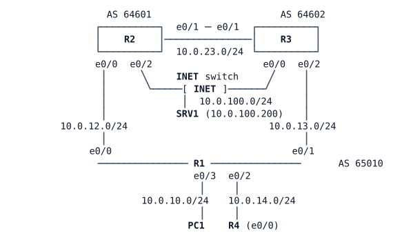

# LAB-022 — eBGP Neighbours and Best Path

Module: 04 Internet Edge and Tracking | Type: F (foundation) | Guidance tier: G3 | Estimated time: 120 min | Blueprint objectives: 3.2.c:I SK-RM:P

## Scenario

Veridian has signed with two Internet providers. Before go-live the network team rehearses BGP on a bench: one enterprise router (R1) with a session to each provider, and a second enterprise router (R4) to see what iBGP changes. The providers (R2 in AS 64601, R3 in AS 64602) are already configured and are read-only: use their `show` commands as a looking glass, never change them. Veridian uses AS 65010.

## Objectives

- Bring up eBGP to both providers and iBGP between R1 and R4, and read the session state machine from the show output and the log.
- Originate the Veridian LAN and understand the exact-match rule of the `network` statement.
- Explain and fix an unusable next hop on an iBGP peer.
- Predict the best path, then move it with weight, local preference, MED and AS-path prepend, naming the deciding attribute each time.
- Accept only the providers' documented prefixes inbound.

## Available Information

| Device | Interface | Address | Connects to |
|---|---|---|---|
| R1 | Loopback0 | 10.255.0.1/32 | |
| R1 | e0/0 | 10.0.12.1/24 | R2 e0/0 |
| R1 | e0/1 | 10.0.13.1/24 | R3 e0/0 |
| R1 | e0/2 | 10.0.14.1/24 | R4 e0/0 |
| R1 | e0/3 | 10.0.10.1/24 | PC1 (10.0.10.101/24) |
| R4 | Loopback0 / e0/0 | 10.255.0.4/32 / 10.0.14.4/24 | R1 e0/2 |
| R2 (AS 64601) | Loopback0 / e0/1 / e0/2 | 10.255.0.2/32 / 10.0.23.2/24 / 10.0.100.2/24 | R3 / INET |
| R3 (AS 64602) | Loopback0 / e0/1 / e0/2 | 10.255.0.3/32 / 10.0.23.3/24 / 10.0.100.3/24 | R2 / INET |
| SRV1 | eth0 | 10.0.100.200/24, gateway 10.0.100.2 | INET |

Provider loopbacks that stand for Internet destinations: R2 10.0.200.0/24 and 10.0.201.0/24 (Loopback1 and 2), R3 10.0.201.0/24 and 10.0.203.0/24. Both providers announce 10.0.201.0/24, so it has two external paths.

The providers' letter documents exactly these prefixes: 10.0.100.0/24, 10.0.200.0/24, 10.0.201.0/24 and 10.0.203.0/24.

BGP passwords: session to R2 `ISPA-64601`, session to R3 `ISPB-64602`. Router login `admin` / `Cisco123!` (console is already privileged); PC1 and SRV1 `cisco` / `cisco`. Interface failure tests: a cable pull is `shutdown` on **both** ends of the link; a silent failure is a CML link stop (the interface stays up/up). Traceroutes on R3 that must come back through R1 need `source Loopback2`.

## Starting State

Addressing and OSPF area 0 between R1 and R4 (loopbacks included) are configured. R2 and R3 are fully configured providers with their eBGP session to each other up and their sessions towards R1 waiting for R1. R1 and R4 have no BGP configuration and no route-maps or prefix-lists. PC1 cannot reach the Internet LAN yet. SSH is enabled on all routers. Give the bench about 90 seconds after boot.

## BGP and route-maps in brief

BGP runs between neighbours you name one by one; the session is TCP port 179, and the peer must match the address you configured as `neighbor`. Different AS numbers make an eBGP session, the same AS number an iBGP session. `show ip bgp summary` shows each neighbour's state (Idle, Active, Established) and, once Established, the number of prefixes received. `show bgp ipv4 unicast <prefix>` lists every path BGP knows for one prefix with its attributes and marks the best one. `show bgp ipv4 unicast neighbors <ip> received-routes` and the providers' own `show` output give a looking-glass view.

BGP does not compare metrics like OSPF. For one prefix it takes the paths it holds and keeps the winner of the first step that separates them, in this order: highest weight, highest local preference, locally originated paths, shortest AS path, lowest origin code, lowest MED, eBGP over iBGP, lowest IGP metric to the next hop, then the oldest path or the lowest router ID. Read a `show bgp` entry from the top of this list down to see which attribute decided it.

A route-map is an ordered list of entries. Each entry has a sequence number, `permit` or `deny`, optional `match` lines and optional `set` lines. Entries are evaluated in sequence order and the first entry whose match is true is used; an entry with no `match` matches everything. A route that matches no entry is denied (implicit deny at the end), so a policy that should let the rest through ends with an empty `permit` entry. A `match` can refer to another object by name, for example a prefix-list (`match ip address prefix-list <name>`). A route-map takes effect only when it is attached to a neighbour with `neighbor <ip> route-map <name> in|out`. `show route-map <name>` shows the entries and how often each matched; `show ip prefix-list <name>` does the same for a prefix-list.

## Requirements / Change Requests

**R1** (sessions) Establish eBGP from R1 (AS 65010) to R2 and to R3, using the passwords above, and iBGP between R1 and R4 using their loopbacks. First configure the iBGP session **without** `update-source` on either end, record the session state and any log line, then correct it.
**R2** (origination) Originate 10.0.10.0/24 from R1 so that both providers see it with origin AS 65010. First configure `network 10.0.0.0 mask 255.255.0.0`, show that nothing is announced, and explain why; then correct it.
**R3** (next hop) On R4, show why the routes learned from R1 are not usable at first, and fix it on R1 so R4 installs them with R1 as the next hop.
**R4** (best path) For 10.0.201.0/24, predict and record the best path on R1 and on R4, with the deciding attribute. Then move the best path to the AS 64602 provider with each of: (a) weight on R1; (b) local preference set by an inbound route-map on R1 (show it reaches R4); (c) MED: R3 already sets MED 50 on 10.0.201.0/24. Set MED 100 on the path from R2 with an inbound route-map, show that R1 does not use it to choose, then apply `bgp always-compare-med`, record the result, and remove it again; the final best path must use neither. R1 must also use `bgp bestpath compare-routerid` so equal-attribute ties do not depend on which path arrived first. (d) AS-path prepend on R1 towards R3 for 10.0.10.0/24, increasing the count until R3's looking glass prefers the path through R2 for 10.0.10.0/24; record the result for one prepend and for two. Remove the temporary changes after each step so the next starts from the default best path.
**R5** (inbound filter) On R1, accept from each provider only the documented prefixes, using a prefix-list referenced from a route-map. Anything else the providers announce must not enter R1's BGP table.
**R6** (outbound filter) Veridian must not carry traffic between its two providers. On R1, announce to each provider only prefixes that AS 65010 itself originates, and show on both providers that no route learned from the other provider arrives via R1.

## Reported Problems

Not applicable (foundation lab, no faults).

## Verification Criteria

**V1** R1 shows both eBGP sessions and the iBGP session as Established, and the log shows each Up transition.
**V2** The providers' looking glass shows 10.0.10.0/24 with AS path 65010 (and no other Veridian prefix), and no route reaches either provider with AS path `65010` followed by the other provider's AS.
**V3** R4 shows all provider routes with R1's loopback as next hop and installs them in its routing table.
**V4** For each step of R4, `show bgp ipv4 unicast 10.0.201.0` on R1 and R4 shows the predicted best path and the attribute that decided it.
**V5** With the final configuration, PC1 reaches 10.0.100.200 (SRV1) and the reverse, and a traceroute shows the chosen provider as the exit.
**V6** R1's BGP table contains from each provider only the four documented prefixes.
**V7** A cable pull on R1-R2 moves the best path to R3 within seconds; a silent failure on the same link takes about the hold time. Record both times.

## Analysis Questions

**Q1** Which state did R1 show for the iBGP session without `update-source`, was there a log line, and why that state?
**Q2** Why is weight useless on R4 for a decision made on R1?
**Q3** Which of weight, local preference, MED and AS path travel to the other AS, and which never leave your AS (or your router)?
**Q4** Why does a `network` statement need an exact RIB match, and what must Veridian add to announce a /26 it does not use internally?
**Q5** R1 shows 10.0.12.0/24 from R2 as `r>` (RIB failure) before the filter: what does it mean for forwarding?
