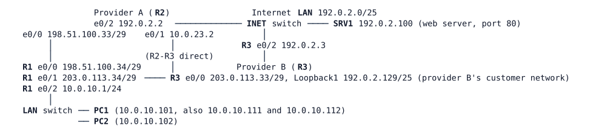

# LAB-023 — Translating Addresses

Module: 04 Internet Edge and Tracking | Type: F (foundation) | Guidance tier: G2 | Estimated time: 75 min | Nodes: 8 (6 devices + 2 unmanaged switches) | Blueprint objectives: 3.3.b:I SK-RM:R

## Scenario

Veridian goes live on two Internet providers next week and uses private addressing internally. The users must share a few public addresses, one internal server (PC2) must be reachable from the Internet at a fixed public address, and each provider only accepts traffic from its own address range. The team rehearses the change on a bench. R1 is the enterprise edge router and is the only device you configure. R2 (provider A) and R3 (provider B) are read-only: use their `show` commands as a looking glass and never change them. SRV1 stands for a web server on the Internet.

## Objectives

- Make PC2 reachable from the Internet at a fixed public address, and make its own outbound traffic use that address.
- Let the users share public addresses from provider A and from provider B, each exit using only its own provider's range.
- Observe what happens when a pool of public addresses is smaller than the number of users, then return to a working design.
- Prove that no private address ever reaches a provider.

## Available Information

| Device | Interface | Address | Remark |
|---|---|---|---|
| R1 | e0/0 | 198.51.100.34/29 | to provider A |
| R1 | e0/1 | 203.0.113.34/29 | to provider B |
| R1 | e0/2 | 10.0.10.1/24 | users LAN |
| R2 | e0/0 / e0/1 / e0/2 | 198.51.100.33/29 / 10.0.23.2/24 / 192.0.2.2/25 | provider A |
| R3 | e0/0 / e0/1 / e0/2 / Lo1 | 203.0.113.33/29 / 10.0.23.3/24 / 192.0.2.3/25 / 192.0.2.129/25 | provider B |
| SRV1 | eth0 | 192.0.2.100/25 | web server on TCP 80 |
| PC1 | eth0 | 10.0.10.101/24 plus secondary 10.0.10.111 and 10.0.10.112 | use `ping -I <address>` to send as a given address |
| PC2 | eth0 | 10.0.10.102/24 | |

Public ranges: provider A has assigned Veridian 198.51.100.0/27, provider B 203.0.113.0/27. Each provider routes its own range to R1 and reaches the other provider's range across the Internet LAN. Addresses you may use: A 198.51.100.1 and 198.51.100.10 (fixed address for PC2), 198.51.100.20-21 (spare); B 203.0.113.1.

Credentials: all routers `admin` / `Cisco123!` (enable `Cisco123!`); Linux hosts `cisco` / `cisco`. The providers' looking glass is an inbound access list, `LG-INGRESS`, on R2 and R3 e0/0: it denies RFC 1918 sources and permits everything else; read its match counters with `show access-lists`. `debug ip nat` accepts only a standard access-list number or name. `clear logging` asks for confirmation, so avoid it in scripted sessions.

## Starting State

R1 has a default route via R2, a floating default route via R3 (administrative distance 5), and a static route sending 192.0.2.128/25 (provider B's customer network) via R3. Providers route the Veridian ranges back to R1. No address translation is configured. PC1 and PC2 cannot reach SRV1 (the providers do not route private space); R1 itself can.

## Requirements / Change Requests

R1. R1 translates so that SRV1 reaches PC2 at 198.51.100.10 through provider A, and PC2's own traffic to SRV1 leaves with that address.
R2. Users (10.0.10.0/24) reaching SRV1 (192.0.2.100) through provider A share the single public address 198.51.100.1, with many sessions multiplexed on it.
R3. Users' traffic leaving through provider B (for example to 192.0.2.129) uses 203.0.113.1, and traffic leaving through A uses 198.51.100.1. PC1 can use both exits at the same time.
R4. Temporarily give the users a pool of two public addresses (198.51.100.20-21) without port multiplexing, send traffic from three different inside addresses, and capture what happens to the third. Then restore the shared-address design.
R5. While you do this, limited debugging on R1 (only for the users' LAN) shows the translations taking place.

## Verification Criteria

V1. From SRV1, `ping 198.51.100.10` succeeds, and R1's translation table shows PC2's traffic to SRV1 with global address 198.51.100.10.
V2. Two simultaneous web requests from PC1 to SRV1 appear in the translation table with the same public address and different ports.
V3. In one test, PC1 traffic to 192.0.2.100 appears with a 198.51.100.x address and PC1 traffic to 192.0.2.129 with a 203.0.113.x address, both entries present at once.
V4. With the two-address pool, a log message and a debug line on R1 identify the third inside address as untranslated, and its pings fail.
V5. After step 4 is undone, all of V2 and V3 work again.
V6. The `LG-INGRESS` deny counters on R2 and R3 do not increase while PC1, PC2 and the extra addresses send traffic after the change.
V7. With the link R1-R2 pulled (shutdown on both ends), record which of PC1, PC2 and which kind of session still work through provider B, and what is left in the translation table; restore the link and clear the translations.

## Analysis Questions

Q1. Why does a rule that selects only by source address fail with two exits, and what did your working rule test in addition?
Q2. In which order are translation and routing applied to a packet entering from the Internet and to a packet entering from the users' LAN? How does that explain why R1 needs no extra route for the fixed public address of PC2?
Q3. What breaks if a provider does not route your public range back to you?
Q4. After the default route changes to the other provider, why does an existing translation keep working or stay in the table, and what did you observe for PC2 while provider A's link was pulled? Relate your observation to what failover design must consider.
