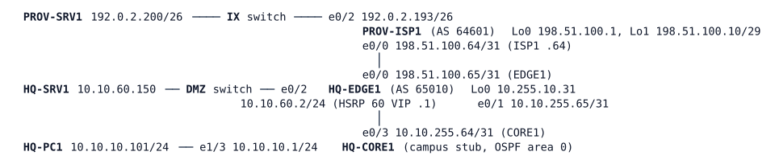

# LAB-024 — Veridian Goes Online

Module: 04 Internet Edge and Tracking | Type: I (implementation) | Guidance tier: G2 | Estimated time: 120 min | Nodes: 8 (6 devices + 2 unmanaged switches) | Blueprint objectives: 3.2.c:P 3.3.b:P

## Scenario

ISP-A has delivered the circuit and its provider letter. The CIO wants users online and the public web server published by Friday, with only Veridian's assigned blocks visible on the Internet. HQ-EDGE1 is the Internet edge and the only device you configure. PROV-ISP1 is ISP-A's router: read-only, use its `show` and `debug` commands as a looking glass and never change it. PROV-SRV1 stands for a web server on the Internet.

## Objectives

- Bring up the authenticated provider peering and control exactly which routes are exchanged in each direction.
- Give users shared Internet access and publish the DMZ web server at a fixed public address.
- Let the campus learn its way out only while the edge itself has a way out.
- Prove what the Internet can and cannot see, and what happens when the provider link fails in two different ways.

## Available Information

HQ-CORE1 stands for the whole campus: it originates 10.10.10.0/24 (user LAN), 10.10.20.0/24 and 10.10.50.0/24. The IX switch is the Internet exchange LAN 192.0.2.192/26. Consoles open in privileged mode.

**Provider letter (ISP-A, circuit 7731):**
- ISP-A is AS 64601 and peers from 198.51.100.64; Veridian is AS 65010 and peers from 198.51.100.65. The BGP session password is `ISPA-64601`.
- Veridian's assigned blocks: user block 192.0.2.0/26 and DMZ block 192.0.2.128/26 (of the 192.0.2.0/24 allocation). ISP-A accepts only prefixes within 192.0.2.0/24 of length /24 to /26.
- ISP-A announces its own prefixes 198.51.100.0/25 and 198.51.100.8/29 (supplier network). Veridian must accept only these.
- Address plan: users share 192.0.2.1; the web server is 192.0.2.130.

| Host | Address | Gateway |
|---|---|---|
| HQ-PC1 | 10.10.10.101/24 | 10.10.10.1 |
| HQ-SRV1 (web server, port 80) | 10.10.60.150/24 | 10.10.60.1 (HSRP VIP on EDGE1) |
| PROV-SRV1 (web server, port 80) | 192.0.2.200/26 | 192.0.2.193 |

Credentials: devices `admin` / `Cisco123!`, hosts `cisco` / `cisco`. Host `tcpdump` needs root and is not available.

## Starting State

HQ-EDGE1 has addressing, Loopback0, OSPF area 0 to HQ-CORE1 (adjacent, no default route), and the DMZ gateway. It has no BGP, no address translation and no default route. PROV-ISP1 is complete and waiting for Veridian. The hosts have their addresses. Nothing outside the campus is reachable yet.

## Requirements / Change Requests

R1: Establish an authenticated BGP session with ISP-A as described in the provider letter. Veridian accepts from ISP-A only the prefixes the letter lists.
R2: The Internet sees exactly 192.0.2.0/26 and 192.0.2.128/26 from Veridian and nothing else, even if someone later adds another route on the edge.
R3: Every inside user (10.10.0.0/16) reaches the Internet (PROV-SRV1 and ISP-A's networks) behind one address of the user block.
R4: HQ-SRV1 is reachable from the Internet at 192.0.2.130 and uses that address for its own outbound traffic.
R5: The campus learns a default route from the edge only while the edge itself has an Internet route.
R6: No private address leaves Veridian. Prove it from the provider side.
R7: Test both a cable pull (both ends of the EDGE1-ISP1 link shut down) and a silent failure of that link (`link stop` in CML, which leaves both interfaces up/up). Record what the edge and the campus do and how long each takes.

## Verification Criteria

V1: The BGP session is established; the log shows the neighbour-up message; a ping sourced from the EDGE1 link address reaches ISP-A.
V2: ISP-A's view of what it receives from Veridian lists exactly two prefixes, the two /26 blocks.
V3: The inbound policy permits exactly ISP-A's two documented prefixes: show the policy (`show ip prefix-list`, `show route-map`) and the count of prefixes received from ISP-A. (ISP-A is read-only and sends only those two, so a rejected prefix cannot be demonstrated here.)
V4: HQ-PC1 reaches PROV-SRV1 and 198.51.100.1, and ISP-A sees the source as 192.0.2.1.
V5: PROV-SRV1 reaches HQ-SRV1 at 192.0.2.130 (ping and web page); HQ-SRV1's own traffic to the Internet arrives at ISP-A from 192.0.2.130.
V6: HQ-CORE1 holds an OSPF-learned default route while the provider link is up, and loses it when the link is cable-pulled.
V7: While HQ-PC1 pings an ISP-A address, no 10.0.0.0/8 source address is seen on ISP-A.
V8: With an extra, unrelated route added on the edge and advertised into BGP, ISP-A still sees only the two blocks (remove the test route afterwards).
V9: The measured times of R7 are recorded.

## Analysis Questions

Q1: How did you make the edge announce blocks it has no interface for, and why does that also satisfy R2's "even if someone later adds a route"?
Q2: Why would forcing the default route out of the edge unconditionally be wrong for R5, and what would the campus do during an outage if it were?
Q3: Trace a packet from HQ-PC1 to PROV-SRV1 and the reply back through every translation and routing decision.
Q4: During the silent failure, why did nothing fail over, and what would detect it?
