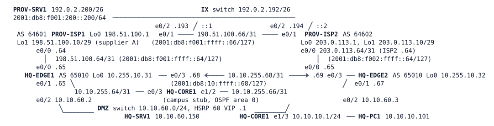

# LAB-025 — Two Providers, One Policy

Module: 04 Internet Edge and Tracking | Type: I (implementation) | Guidance tier: G2 | Estimated time: 150 min | Nodes: 10 (8 devices + 2 unmanaged switches) | Blueprint objectives: 3.2.c:P SK-RM:R IPv6:R

## Scenario

ISP-B's circuit is live on the new HQ-EDGE2 and the board has approved a routing policy. ISP-A remains the primary provider. ISP-B carries ISP-B's own customers and a supplier that asked to be reached through it. Inbound web traffic must prefer ISP-A. Veridian must never carry traffic between the two providers. IPv6 goes live on the edge at the same time. HQ-EDGE1 and HQ-EDGE2 are the devices you configure; HQ-CORE1 is the campus stub and needs no change. PROV-ISP1 and PROV-ISP2 belong to the providers: they are read-only, and you use their `show` and `traceroute` commands as a looking glass. Never change them. PROV-SRV1 is a web server on the Internet side.

## Objectives

- Bring up authenticated IPv4 and IPv6 BGP with both providers and keep the two edges consistent with each other.
- Announce each block to the right provider and steer inbound traffic with the attributes Veridian can send, knowing a provider's own policy can override them.
- Make Veridian a stub network: it announces only its own prefixes, to both providers, in both address families.
- Choose the outbound exit per destination, and give the campus an IPv6 way out that follows the edge's own Internet route.
- Prove each policy from the providers' side, and observe what a failed provider link does in each address family.

## Available Information

HQ-CORE1 stands for the whole campus: it originates 10.10.10.0/24 (user LAN), 10.10.20.0/24 and 10.10.50.0/24 and its user LAN plays a distribution-switch role. The IX switch is the Internet exchange LAN. Consoles open in privileged mode. IPv6 addresses follow the IPv4 plan (the IPv6 column below). Hosts take their IPv6 default from router advertisements.

| Device | Interface | IPv4 | IPv6 |
|---|---|---|---|
| HQ-EDGE1 | Lo0 | 10.255.10.31/32 | 2001:db8:ffff:10::31/128 |
| HQ-EDGE1 | e0/0 (ISP-A) | 198.51.100.65/31 | 2001:db8:f001:ffff::65/127 |
| HQ-EDGE1 | e0/1 (core) | 10.10.255.65/31 | 2001:db8:10:ffff::65/127 |
| HQ-EDGE1 | e0/2 (DMZ) | 10.10.60.2/24 (HSRP VIP .1) | 2001:db8:10:60::2/64 |
| HQ-EDGE1 | e0/3 (EDGE2) | 10.10.255.68/31 | 2001:db8:10:ffff::68/127 |
| HQ-EDGE2 | Lo0 | 10.255.10.32/32 | 2001:db8:ffff:10::32/128 |
| HQ-EDGE2 | e0/0 (ISP-B) | 203.0.113.65/31 | 2001:db8:f002:ffff::65/127 |
| HQ-EDGE2 | e0/1 (core) | 10.10.255.67/31 | 2001:db8:10:ffff::67/127 |
| HQ-EDGE2 | e0/2 (DMZ) | 10.10.60.3/24 | 2001:db8:10:60::3/64 |
| HQ-EDGE2 | e0/3 (EDGE1) | 10.10.255.69/31 | 2001:db8:10:ffff::69/127 |

Hosts: HQ-PC1 10.10.10.101/24 gw 10.10.10.1, 2001:db8:10:10::101/64; HQ-SRV1 10.10.60.150/24 gw 10.10.60.1, 2001:db8:10:60::150/64; PROV-SRV1 192.0.2.200/26 gw 192.0.2.193, 2001:db8:f001:200::200/64 (IPv6 default via ISP-A). Credentials: hosts `cisco` / `cisco`; devices `admin` / `Cisco123!`. Host `tcpdump` needs root and is not available. `clear ip bgp * soft` is safe on every router.

**Provider letters.**
- ISP-A (AS 64601) peers from 198.51.100.64 and 2001:db8:f001:ffff::64. The session password is `ISPA-64601` (both families). It announces 198.51.100.0/25, supplier network 198.51.100.8/29, IPv6 2001:db8:f001::/48 and an IPv6 default route.
- ISP-B (AS 64602) peers from 203.0.113.64 and 2001:db8:f002:ffff::64. The session password is `ISPB-64602` (both families). It announces 203.0.113.0/25, 203.0.113.8/29 (its portal), IPv6 2001:db8:f002::/48 and an IPv6 default route. At the supplier's request it also sends ISP-A's supplier network 198.51.100.8/29.
- Both providers accept from Veridian only 192.0.2.0/24 prefixes of length /24 to /26 and IPv6 2001:db8:10::/48 exactly, and keep a copy of what they receive (soft reconfiguration), so `show ip bgp neighbors <peer> received-routes` on the provider shows what Veridian really sent. The two providers also peer with each other (IPv4 and IPv6) and carry each other's customers.
- Address plan: user block A 192.0.2.0/26 (shared address 192.0.2.1 on HQ-EDGE1), user block B 192.0.2.64/26 (shared address 192.0.2.65 on HQ-EDGE2), DMZ block 192.0.2.128/26 (HQ-SRV1 is 192.0.2.130). Veridian's IPv6 allocation is 2001:db8:10::/48.

## Starting State

HQ-EDGE1 is as ISP-A's go-live left it: IPv4 BGP to ISP-A, NAT, the static default route and its OSPF origination, and HSRP active in the DMZ. HQ-EDGE2 has addressing (IPv4 and IPv6), OSPFv2 and OSPFv3 to HQ-CORE1 and HQ-EDGE1, an IPv4 iBGP session with HQ-EDGE1, NAT with its own address pool and the static entry for HQ-SRV1, and the standby HSRP role. PROV-ISP1 and PROV-ISP2 and their interconnect are complete. All addresses (IPv4 and IPv6) are configured. HQ-EDGE2 has no provider session, no default route of its own and no policy of any kind. There are no IPv6 BGP sessions and no IPv6 default route in the campus.

Platform note: BGP configuration on IOS is organised per address family, and a neighbour is activated in IPv4 unicast by default unless you change that. Check which families each neighbour is active in with `show bgp all summary`.

## Requirements / Change Requests

R1: Establish authenticated IPv4 BGP between HQ-EDGE2 and ISP-B, authenticated IPv6 BGP between each edge and its provider, and IPv6 BGP between the two edges. IPv6 neighbours carry only IPv6 routes, and IPv4 neighbours only IPv4 routes.
R2: User block A goes only to ISP-A and user block B only to ISP-B. The DMZ block goes to both. Inbound traffic to the DMZ block prefers ISP-A while ISP-A is up, including traffic that enters the Internet at ISP-B. Veridian's IPv6 /48 goes to both providers, and inbound IPv6 prefers ISP-A in the same way as the DMZ block. Prove it from ISP-B's looking glass: its best path and a traceroute from ISP-B to the DMZ server.
R3: Veridian is never a transit network. Each provider receives only Veridian's own prefixes, in IPv4 and in IPv6. Before you fix this, show what ISP-B would receive from Veridian if nothing filtered it.
R4: Internet traffic leaves through ISP-A while ISP-A is up, and falls back to ISP-B when HQ-EDGE1 loses its Internet route. Traffic to ISP-B's networks always leaves through ISP-B. Traffic to the supplier network 198.51.100.8/29 (an ISP-A customer) leaves through ISP-B, at the supplier's request.
R5: HQ-PC1 and HQ-SRV1 reach PROV-SRV1 over IPv6, through ISP-A while it is up. The campus learns its IPv6 default route from the edges, from the preferred edge while it has an IPv6 Internet route.
R6: Test a cable pull of the EDGE1-ISP-A link (`shutdown` on both ends of HQ-EDGE1 e0/0 and PROV-ISP1 e0/0) and a silent failure of the same link (`link stop` in CML, which leaves both interfaces up/up). Record what happens in IPv4 and IPv6 and how long each takes.

## Verification Criteria

V1: All IPv4 and IPv6 sessions with the providers and between the edges are established.
V2: Each provider's received-routes view from Veridian shows exactly its documented prefixes and nothing from the other provider (IPv4 and IPv6); the unfiltered case you captured for R3 differs from it.
V3: On PROV-ISP2, the best path to the DMZ block and to 2001:db8:10::/48 goes through AS 64601, and a traceroute from PROV-ISP2's loopback to the DMZ server crosses ISP-A.
V4: HQ-PC1 reaches PROV-SRV1 through ISP-A (traceroute), reaches 203.0.113.10 through ISP-B and 198.51.100.10 through ISP-B.
V5: HQ-PC1 and HQ-SRV1 ping PROV-SRV1's IPv6 address, and a traceroute from HQ-PC1 shows ISP-A as the exit.
V6: HQ-CORE1 holds an IPv4 and an IPv6 default route from HQ-EDGE1 while ISP-A is up. During the cable pull both move to HQ-EDGE2 and return after recovery.
V7: During the cable pull the DMZ block and the /48 are still reachable from both providers; during a silent failure the observed symptoms in IPv4 and IPv6 are recorded and differ where the mechanisms differ.
V8: The measured times of R6 are recorded.

## Analysis Questions

Q1: For each of the three outbound cases in R4, which attribute decides the path on HQ-EDGE1 and on HQ-EDGE2?
Q2: Which attribute did you use for the supplier exit, and why would a router-local one not be enough?
Q3: What did you use to make ISP-B prefer the path through ISP-A, and why can it never guarantee inbound behaviour?
Q4: How did ISP-B's looking glass prove R3 before and after your change: what did ISP-B receive and what did it accept?
Q5: The cable-pull test moved IPv4 to ISP-B. Which mechanisms moved IPv4 and IPv6, and which of them would still fail on a silent failure?
