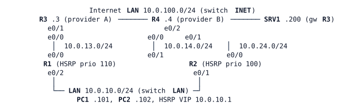

# LAB-026 — Measure, Track, React

Module: 04 Internet Edge and Tracking | Type: F (foundation) | Guidance tier: G2 | Estimated time: 100 min | Blueprint objectives: 4.4:I 3.3.c:R | Licensed nodes: 9 (R1–R4, PC1, PC2, SRV1 and the two unmanaged switches LAN and INET all count)

## Scenario

Veridian's silent provider failure in the previous labs was only noticed by users. The network team now prototypes path monitoring on a bench before the real change: R1 and R2 are the LAN gateway pair, R3 stands for provider A (the primary path) and R4 for provider B (the backup). R1 must measure the provider-A path, and when it degrades, move its default route and the LAN gateway away from it. R3 and R4 are the providers: **read-only, `show` commands only, never configure them**. They are already configured, including IP SLA responders and their own tracked return routes.

## Objectives

- Measure a path with IP SLA operations and read their statistics.
- Turn measurements into object tracks and decide which track type fits which failure.
- Make a static default route and the HSRP gateway role follow the tracks, without flapping.
- Pin a probe so it only tests the path it is meant to test.
- Combine tracks, and test with a cable pull, a silent failure and a node stop.

## Available Information

(R1 e0/0 – R3 e0/0, R1 e0/1 – R4 e0/0, R2 e0/0 – R4 e0/1, R3 e0/1 and R4 e0/2 and SRV1 on INET, R1 e0/2, R2 e0/1, PC1, PC2 on LAN.)

| Device | Interface | Address | Remark |
|---|---|---|---|
| R1 | Loopback0 | 10.255.0.1/32 | |
| R1 | e0/0 (to R3) | 10.0.13.1/24 | |
| R1 | e0/1 (to R4) | 10.0.14.1/24 | |
| R1 | e0/2 (LAN) | 10.0.10.2/24 | HSRP group 10, VIP 10.0.10.1 |
| R2 | Loopback0 | 10.255.0.2/32 | |
| R2 | e0/0 (to R4) | 10.0.24.2/24 | |
| R2 | e0/1 (LAN) | 10.0.10.3/24 | HSRP group 10 |
| R3 | e0/0 / e0/1 | 10.0.13.3/24 / 10.0.100.3/24 | provider A, Lo0 10.255.0.3/32 |
| R4 | e0/0 / e0/1 / e0/2 | 10.0.14.4/24 / 10.0.24.4/24 / 10.0.100.4/24 | provider B, Lo0 10.255.0.4/32 |
| PC1, PC2 | eth0 | 10.0.10.101/24, 10.0.10.102/24 | gateway 10.0.10.1 |
| SRV1 | eth0 | 10.0.100.200/24 | gateway 10.0.100.3 |

Credentials: `admin` / `Cisco123!`, enable secret `Cisco123!`; the router consoles open at privileged level. Hosts: `cisco` / `cisco`.

Provider background: R3 and R4 run `ip sla responder` and return traffic to 10.0.10.0/24 over statics that follow their own IP SLA probes of the customer link addresses (probe every 2 s), with a backup across the Internet LAN. You do not need to change anything on them.

Failure methods used in this lab (never mixed): **cable pull** = `shutdown` on both ends of the link; **silent failure** = stop the CML link (the interfaces stay up/up and traffic is silently dropped); **node stop** = stop the node in CML (save its configuration first with `write memory`; the node disappears without sending an HSRP resign, so its peer only notices when the hold timer expires). **Delay for the measurement tests:** select the link R1 e0/0 – R3 e0/0 in the CML GUI, open link conditioning and set latency to 100 ms (the delay applies per direction, so round trips grow by about 200 ms); remove it afterwards.

Measure outages from a host with a continuous ping (1 per second) and count lost replies.

## Starting State

HSRP group 10 is running with R1 active (priority 110, preempt) and R2 standby (priority 100, preempt), without tracking. R1 has a default route via R3 and a floating default via R4 (distance 5); R2's default is via R4. PC1 and PC2 reach SRV1 through R1 and R3. There is no IP SLA and no tracking on R1 or R2.

## Requirements / Change Requests

R1. R1 measures the reachability of the provider-A path every 5 s, using a target beyond R3 that is reachable only through the R1–R3 link, and records RTT and loss. The target must not be a destination users need.
R2. R1 uses its default route via R3 only while that measurement succeeds; otherwise traffic uses R4. After the path recovers, R1 does not switch back before 30 s of good measurements.
R3. The LAN gateway moves to R2 when R1 loses provider A, and moves back afterwards.
R4. A second measurement from R1 to a responder on R3 records jitter and loss over several packets every 10 s. A third measurement declares the path bad when the round-trip time exceeds 100 ms, even though the path does not fail (use the link conditioning above). Decide which track type (reachability or state) the default route should follow, and which one the bad-path declaration needs.
R5. One object is Down only when both the reachability track and the jitter-measurement track are Down.
R6. Demonstrate the host-route pitfall: pin the probe target by a route to a destination users need (SRV1) and show what users lose during a failure of the R1–R3 path, with the gateway tracking of requirement 3 removed for the demonstration; then move the probe back to its dedicated target and restore the tracking.
R7. The pinning from requirement 1 survives a cable pull: the measurement still goes Down when the R1–R3 link is shut down at both ends.

## Verification Criteria

V1. With the link healthy, R1's measurement 1 shows a successful return code and its track is Up; R1's default route is via R3 and R1 is HSRP active.
V2. After a silent failure of R1–R3, within the measured target below the track goes Down, R1's default is via R4, R2 is HSRP active, and PC1 reaches SRV1 again.
V3. PC1's continuous ping to SRV1 loses no more than 15 replies during the silent failure; the gateway has moved no later than 30 s after the failure.
V4. After the link is restored, the track returns to Up no sooner than 30 s after the first good measurement, and R1 becomes HSRP active again.
V5. With 100 ms of link conditioning on R1–R3 the reachability track on measurement 1 stays Up while the state track on measurement 3 (round-trip time) goes Down; both recover when the conditioning is removed.
V6. After a cable pull of R1–R3, the reachability track goes Down and traffic still flows through R4.
V7. After a node stop of R1, R2 is HSRP active and PC1 reaches SRV1; R3 and R4 return traffic for 10.0.10.0/24 over paths that exist.
V8. Toolkit: `%TRACK-6-STATE` and `%HSRP-5-STATECHANGE` log lines on R1 show the track and gateway transitions in order, with timestamps you can subtract.

## Analysis Questions

Q1. Your reachability track and your round-trip-time track react differently under 100 ms conditioning: which return codes does each track type treat as Down, and which should drive the default route?
Q2. How did you keep the probe on the R1–R3 path, including during a cable pull, and why must its target not be a destination users need?
Q3. How did you implement the 30 s hold-off, and what does it cost?
Q4. From your measurements, how long does it take from a silent failure to the gateway move? Which timers add up to it?
Q5. Why is a combined (boolean) track useful here, and when does it change state compared with its members?
