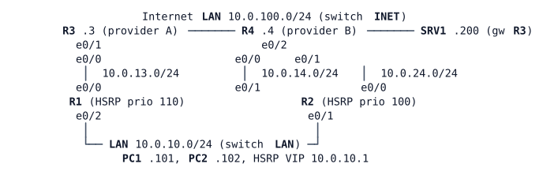

# LAB-027 — Policy-Based Routing

Module: 04 Internet Edge and Tracking | Type: F (foundation) | Guidance tier: G2 | Estimated time: 60 min | Blueprint objectives: 3.2.d:I 4.4:P | Licensed nodes: 9 (R1–R4, PC1, PC2, SRV1 and the two unmanaged switches LAN and INET all count)

## Scenario

Veridian's logistics team asks that its bulk transfers (PC2) use the backup provider (R4) while that path is healthy, and fall back to the primary provider (R3) only if the backup fails. The routing table cannot express "this host, not that one", so the bench tests a policy on the LAN gateway R1. R3 and R4 are the providers: **read-only, `show` commands only, never configure them**. R2 is the standby LAN gateway and needs no change.

## Objectives

- Steer one host's traffic with policy-based routing, leaving every other host on the routing table.
- Make the policy depend on the health of the path it uses.
- Tell apart "use this next hop regardless" from "use it only when the routing table has no route".
- Show which traffic a router policy-routes and which it does not (locally generated traffic, traffic arriving at the standby gateway).

## Available Information

(R1 e0/0 – R3 e0/0, R1 e0/1 – R4 e0/0, R2 e0/0 – R4 e0/1, R3 e0/1 and R4 e0/2 and SRV1 on INET, R1 e0/2, R2 e0/1, PC1, PC2 on LAN.)

| Device | Interface | Address | Remark |
|---|---|---|---|
| R1 | Loopback0 | 10.255.0.1/32 | |
| R1 | e0/0 (to R3) | 10.0.13.1/24 | |
| R1 | e0/1 (to R4) | 10.0.14.1/24 | |
| R1 | e0/2 (LAN) | 10.0.10.2/24 | HSRP group 10, VIP 10.0.10.1 |
| R2 | Loopback0 | 10.255.0.2/32 | |
| R2 | e0/0 (to R4) | 10.0.24.2/24 | |
| R2 | e0/1 (LAN) | 10.0.10.3/24 | HSRP group 10 |
| R3 | e0/0 / e0/1 | 10.0.13.3/24 / 10.0.100.3/24 | provider A, Lo0 10.255.0.3/32 |
| R4 | e0/0 / e0/1 / e0/2 | 10.0.14.4/24 / 10.0.24.4/24 / 10.0.100.4/24 | provider B, Lo0 10.255.0.4/32 |
| PC1, PC2 | eth0 | 10.0.10.101/24, 10.0.10.102/24 | gateway 10.0.10.1 |
| SRV1 | eth0 | 10.0.100.200/24 | gateway 10.0.100.3 |

Credentials: `admin` / `Cisco123!`, enable secret `Cisco123!`; the router consoles open at privileged level. Hosts: `cisco` / `cisco`.

Failure methods used in this lab (never mixed): **cable pull** = `shutdown` on both ends of the link (used for the HSRP failover: R1 e0/0 and R3 e0/0); **silent failure** = stop the CML link (the interfaces stay up/up and traffic is silently dropped; used for R1 e0/1 – R4 e0/0). Restore with `no shutdown` / link start.

Test from the hosts: `traceroute -n 10.0.100.200` on PC1 and PC2 (Alpine busybox) and a continuous `ping`. Pings and probes that R1 itself originates are not policy-routed by default, so a ping from R1 is not a valid test of a policy. Use `Ethernet0/2` (not `Loopback0`) as the source for R1's own tests: the providers have no route to R1's loopback. The return traffic from SRV1 is not policy-routed and may take a different path than the outbound traffic; no NAT is configured, so this still works. Allow about 3 minutes after boot for the tracks and HSRP to settle.

## Starting State

R1 carries LAB-026's SLA 1/track 1/HSRP design only (its SLA 2–4 and track 2/4 are not present); SLA 3 and track 3 here are new and unrelated to LAB-026's RTT probe. IP SLA 1 and track 1 (provider A path) drive the default route via R3 (distance 1, floating default via R4 at distance 5) and the HSRP priority; R1 is HSRP active. R1 also has a prebuilt measurement of the R1–R4 path: IP SLA 3 (icmp-echo to 10.0.100.4, pinned to R4 with a Null0 backup route) and track 3 (reachability, `delay up 20`). Read them; do not change them. (`show ip sla statistics` for SLA 3 may show about 10 failures from probes sent while the network was still starting; they are harmless.) There is no ACL, route-map or policy on any router. R2's default route is via R4.

## Requirements / Change Requests

R1. PC2's traffic to the Internet LAN (10.0.100.0/24) leaves R1 towards R4; PC1's traffic still follows the routing table (via R3). Only PC2 is affected, and the policy is applied to traffic entering R1 from the LAN.
R2. When the R1–R4 path fails, PC2's traffic follows the routing table again within the track timers, and it returns to R4 after the path recovers.
R3. Show the difference between "use R4 even if the routing table has a route" and "use R4 only if the routing table has no route" for PC2's traffic. To make the difference visible, temporarily add a specific (non-default) static route on R1 for the Internet LAN via R3, test both forms, then remove the route. State which form R1 needs and why.
R4. Show that R1's own traffic is not policy-routed unless a local policy is configured: demonstrate with a local policy that moves a traceroute R1 originates, then remove the local policy.

## Verification Criteria

V1. `traceroute -n 10.0.100.200` from PC1 shows hops 10.0.10.2, 10.0.13.3, 10.0.100.200; from PC2 it shows 10.0.10.2, 10.0.14.4, 10.0.100.200.
V2. On R1, the route-map's match counters increase while PC2 sends traffic and do not increase for PC1's traffic; `show ip policy` lists the policy on the LAN interface only.
V3. With a 1-per-second ping from PC2 already running (start it first, then stop the link), after a silent failure of R1 e0/1 – R4 e0/0, track 3 goes Down and PC2's traceroute goes via 10.0.13.3; it loses no more than 10 replies of a 1-per-second ping. After the link is restored, track 3 returns to Up and PC2 goes back via 10.0.14.4.
V4. With the explicit static route present, the two forms of next-hop setting send PC2's traffic by different paths (record both traceroutes).
V5. With a local policy, a traceroute from R1 sourced from Ethernet0/2 goes via 10.0.14.4; after removing it, `show ip local policy` reports it disabled.
V6. After a cable pull of R1 e0/0 and R3 e0/0, R2 is HSRP active and PC1's and PC2's traffic is delivered; R1's policy match counter stops increasing.

## Analysis Questions

Q1. Why does a traceroute from PC2 show the policy path, while a ping from R1 to the same destination does not?
Q2. What happens to PC2's traffic when the R1–R4 path fails and the policy has no health check on the next hop? How did you observe it?
Q3. Where else could Veridian use PBR, and why does the Internet edge E2 later use tracked default routes instead?
Q4. What does PBR do to traffic that arrives at a gateway that does not have the policy (here the HSRP standby side)? Why do PC2's and PC1's traces both end up through R4 after the failover?
Q5. Under which condition does the "default" form of the next-hop setting act on traffic, and what did you observe when only a default route existed in R1's table?
