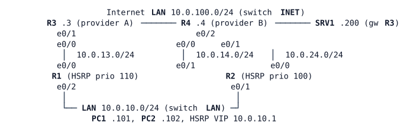

# LAB-028 — EEM: Automating Evidence

Module: 04 Internet Edge and Tracking | Type: F (foundation) | Guidance tier: G3 | Estimated time: 75 min | Blueprint objectives: 6.6:I 4.1:R | Licensed nodes: 9 (R1–R4, PC1, PC2, SRV1 and the two unmanaged switches LAN and INET all count)

## Scenario

When the primary provider failed last month, nobody captured the routing table before it changed, so the post-incident review could not say what had changed or when. The network team prototypes on-box applets (Embedded Event Manager, EEM) on the LAN gateway R1 that collect evidence the moment something happens. R3 and R4 are the providers: **read-only, `show` commands only, never configure them**. R2 is the standby gateway and needs no change.

## Objectives

- Build EEM applets with a track event, a syslog-pattern event and an on-demand (`none`) event.
- Capture time-stamped evidence (route, track, SLA statistics) into a file and log a pointer to it.
- Run a periodic (timer) applet, then remove it cleanly.
- Recognise and repair three common applet pitfalls from the evidence they leave in the EEM history.

## Available Information

(R1 e0/0 – R3 e0/0, R1 e0/1 – R4 e0/0, R2 e0/0 – R4 e0/1, R3 e0/1, R4 e0/2 and SRV1 on INET, R1 e0/2, R2 e0/1, PC1 and PC2 on LAN.)

| Device | Interface | Address |
|---|---|---|
| R1 | Loopback0 / e0/0 (R3) / e0/1 (R4) / e0/2 (LAN) | 10.255.0.1/32 / 10.0.13.1/24 / 10.0.14.1/24 / 10.0.10.2/24 (HSRP group 10, VIP 10.0.10.1) |
| R2 | Loopback0 / e0/0 (R4) / e0/1 (LAN) | 10.255.0.2/32 / 10.0.24.2/24 / 10.0.10.3/24 |
| R3 | Loopback0 / e0/0 (R1) / e0/1 (INET) | 10.255.0.3/32 / 10.0.13.3/24 / 10.0.100.3/24 |
| R4 | Loopback0 / e0/0 (R1) / e0/1 (R2) / e0/2 (INET) | 10.255.0.4/32 / 10.0.14.4/24 / 10.0.24.4/24 / 10.0.100.4/24 |
| PC1, PC2 | eth0 | 10.0.10.101/24, 10.0.10.102/24 (gateway 10.0.10.1) |
| SRV1 | eth0 | 10.0.100.200/24 |

Credentials: console is privileged; SSH `admin` / `Cisco123!`; enable secret `Cisco123!`. Use the **silent-failure method** (CML link stop) for the provider drill: stop the CML link R1 e0/0 – R3 e0/0, because the interface stays up/up and only the probe notices. The scratch file system on the routers is `unix:` (there is no `flash:`).

## Starting State

R1 carries the LAB-026 design (R1 only, SLA 1/track 1; SLA 2–4 are absent): IP SLA 1 (ICMP echo to 10.0.100.3 every 5 s), track 1 on its reachability (`delay up 30`), a pinned host route for the probe target, the tracked primary default route via R3 with a floating default via R4, and HSRP group 10 (priority 110, preempt) that decrements when track 1 goes down. R2–R4 and the PCs are unchanged. `logging buffered 64000` and log timestamps are configured. No EEM applets exist.

## Requirements / Change Requests

R1. R1: when track 1 goes down, an applet writes a time-stamped evidence file containing the default route, the state of track 1 and the SLA 1 statistics, and logs one line that names the file.
R2. R1: a second applet produces the same evidence when triggered by the syslog message announcing the track state change instead of the track event. The pattern must match the real message exactly.
R3. R1: a periodic applet logs the SLA 1 round-trip time every 60 s for 5 minutes; afterwards it is removed and logging stops.
R4. R1: evidence can be collected on demand, with no failure, by running a third applet by name.
R5. Reproduce each of three pitfalls (an applet whose commands silently produce nothing, an applet whose pattern never matches, an applet that triggers itself), record what `show event manager history events` and the log show for each, and repair them.

## Verification Criteria

V1. After a silent failure of the R1–R3 link, the evidence file(s) exist and show a clock time, the default route, track 1 and the SLA statistics.
V2. Exactly one log line per applet names its evidence file, and the history shows one run per applet for the failure.
V3. After the link is restored there is no second capture.
V4. The watchdog logs one RTT line about every 60 s and, once removed, no more.
V5. The on-demand applet creates its own evidence file when run.
V6. For each pitfall you can state, from the history and the log, how it shows (or fails to show) itself, and the repaired applet behaves as intended.

## Analysis Questions

Q1. A track event and a syslog pattern can both trigger the evidence capture. Which is more robust, and why?
Q2. For the applet whose commands produced nothing, what was missing and how did the history or the file show it?
Q3. What must an evidence applet capture so that the person investigating tomorrow can answer "what changed and when"? Compare what the route showed when your applet ran with the moment the failure was detected.
Q4. Why is EEM treated in this course as a router-side tool, and what are its limits when the gateway itself fails?
