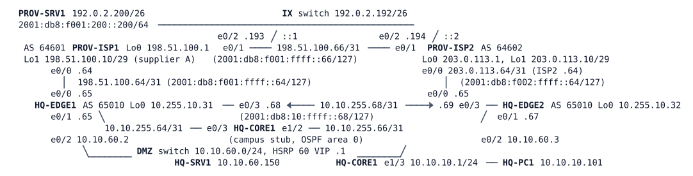

# LAB-029 — Edge Failover

Module: 04 Internet Edge and Tracking | Type: I/N (implementation/integration) | Guidance tier: G2 | Estimated time: 190 min | Nodes: 10 (8 devices + 2 unmanaged switches) | Blueprint objectives: 4.4:P 3.3.c:R 6.6:P | AI-change review

## Scenario

The failover change prototyped on the bench goes live on Veridian's dual-ISP edge. Today a silent failure of ISP-A (the link stays up but the provider stops forwarding) black-holes Veridian's default-routed Internet traffic, because the static default on HQ-EDGE1 never goes away. The board wants either provider's failure detected within seconds, the Internet default and the DMZ gateway moved to the edge whose provider is healthy, and evidence of every ISP-A failure captured automatically for the provider dispute. A colleague asked an AI assistant for the evidence applet. You are the reviewer: test it live before it goes in. HQ-EDGE1 and HQ-EDGE2 are the devices you configure; HQ-CORE1 is the campus stub and needs no change. PROV-ISP1 and PROV-ISP2 belong to the providers: read-only looking glasses (`show`, `ping`, `traceroute`), with one exception: for the cable-pull test (R7) you may `shutdown` and re-enable PROV-ISP1 e0/0 and PROV-ISP2 e0/0 and nothing else on a provider. PROV-SRV1 is a web server on the Internet side.

## Objectives

- Detect a provider that stops forwarding, whether or not its link is down, and act on it automatically and quickly.
- Move the campus default route and the DMZ gateway to the healthy edge, and return them only when the provider has been stable again.
- Keep the measurements themselves from taking over any destination users need.
- Capture evidence of every ISP-A failure on the router without anyone logged in.
- Review an AI-written automation change with live evidence and decide: approve, amend or reject.
- Measure the end-to-end failover and recovery times and explain which timers decide them.

## Available Information



HQ-CORE1 stands for the whole campus (it originates 10.10.10.0/24, 10.10.20.0/24 and 10.10.50.0/24; its user LAN plays a distribution-switch role). The IX switch is the Internet exchange LAN. Consoles open in privileged mode.

| Device | Interface | IPv4 | IPv6 |
|---|---|---|---|
| HQ-EDGE1 | Lo0 | 10.255.10.31/32 | 2001:db8:ffff:10::31/128 |
| HQ-EDGE1 | e0/0 (ISP-A) | 198.51.100.65/31 | 2001:db8:f001:ffff::65/127 |
| HQ-EDGE1 | e0/1 (core) | 10.10.255.65/31 | 2001:db8:10:ffff::65/127 |
| HQ-EDGE1 | e0/2 (DMZ) | 10.10.60.2/24 (HSRP 60 VIP .1) | 2001:db8:10:60::2/64 |
| HQ-EDGE1 | e0/3 (EDGE2) | 10.10.255.68/31 | 2001:db8:10:ffff::68/127 |
| HQ-EDGE2 | Lo0 | 10.255.10.32/32 | 2001:db8:ffff:10::32/128 |
| HQ-EDGE2 | e0/0 (ISP-B) | 203.0.113.65/31 | 2001:db8:f002:ffff::65/127 |
| HQ-EDGE2 | e0/1 (core) | 10.10.255.67/31 | 2001:db8:10:ffff::67/127 |
| HQ-EDGE2 | e0/2 (DMZ) | 10.10.60.3/24 | 2001:db8:10:60::3/64 |
| HQ-EDGE2 | e0/3 (EDGE1) | 10.10.255.69/31 | 2001:db8:10:ffff::69/127 |

Hosts: HQ-PC1 10.10.10.101/24 gw 10.10.10.1; HQ-SRV1 10.10.60.150/24 gw 10.10.60.1 (HSRP VIP; public address 192.0.2.130); PROV-SRV1 192.0.2.200/26 gw 192.0.2.193. Credentials: hosts `cisco` / `cisco`; devices `admin` / `Cisco123!`. Host `tcpdump` needs root and is not available; hosts `ping` once per second. ISP-A (AS 64601) peers from 198.51.100.64, ISP-B (AS 64602) from 203.0.113.64, with default BGP timers (keepalive 60 s, hold 180 s). Each provider has a loopback, 198.51.100.1 (ISP-A) and 203.0.113.1 (ISP-B), that answers ICMP and is a reasonable probe target. Both providers' own networks (ISP-A's 198.51.100.0/25 and 198.51.100.8/29, ISP-B's 203.0.113.0/25 and 203.0.113.8/29) arrive on the edges by BGP.

**Failure methods used in this lab (never mixed).**
- **Cable pull:** `shutdown` on both ends of the link (HQ-EDGE1 e0/0 with PROV-ISP1 e0/0, or HQ-EDGE2 e0/0 with PROV-ISP2 e0/0). Both ends go down. `shutdown` on only one end leaves the other end up/up and is a different, one-ended case.
- **Silent failure:** `link stop` in CML on the same link. Both interfaces stay up/up and the link silently drops traffic. Never stop a link as a "cable pull".
- Stopping a node is a silent failure for its neighbours.

**The AI assistant's proposal** (for the review in R5; not configured anywhere yet). The assistant was asked: "On HQ-EDGE1, when ISP-A fails, save the time, the default route, the track state, the SLA statistics and the BGP summary to a file on the router and log a line, and move the DMZ server's gateway to HQ-EDGE2 while ISP-A is down." It answered:

```
event manager applet ISPA-EVIDENCE
 event syslog pattern "%BGP-5-ADJCHANGE: neighbor 198.51.100.64 Down"
 action 0.1 cli command "enable"
 action 1.0 cli command "show clock | append unix:ispa-evidence.txt"
 action 2.0 cli command "show ip route 0.0.0.0 | append unix:ispa-evidence.txt"
 action 3.0 cli command "show track | append unix:ispa-evidence.txt"
 action 4.0 cli command "show ip sla statistics | append unix:ispa-evidence.txt"
 action 5.0 cli command "show ip bgp summary | append unix:ispa-evidence.txt"
 action 6.0 cli command "configure terminal"
 action 6.1 cli command "interface Ethernet0/2"
 action 6.2 cli command "standby 60 priority 90"
 action 6.3 cli command "end"
 action 7.0 syslog msg "ISP-A evidence captured, DMZ gateway moved to HQ-EDGE2"
```

`unix:` is the router's local file area: `more unix:ispa-evidence.txt` shows the file and `delete /force unix:ispa-evidence.txt` removes it. The file keeps growing across runs (every capture is appended), so delete or rename it between tests, or compare the time stamps. The track and SLA names you are expected to use are SLA 10 and track 10 for ISP-A, SLA 20 and track 20 for ISP-B.

## Starting State

The edge is the dual-ISP environment of LAB-025 as solved (environment stage EDGE E1): IPv4 and IPv6 BGP with both providers, the iBGP between the edges, the per-provider announcements and the 025 outbound policy. HQ-EDGE1 has an untracked static default to ISP-A that it originates into OSPF (metric 10); HQ-EDGE2 has an untracked static default to ISP-B originated at metric 30; HSRP 60 gives HQ-EDGE1 priority 110 and HQ-EDGE2 priority 100, both with preemption. There is no IP SLA, no tracking and no EEM applet. PROV-ISP1 and PROV-ISP2 are complete. Allow about three minutes after boot for BGP and OSPF to settle.

## Requirements / Change Requests

R1: When ISP-A stops forwarding, whether the link goes down or stays up, default-routed IPv4 Internet traffic from the campus (HQ-PC1 to PROV-SRV1, and anything without a BGP route) must move to ISP-B within 20 seconds of the failure, and return to ISP-A no earlier than 30 seconds after ISP-A is healthy again. Do the same for ISP-B on HQ-EDGE2: when ISP-B stops forwarding, HQ-EDGE2 must stop originating its default into OSPF. Destinations learned by BGP from the failed provider follow BGP; that is expected.
R2: The DMZ server's gateway (HSRP 60) must sit on the edge router whose provider is healthy, preferring HQ-EDGE1, and HQ-EDGE1 must take it back after ISP-A has been healthy again.
R3: The measurements must not take over any destination users need: the probe traffic must always use the provider's own link and must not be able to leave through the other edge, even during a cable pull.
R4: Every ISP-A failure, cable pull and silent failure alike, must produce an evidence file on HQ-EDGE1 with the time, the default route, the track state, the SLA statistics and the BGP summary, plus one log line saying so, without anyone logged in. The file must be written within 30 seconds of the failure, so that it shows the state at the moment the edge reacted.
R5: Test the assistant's proposal as written on HQ-EDGE1 against every requirement it is meant to meet. Decide approve, amend or reject with evidence from the router (command output, log lines, the file and its timestamps). Deploy a version that meets R2 and R4.
R6: The 025 outbound policy is unchanged in steady state: re-run its traceroutes from HQ-PC1 to PROV-SRV1, 203.0.113.10 and 198.51.100.10.
R7: Test and time both failure methods on both provider links, and a node stop of HQ-EDGE1 (save its configuration first). Cable pull on the ISP-A and ISP-B links (provider side `shutdown` allowed as stated above), silent failure on the same links, restore, and record for each case the time to detect the failure, the time until HQ-PC1 recovers, the pings lost, where the DMZ gateway and the default route sit, and when the original path returns. A restored link needs roughly three minutes before its BGP session and the DMZ server are fully back; that is normal.

## Verification Criteria

V1: In steady state both providers' BGP sessions are up, the probes are up, HQ-CORE1's default route comes from HQ-EDGE1, HQ-EDGE1 is the DMZ HSRP active router and R6 holds.
V2: During a silent failure of the ISP-A link, HQ-PC1's pings to PROV-SRV1 resume through ISP-B within 20 seconds of the failure (count the lost pings), HQ-CORE1's default route comes from HQ-EDGE2 and HQ-EDGE2 is the DMZ gateway.
V3: After the ISP-A link is restored, HQ-PC1's traffic stays on ISP-B for at least 30 seconds of probe health, then returns to ISP-A with no lost pings, and HQ-EDGE1 is the DMZ gateway again.
V4: During a cable pull of the ISP-A link the failover happens as in V2, HQ-EDGE1's probe reports Down while HQ-EDGE2's probe (which targets ISP-B) stays Up, and on HQ-EDGE1 the probe target is not reachable through HQ-EDGE2 or the other provider.
V5: A silent failure of the ISP-B link does not disturb default-routed traffic, and HQ-EDGE2 stops originating its default.
V6: For each ISP-A failure the evidence file on HQ-EDGE1 holds a new set of the five items, time-stamped within 30 seconds of the failure, and the log shows exactly one capture line.
V7: Your verdict on the assistant's proposal is backed by live evidence from running it as written, and the deployed version meets R2 and R4.
V8: The R7 measurements are recorded for every case, including the destinations that follow BGP (ISP-A's own networks and the inbound path to the DMZ server from PROV-SRV1).

## Analysis Questions

Q1: From the silent failure to HQ-PC1's recovery, list the times you measured (failure, probe down, default withdrawn, traffic restored). Which timer dominates, and which parameters could you change to shorten it?
Q2: Why does inbound traffic to the DMZ server recover later than outbound traffic during a silent ISP-A failure, and what, outside Veridian's control, decides when?
Q3: Why does the IPv6 Internet not fail over on a silent failure, and what would fix it?
Q4: Why must the OSPF default that HQ-EDGE1 originates depend on its tracked route?
Q5: What is your verdict on the assistant's applet, and what evidence from your tests supports it?
Q6: During a silent ISP-A failure, why do ISP-A's own networks stay unreachable for up to three minutes even after the default route has moved, and which options (none on the provider side) would shorten it?
