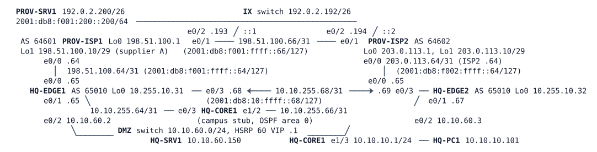

# LAB-030 — The Internet Is Half Down

Module: 04 Internet Edge and Tracking | Type: T (troubleshooting) | Guidance tier: G2 | Estimated time: 120 min | Nodes: 10 (8 devices + 2 unmanaged switches) | Blueprint domains: 3, 4

## Scenario

Monday after Veridian's maintenance weekend. The change ticket reads "edge configuration clean-up" and records no details. The service desk and the network operations centre have each opened a ticket (see Reported Problems). HQ-EDGE1 and HQ-EDGE2 are the devices you may change; HQ-CORE1 is the campus stub and is not part of the change. PROV-ISP1 and PROV-ISP2 belong to the providers: read-only looking glasses (`show`, `ping`, `traceroute`), nothing else. PROV-SRV1 is a web server on the Internet side. Work out what the clean-up changed, restore the documented design, and prove it.

## Objectives

- Close the tickets with before/after evidence a reviewer can repeat.
- Reproduce each ticket from a user's point of view and from outside Veridian.
- Restore the documented edge design without bending it to make a ticket go away.
- Write the post-change checks that would have caught each problem.

## Available Information

HQ-CORE1 stands for the whole campus (it originates 10.10.10.0/24, 10.10.20.0/24 and 10.10.50.0/24; its user LAN plays a distribution-switch role). The IX switch is the Internet exchange LAN. Consoles open in privileged mode.

| Device | Interface | IPv4 | IPv6 |
|---|---|---|---|
| HQ-EDGE1 | Lo0 | 10.255.10.31/32 | 2001:db8:ffff:10::31/128 |
| HQ-EDGE1 | e0/0 (ISP-A) | 198.51.100.65/31 | 2001:db8:f001:ffff::65/127 |
| HQ-EDGE1 | e0/1 (core) | 10.10.255.65/31 | 2001:db8:10:ffff::65/127 |
| HQ-EDGE1 | e0/2 (DMZ) | 10.10.60.2/24 (HSRP 60 VIP .1) | 2001:db8:10:60::2/64 |
| HQ-EDGE1 | e0/3 (EDGE2) | 10.10.255.68/31 | 2001:db8:10:ffff::68/127 |
| HQ-EDGE2 | Lo0 | 10.255.10.32/32 | 2001:db8:ffff:10::32/128 |
| HQ-EDGE2 | e0/0 (ISP-B) | 203.0.113.65/31 | 2001:db8:f002:ffff::65/127 |
| HQ-EDGE2 | e0/1 (core) | 10.10.255.67/31 | 2001:db8:10:ffff::67/127 |
| HQ-EDGE2 | e0/2 (DMZ) | 10.10.60.3/24 | 2001:db8:10:60::3/64 |
| HQ-EDGE2 | e0/3 (EDGE1) | 10.10.255.69/31 | 2001:db8:10:ffff::69/127 |

Hosts: HQ-PC1 10.10.10.101/24 gw 10.10.10.1; HQ-SRV1 10.10.60.150/24 gw 10.10.60.1 (HSRP VIP; public address 192.0.2.130); PROV-SRV1 192.0.2.200/26 gw 192.0.2.193. Credentials: hosts `cisco` / `cisco`; devices `admin` / `Cisco123!`. Host `tcpdump` needs root and is not available; hosts `ping` once per second. ISP-A (AS 64601) peers from 198.51.100.64, ISP-B (AS 64602) from 203.0.113.64, with default BGP timers (keepalive 60 s, hold 180 s). Each provider has a loopback, 198.51.100.1 (ISP-A) and 203.0.113.1 (ISP-B), that answers ICMP and is a reasonable probe target. Both providers' own networks (ISP-A's 198.51.100.0/25 and 198.51.100.8/29, ISP-B's 203.0.113.0/25 and 203.0.113.8/29) arrive on the edges by BGP.

**Documented design (policy).**
- ISP-A (AS 64601) is the primary provider. ISP-B (AS 64602) carries ISP-B's own networks and the supplier network 198.51.100.8/29 (supplier A's portal, 198.51.100.10), which both providers can reach; Veridian sends that traffic out through ISP-B, not ISP-A.
- Address pools: 192.0.2.0/26 (translation address 192.0.2.1) is announced to ISP-A only; 192.0.2.64/26 (translation address 192.0.2.65) is announced to ISP-B only, exactly as a /26; 192.0.2.128/26 is the DMZ block, announced to both, with ISP-A preferred inbound (ISP-B sees it prepended three times). Translated user traffic uses the pool of the provider it leaves through. The DMZ server is published as 192.0.2.130.
- Veridian is not a transit network: it announces only its own prefixes and never re-announces one provider's routes to the other.
- A silent failure of a provider (the link stays up but forwards nothing) must be detected on the edge within 20 seconds; the campus default route and the DMZ gateway (HSRP 60) then follow the healthy provider, and HQ-EDGE1 takes them back only after ISP-A has been stable for 30 seconds. Every ISP-A failure writes evidence (a file on HQ-EDGE1 and one log line) without anyone logged in, and only an ISP-A failure does.
- Each edge router's failover measurement depends only on its own provider link (the principle recorded in the LAB-029 change record).
- IPv4 and IPv6 both work for every destination in the design.

**Failure methods used in this lab (never mixed).**
- **Silent failure:** `link stop` in CML on the HQ-EDGE1 e0/0 - PROV-ISP1 e0/0 link (ISP-A) or the HQ-EDGE2 e0/0 - PROV-ISP2 e0/0 link (ISP-B), restored with `link start`. Both interfaces stay up/up and the link silently drops traffic. Never stop a link to imitate a cable pull.
- **Cable pull:** `shutdown` on both ends of the link. `shutdown` on one end only is a different, one-ended case. Neither is used in this lab's checks.
- Stopping a node is a silent failure for its neighbours. IOS changes are lost on a node stop/start unless saved: `copy running-config startup-config` first.

Hosts `ping` once per second; `tcpdump` is not available, and a bounded `debug ip packet` shows little on this platform because transit traffic is CEF-switched. Allow about three minutes after boot for BGP, OSPF and the probes to settle. A restored provider link needs roughly three minutes before its BGP session is fully back; that is normal.

## Starting State

The dual-ISP edge is as documented above and has been in service for weeks, except for what the weekend clean-up changed. Both providers' BGP sessions are established, HQ-CORE1 learns its default route from HQ-EDGE1 and the DMZ gateway is active on HQ-EDGE1. PROV-ISP1 and PROV-ISP2 are complete and unchanged. The DMZ web server is working.

## Requirements / Change Requests

R1: Restore both tickets' services: every user reaches every Internet destination in the documented design, along the documented exit, in IPv4 and IPv6, and the public web server stays reachable from the Internet.
R2: Reproduce the NOC ticket's incident with a silent failure of the backup provider link, find what the clean-up changed, and restore the documented behaviour. Then repeat the drill for each provider and confirm failover of the default-routed traffic and the DMZ gateway, evidence capture where the design says so, and a return to steady state after each link is restored.
R3: Change only what is needed. Do not change the provider routers, and do not relax any property of the documented design (prefixes, lengths, exits, no transit, translation ranges, the measurement rule) to make a ticket go away.
R4: For each ticket, collect one piece of evidence from your own toolkit (a log line, a sourced ping or traceroute, a counter or table) before and after the fix, and one piece of evidence from outside your own routers.
R5: Save the final configuration of both edges.
R6: Write a post-change checklist of the tests that would have caught each problem during the maintenance window.

## Reported Problems

T1 (service desk): "Since this morning nobody can open the two supplier portals (198.51.100.10 and 203.0.113.10). A few other external sites fail too, but most of the Internet works, and the public web server is fine."

T2 (NOC, about last Thursday): "ISP-B, our backup provider, had a fault inside their network for 40 minutes; ISP-A reports no fault at all on their side. During those 40 minutes the whole office had no Internet over IPv4 and the public web server was unreachable from outside, while our IPv6 checks stayed green. The automatic evidence capture for an ISP-A failure ran and wrote its file." Reproduce the incident with a silent failure of the backup provider link (see Available Information), then restore the link.

## Verification Criteria

V1: Every user reaches every Internet destination in the documented design, along the documented exit, in IPv4 and IPv6, and the public web server is reachable from the Internet (HQ-PC1 to the supplier portals, provider loopbacks and PROV-SRV1; PROV-SRV1 to 192.0.2.130).
V2: After a silent failure of either provider link, default-routed Internet traffic recovers within the documented time, the DMZ gateway follows the healthy provider, evidence is captured where the design says so (and only there), and BGP-routed destinations behave as documented. Restoring the link returns the documented steady state.
V3: Every property of the documented design (announced prefixes and their lengths, exit per destination, no transit, translation ranges per provider, each failover measurement depending only on its own provider link) is shown with a live test, in both directions where it applies.
V4: For each ticket you have one piece of toolkit evidence from before and after the fix (state your evidence).
V5: The startup configuration of both edges holds your changes (state your evidence).

## Analysis Questions

Q1: For each ticket, what was the first piece of evidence that showed the obvious explanation was wrong?
Q2: After each change you made, what was different in the symptom and what was not, and how did you prove you were not chasing the wrong cause?
Q3: Which evidence from outside your own routers did you use, and what could it show that your routers could not?
Q4: Which of your tests succeeded while users still failed, and why did it mislead you (or not)?
Q5: Which test would have caught each problem during the maintenance window? Write them as a post-change checklist.
Q6: For each automatic reaction in the design, which links and devices does its input really depend on, and how did you prove it rather than read it from the configuration?
