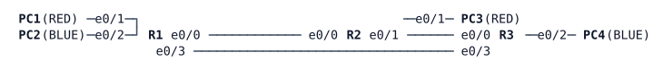

# LAB-031 — VRF-lite fundamentals

**Module:** 05 Management and segmentation · **Type:** F (Foundation) · **Guidance tier:** G3 (guided) · **Estimated time:** 90 min · **Blueprint objectives:** 2.2.a:I (virtualization: VRF-lite, path virtualization)

## Scenario
Veridian will soon carry its management traffic in its own routing table, and Aster Warehousing's networks overlap with Veridian's. Before touching HQ, the network team proves on a bench that two tenants with identical addresses can share three routers and their links without ever seeing each other. The tenants are called RED and BLUE. Both use 10.0.1.0/24 at the west site and 10.0.3.0/24 at the east site.

## Objectives
- Build two VRFs on three routers and carry both tenants over the same physical links with 802.1Q subinterfaces.
- Route RED with a per-VRF OSPF process and BLUE with static and floating static routes.
- Prove isolation and address overlap, and use the VRF-aware verification tools.
- Measure what a cable pull and a silent failure do to each tenant.

## Available Information

R1 and R3 are joined directly by e0/3 (the backup path for R1-R3 traffic); R1-R2 and R2-R3 are the primary path.

| Link | A side | B side | Global /31 (already configured) |
|---|---|---|---|
| R1-R2 | R1 e0/0 | R2 e0/0 | 10.0.12.0 / .1 |
| R2-R3 | R2 e0/1 | R3 e0/0 | 10.0.23.0 / .1 |
| R1-R3 | R1 e0/3 | R3 e0/3 | 10.0.13.0 / .1 |

Tenant transit addressing to configure (/31 per link and VRF, A side gets the even address):

| Link | RED (dot1q 10) | BLUE (dot1q 20) |
|---|---|---|
| R1-R2 | 10.0.112.0 / .1 | 10.0.212.0 / .1 |
| R2-R3 | 10.0.123.0 / .1 | 10.0.223.0 / .1 |
| R1-R3 | 10.0.113.0 / .1 | 10.0.213.0 / .1 |

| Site | RED LAN | BLUE LAN | Router ports | Hosts |
|---|---|---|---|---|
| West | 10.0.1.0/24 (R1 e0/1, .1) | 10.0.1.0/24 (R1 e0/2, .1) | R1 | PC1 (RED), PC2 (BLUE): 10.0.1.10 |
| East | 10.0.3.0/24 (R3 e0/1, .1) | 10.0.3.0/24 (R3 e0/2, .1) | R3 | PC3 (RED), PC4 (BLUE): 10.0.3.10 |

Loopbacks (global table): R1 10.255.0.1, R2 10.255.0.2, R3 10.255.0.3. Credentials on every router: `admin` / `Cisco123!`, enable secret `Cisco123!`; consoles are already privileged. SSH is enabled on the vty lines.

## Starting State
- All three routers run global OSPF process 1 (area 0) over the three links; the adjacencies are FULL. This is background and stays untouched.
- No VRFs and no subinterfaces exist. The router LAN ports (R1 e0/1, e0/2; R3 e0/1, e0/2) are up but have no address.
- Hosts are addressed with their gateway at .1 and cannot reach each other.

## Requirements / Change Requests
R1. Create VRFs RED and BLUE on all three routers. On each router link, add dot1q 10 (RED) and dot1q 20 (BLUE) subinterfaces on the existing physical port, keeping the global addressing on the main interface. Place the LAN ports in their VRF with the addresses from the tables.
R2. RED runs a per-VRF OSPF process (area 0) on all three links and both LANs; the R1-R3 link is the backup path (cost 100 on it). BLUE uses static routes over the primary path (R1-R2-R3) plus floating statics (administrative distance 200) over the R1-R3 link.
R3. Prove isolation and overlap: PC1 reaches PC3 and PC2 reaches PC4 (and the reverse); PC1 never reaches PC2 or PC4 although they share addresses; the global routing table holds no tenant route.
R4. From the routers, using only VRF-aware tools: ping and traceroute each tenant's east PC from R2, show each VRF's CEF entry for 10.0.3.10 on R2, show each VRF's ARP entry for the east PC on R3, and open an SSH session from R2 to R3 inside RED (log in as `admin`; do this by hand on the console).
R5. Failure tests. Run a continuous ping from all four PCs (`ping -i 0.2`), and for each test measure both tenants' outage in both directions, then restore: (a) a cable pull of R1-R2; (b) a silent failure of R1-R2.

## Verification Criteria
V1. Every router lists a FULL OSPF neighbour on each link in the global process and, for RED, in the per-VRF process.
V2. `show ip route vrf RED` on R1 holds an OSPF route to 10.0.3.0/24; `show ip route vrf BLUE` holds only connected, local and static routes.
V3. PC1-PC3 and PC2-PC4 pings succeed in both directions.
V4. A global `show ip route` on every router contains neither 10.0.1.0/24 nor 10.0.3.0/24.
V5. On R3, the ARP table of each VRF shows the MAC of the PC in that VRF only, and a ping from PC1 to 10.0.3.10 is answered by PC3, never PC4.
V6. R2 reaches 10.0.3.10 with `ping` and `traceroute` in each VRF, and the SSH session to R3 inside RED reaches the login prompt and logs in.
V7. For each failure test you have recorded, per tenant and direction, the outage in seconds and which route changed on R1, R2 and R3.

## Analysis Questions
Q1. Why did assigning a VRF to an interface that already had an address remove the address, and in which order must you therefore configure the interface?
Q2. How does R2 keep RED's and BLUE's identical packets apart on one physical link? Follow one frame from the tag to the routing table.
Q3. Why does `ping 10.0.3.10` (without a VRF) fail on R1 although both east PCs answer? Why does a BLUE ping from R1 need an explicit source while the RED ping does not?
Q4. Did BLUE's floating statics keep BLUE working in each failure test? Trace one request and its reply, and name two ways to fix what you found with skills you already have.
Q5. What would adding a fourth site cost in VRF-lite, and which technology removes the hop-by-hop configuration?

## Notes for failure tests
- Cable pull = `shutdown` on both ends of the link (a CML link stop does not bring an IOL interface down). A silent failure = stopping the CML link; neighbours must notice by their timers.
- The first console call after boot can take several seconds on a busy server.
