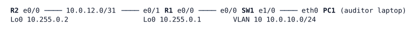

# LAB-032 — An audit finding: device access

**Module:** 05 Management and segmentation · **Type:** I (Implementation) · **Guidance tier:** G2 (requirements) · **Estimated time:** 75 min · **Blueprint objectives:** 5.1.a:P (device access control and security)

## Scenario
Last quarter an external auditor tested the device access of Veridian's branch bench (R1, R2, SW1) and wrote up eight findings, A1 to A8. The auditor worked from a laptop on the bench VLAN (PC1) with `nmap` and `ssh`, and from a review of the saved configurations. You close every finding and leave the auditor a re-test for each, so the bench passes the follow-up audit. Restricting management to a management subnet is a separate project (ACL-1) and is out of scope.

## Objectives
- Read an audit report and turn each finding into a configuration change and a re-test.
- Store every secret in a non-recoverable form and keep the local account working.
- Allow only SSH version 2 with a strong host key and strong ciphers, on every VTY line alike.
- Limit idle sessions and password guessing, and prove it from the auditor's laptop.

## Available Information

| Device | Interface | Address | Peer |
|---|---|---|---|
| R1 | Ethernet0/0 | 10.0.10.1/24 | SW1 Ethernet0/0 |
| R1 | Ethernet0/1 | 10.0.12.0/31 | R2 Ethernet0/0 |
| R1 | Loopback0 | 10.255.0.1/32 | |
| R2 | Ethernet0/0 | 10.0.12.1/31 | R1 Ethernet0/1 |
| R2 | Loopback0 | 10.255.0.2/32 | |
| SW1 | Vlan10 | 10.0.10.2/24 (gateway 10.0.10.1) | PC1 on Ethernet1/0 |
| PC1 | eth0 | 10.0.10.100/24 (gateway 10.0.10.1) | SW1 Ethernet1/0 |

Credentials: local account `admin` / `Cisco123!` (privilege 15, the break-glass account) on all three devices. The consoles open in privileged mode on purpose (the lab console exemption): the lab tools log in through them. The auditor accepted this exception and it stays. PC1 offers `nmap`, `ssh`, `nc`, `python3` and `perl`. VTY lines on these platforms are `0 4` only.

**Audit report (summary)**

| ID | Device | Finding as written by the auditor |
|---|---|---|
| A1 | R1, SW1 | Telnet (TCP 23) is open on the management address. |
| A2 | R1, R2 | Passwords are recoverable from the configuration (config review). |
| A3 | R1 | The SSH host key is the minimum 2048 bits (policy: 3072 or more) and the SSH version is not pinned in the configuration. |
| A4 | R1 | SSH offers CBC ciphers (`ssh -c aes128-cbc` connects). |
| A5 | SW1 | A shared line password is used instead of personal accounts. |
| A6 | R1, R2, SW1 | R2 never times out idle sessions (`exec-timeout 0 0`); R1 and SW1 use the IOS default (10 minutes), longer than the 5-minute policy (config review). |
| A7 | R1, SW1 | Web management (the HTTP and HTTPS servers) is enabled (config review). |
| A8 | all | No protection against password guessing. |

## Starting State
- Addressing and reachability are in place: PC1 reaches R1, R2 and SW1.
- SSH with `admin` works on all three devices. Telnet to R1 and SW1 works with the shared password `cisco`.
- R2 and SW1 are otherwise configured as the report describes. Nothing here needs a network change.
- The VTY lines of R1 and SW1 are split in two groups; R2 has one group.
- Checks run from the router console (a CML console, not the lab automation) show the running timeouts. Automation tools reset `exec-timeout` on VTY 0 4 when they connect, so read it on the CML console.

## Requirements / Change Requests
R1. Close every finding A1 to A8 on every device it names; each finding's re-test (R5) must pass from PC1 afterwards.
R2. No secret on any device is stored in a recoverable form: no plain-text or type 7 passwords, no `enable password`, and the local account `admin` keeps working with the same password. Use the strongest hash type the device accepts.
R3. Every VTY line of a device behaves the same way: the same login method (personal local accounts), transport (SSH only) and idle timeout (5 minutes).
R4. After three failed logins within 30 seconds a device refuses all logins for 60 seconds and logs both events, without touching the console.
R5. Write the re-test for each finding A1 to A8: one command or scan from PC1 (or the device) and the result that shows the finding closed. Keep the table as your change record.
R6. Save the configuration of all three devices.

## Verification Criteria
V1. `nmap -p 22,23,80,443` from PC1 shows only port 22 open on R1, R2 and SW1.
V2. `ssh -c aes128-cbc` to R1 is refused by cipher negotiation, a normal `ssh admin@` login to R1, R2 and SW1 still reaches privilege 15, and the RSA host key R1 presents (as `ssh-keyscan -t rsa` shows) is at least 3072 bits, with SSH version 2 only.
V3. No `enable password`, `password 0` or `password 7` line exists on any device, and every secret uses a non-reversible type. (Optional: show from PC1 that a type 7 string decodes in one line.)
V4. The VTY lines of each device show one consistent set of login, transport and timeout settings.
V5. Three failed SSH logins from PC1 within 30 seconds produce a quiet-mode log line on the device; the console still works while logins are refused; logins work again after the block period.
V6. On every device the HTTP and HTTPS servers are disabled.
V7. Your change record lists a re-test and a closed result for each of A1 to A8 and mentions the accepted console exception.

## Analysis Questions
Q1. Why does `service password-encryption` not close A2 on R2?
Q2. Why is replacing the RSA host key disruptive to existing SSH users, and how would you announce it?
Q3. Which findings can a scan from PC1 not reveal on this bench, and how did the auditor find them?
Q4. What does the console exemption cost in a real network, and what would replace it?
Q5. Why is quiet mode dangerous without an exception for the management station, and which later change addresses that?
