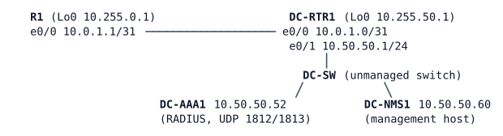

# LAB-033 — Central AAA with a safe fallback

**Module:** 05 Management and segmentation · **Type:** F (Foundation) · **Guidance tier:** G3 (named technologies) · **Estimated time:** 90 min · **Blueprint objectives:** 5.1.b:I (AAA with RADIUS and TACACS+)

## Scenario
Veridian is moving from shared local accounts to personal accounts held on the data-centre RADIUS server. The branch router R1 and the DC router DC-RTR1 are the pilot. The security officer's condition: "no one can lock us out, and the emergency account must work when the server is down". You will enable AAA on both routers without losing access at any point, prove what happens when the server is dead and when it is alive but says no, and check that the routers would also accept a TACACS+ configuration.

## Objectives
- Enable `aaa new-model` without locking yourself out of the console or the VTY lines.
- Use named method lists, a RADIUS server group with a fixed source interface, and local fallback.
- Authorize the privilege level from the server and record every VTY session start and stop.
- Tune how quickly the router declares a RADIUS server dead and when it tries it again.
- Tell a RADIUS reject (no fallback) from a RADIUS failure (fallback), and prove both.
- Compare RADIUS and TACACS+ and write a TACACS+ method list the router accepts.

## Available Information

| Device | Interface | Address |
|---|---|---|
| R1 | e0/0 / Lo0 | 10.0.1.1/31 / 10.255.0.1/32 |
| DC-RTR1 | e0/0 / e0/1 / Lo0 | 10.0.1.0/31 / 10.50.50.1/24 / 10.255.50.1/32 |
| DC-AAA1 | eth0 | 10.50.50.52/24, gateway 10.50.50.1 |
| DC-NMS1 | eth0 | 10.50.50.60/24, gateway 10.50.50.1 |

| Credential | Value |
|---|---|
| Local emergency account (both routers) | `admin` / `Cisco123!` (privilege 15); enable secret `Cisco123!` |
| RADIUS shared secret | `RADKEY123` (the server accepts clients from 10.0.0.0/8) |
| RADIUS user, full access | `netadmin` / `netpass` |
| RADIUS user, read-only | `netops` / `opspass` |
| TACACS+ (Q4 only, no server in this lab) | server 10.50.50.53, key `TACKEY123` |

- DC-AAA1 is a service node: its console is read-only. Read what it logged with the CML console log of that node (look for `Login OK`, `Login incorrect` and `ACCT`).
- DC-NMS1 is an Alpine-based host with an SSH client. Use it as the management station for the SSH tests (`ssh user@10.255.0.1`).
- The routers' console line stays reachable from CML whatever you configure.

## Starting State
Routing is complete (R1 default route to DC-RTR1; DC-RTR1 has a route to R1's Lo0). Both routers have the local account `admin`, SSH-only VTY lines with `login local`, and no AAA. DC-AAA1 is running; its console shows `Ready to process requests`. DC-NMS1 reaches both routers and the server.

## Requirements / Change Requests
R1. On both routers, enable AAA so that the console line is exempt from the new policy (a named list that uses no authentication) and the VTY lines use their own named list.
R2. VTY logins authenticate against DC-AAA1 first and fall back to the local database only when the server cannot be reached. Use the router's Loopback0 as the source of RADIUS packets.
R3. A `netadmin` login lands in privileged mode and a `netops` login in user mode, with no local user for either, and no per-user configuration on the router.
R4. The start and stop of every VTY session is recorded on DC-AAA1.
R5. The router declares the server dead after two failed tries within 5 seconds and tries it again after 1 minute.
R6. Prove the fallback: stop DC-AAA1 (CML node stop, a silent failure for the router), log in as `admin`, show that `netadmin` cannot log in, and measure the login time of the first and the next `admin` login. Start DC-AAA1 again and show that RADIUS is used again.
R7. Prove the opposite case: with the server up, show what happens to `admin` and to `netadmin` with a wrong password.
R8. Write the TACACS+ configuration you would use for the VTY lines (server, group, authentication, exec and command authorization, command accounting) and check the router accepts it. No server exists, so only the configuration can be checked.

## Verification Criteria
V1. `test aaa group` for `netadmin` returns success with privilege level 15 and for `netops` with level 1, and for `netadmin` with a wrong password returns a reject.
V2. From DC-NMS1, an SSH login as `netadmin` shows privilege level 15 and `netops` level 1, on both routers.
V3. DC-AAA1 logs `Login OK` and an accounting start and an accounting stop for `netadmin`.
V4. With DC-AAA1 stopped, the router logs that the server is dead, `admin` logs in, and `netadmin` does not.
V5. With DC-AAA1 running again, `netadmin` logs in after the router marks the server alive again.
V6. With DC-AAA1 running, you recorded the result of an `admin` login and of a `netadmin` login with a wrong password, with the server and router log lines that explain each.
V7. The console of both routers still works throughout.
V8. The TACACS+ lines of requirement 8 are accepted by the router.

## Analysis Questions
Q1. Explain the `admin` result in requirement 7 and what it means for the emergency account's password policy.
Q2. Why is a wrong RADIUS key on the router dangerous in a way a wrong user password is not? Which fallback does it trigger?
Q3. What changes if the console line uses the VTY method list?
Q4. Compare RADIUS and TACACS+ for device administration (transport, what is encrypted, per-command authorization and accounting). Give the TACACS+ method list you would use once the server exists.
Q5. What would `aaa authentication login default group RADGRP local` change for the console here?
