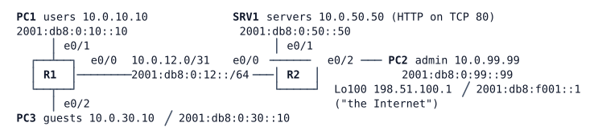

# LAB-034 — ACL design for the Veridian site

**Module:** 05 Management and segmentation · **Type:** I (Implementation) · **Guidance tier:** G2 (requirements) · **Estimated time:** 90 min · **Blueprint objectives:** 5.2.a:I (access control lists), IPv6:R (IPv6 filtering)

## Scenario
Project ACL-1 from the device-access audit gives the Veridian site its traffic policy. The site has a users LAN, a guest LAN, a server LAN and an admin LAN, behind two routers, and it runs IPv4 and IPv6 side by side. Today everything can reach everything. You are to write the policy for both stacks, place it where it does the least harm, prove each rule with a permitted and a denied test, and keep routing and management working while you do it. After go-live, a change request arrives.

## Objectives
- Choose between standard, extended and named ACLs, and justify where each one sits.
- Filter the same policy in IPv4 and IPv6, and prove the IPv6 policy still forwards after neighbour caches age.
- Prove with hit counters and `log` output that a deny was caused by your test.
- Restrict management sessions to the admin LAN in both stacks without disturbing OSPFv2 and OSPFv3.
- Change a live ACL by sequence number, without removing it.

## Available Information

| Device | Interface | IPv4 | IPv6 |
|---|---|---|---|
| R1 | e0/0 (to R2) | 10.0.12.0/31 | 2001:db8:0:12::1/64 |
| R1 | e0/1 (users) | 10.0.10.1/24 | 2001:db8:0:10::1/64 |
| R1 | e0/2 (guests) | 10.0.30.1/24 | 2001:db8:0:30::1/64 |
| R1 | Lo0 | 10.255.0.1/32 | 2001:db8:ffff:0::1/128 |
| R2 | e0/0 (to R1) | 10.0.12.1/31 | 2001:db8:0:12::2/64 |
| R2 | e0/1 (servers) | 10.0.50.1/24 | 2001:db8:0:50::1/64 |
| R2 | e0/2 (admin) | 10.0.99.1/24 | 2001:db8:0:99::1/64 |
| R2 | Lo0 / Lo100 | 10.255.0.2/32, 198.51.100.1/32 | 2001:db8:ffff:0::2/128, 2001:db8:f001::1/128 |

- Hosts (PC1, PC2, PC3, SRV1) are Alpine Linux, login `cisco` / `cisco`, static IPv4 and IPv6 addresses, default gateway = the router's `.1` / `::1` address. Routers send no RAs.
- Routers: local account `admin` / `Cisco123!`, enable secret `Cisco123!`, SSH only on VTY 0 to 4.
- Tools on the hosts: `ping`, `ping -6`, `wget`, `nc` (IPv4 only), `ssh`. For an IPv6 TCP probe use `wget http://[address]:port/`. Scripted SSH needs a one-line `SSH_ASKPASS` helper (write the file with `printf`).
- Do not shut down or change the R1-R2 link or addressing, and leave R2 Lo100 as the only "Internet" address.

## Starting State
Both routers run OSPFv2 and OSPFv3 on every interface (LAN ports and loopbacks passive; the adjacency forms on the R1-R2 link) and all hosts reach each other and Lo100 in both stacks. There are no ACLs. SRV1 serves a web page on TCP 80. Router interface e0/3 is shut down and unused.

## Requirements / Change Requests
R1. **R1 users:** Hosts on the users LAN reach the server LAN only for web (TCP 80) and ping, in IPv4 and IPv6. All other traffic from users to the server LAN is refused. Users keep access to everything else.
R2. **R2 guests:** Hosts on the guest LAN reach the Internet address (R2 Lo100) in both stacks and nothing else inside the site, including the routers' own addresses. Guest neighbour discovery must keep working.
R3. **R3 management:** Only the admin LAN may open management sessions (SSH) to R1 and R2, in both stacks, on every VTY line. OSPFv2 and OSPFv3 adjacencies stay FULL throughout.
R4. **R4 durability:** The IPv6 policy must still forward permitted traffic 3 minutes after you apply it (long enough for the routers' neighbour caches to age). Re-test after the wait.
R5. **R5 change request:** After go-live, allow users TCP 443 to SRV1 (IPv4 only is acceptable to test; do both stacks if you can) by inserting a single line into the live ACL, without removing or re-applying the ACL.
R6. **R6 documentation:** For each ACL you write, record the device, interface and direction and the reason it sits there.

## Verification Criteria
V1. From the users LAN, a web fetch and a ping to SRV1 succeed, and another TCP port to SRV1 fails, in IPv4 and IPv6, and the matching ACL counters or `log` lines increase by your test.
V2. From the guest LAN, Lo100 answers in both stacks, and SRV1, a user host, R1's guest-LAN address, R2's loopback and R2's link address are all unreachable.
V3. SSH from the admin LAN to R1 and R2 succeeds in both stacks (the login is logged), and SSH from the users and guest LANs does not open a session.
V4. OSPFv2 and OSPFv3 on both routers show a FULL neighbour before, during and after your changes.
V5. A continuous IPv6 ping from a user host to SRV1 keeps succeeding for at least 3 minutes after the IPv6 ACLs are applied.
V6. The change in R5 is made with one inserted line, the other ACL entries keep their hit counters, and a TCP 443 connection now reaches SRV1.
V7. For each denied test you can point to the single ACL entry whose counter or log line moved, and show that the log line came from your test traffic.

## Analysis Questions
Q1. Did your IPv6 ACL still forward permitted traffic after R4's wait? Explain what you saw and which entries decide it.
Q2. For the users-to-servers restriction, where would a standard ACL have to sit, and what would it break?
Q3. How did you prove a deny was hit by your test and not by other traffic?
Q4. What does an `access-class` on the VTY lines not protect against that an interface ACL does? How does the client's error message differ between the two?
Q5. Compare filtering the guests on R1 inbound with filtering on R2 (closer to the Internet). What does each cost or save?
