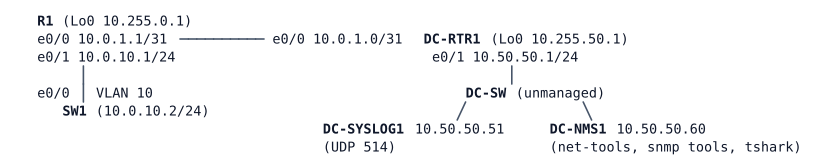

# LAB-035 — Telemetry and time

**Module:** 05 Management and segmentation · **Type:** I (Implementation) · **Guidance tier:** G2 (behaviour only) · **Estimated time:** 120 min · **Blueprint objectives:** 4.1:P (syslog, SNMP, NTP), 3.3.a:P (PTP, analysis only; PTP:A)

## Scenario
The DC team has deployed a log collector (DC-SYSLOG1), a monitoring station (DC-NMS1) and an authenticated time source (DC-RTR1). Before the next audit, the branch router R1 and its access switch SW1 must feed all three: their messages must reach the collector, the monitoring station must be able to poll and be warned by them using secure methods, and their clocks must come from the authenticated DC source. The audit also asks the network team to show that it understands how PTP differs from NTP, using a sample configuration from a PTP-enabled switch you are not able to build in this lab.

## Objectives
- Send syslog to a central collector from a stable source address, with a deliberate severity threshold.
- Allow SNMP polling from one station only, with the strongest security each platform supports.
- Make a device send an unsolicited notification when an interface fails, and prove it on the wire.
- Take time from an authenticated source, and test what NTP authentication does and does not protect against.
- Read PTP roles, clock types and port states from sample output.

## Available Information


| Device | Interface | Address |
|---|---|---|
| R1 | e0/0 / e0/1 / Lo0 | 10.0.1.1/31 / 10.0.10.1/24 / 10.255.0.1/32 |
| SW1 | VLAN 10 (e0/0 access) | 10.0.10.2/24, default gateway 10.0.10.1 |
| DC-RTR1 | e0/0 / e0/1 / Lo0 | 10.0.1.0/31 / 10.50.50.1/24 / 10.255.50.1/32 |
| DC-SYSLOG1 | eth0 | 10.50.50.51/24 (syslog collector) |
| DC-NMS1 | eth0 | 10.50.50.60/24 (the only authorised poller and trap receiver) |

| Item | Value |
|---|---|
| Console / SSH account | `admin` / `Cisco123!` (privilege 15), enable secret `Cisco123!` |
| SNMPv3 user | `nmsuser`, authentication SHA `AUTHPASS123`, privacy AES-128 `PRIVPASS123` (where supported) |
| SNMPv2c read-only community | `ENCOR-RO` |
| NTP | source 10.0.1.0 (DC-RTR1, stratum 3), key number 1, `hmac-sha2-256`, key string `NTPKEY123` |

DC-NMS1 has the net-snmp tools (`snmpget`, `snmpwalk`) and `tshark`; DC-SYSLOG1's console log shows every message it receives. DC-NMS1 can also add a second source address if you want to test a poller that should be refused (`ip addr add 10.50.50.61/24 dev eth0`, plus a route to the target with `src 10.50.50.61`).

Sample PTP material for R5 (taken from a PTP-capable Catalyst/IE switch; not runnable in this lab):
```
GM-SW (ptp mode ordinary-clock, priority1 100)    BC-SW (ptp mode boundary-clock)    Tester
  Te1/0/1 (master) --------------------------------- Te1/0/1 (slave)
                                                     Te1/0/2 (master) ------------- Gi1/0/1 (slave)
```
```
BC-SW# show ptp clock
 PTP CLOCK INFO
  PTP Device Type: Boundary clock
  Clock Identity: 0x2C:5A:A:FF:FE:3B:7D:80
  Clock Domain: 0
  Number of PTP ports: 2
  Priority1: 128
  Priority2: 128
  Clock Quality:
   Class: 248
   Accuracy: Unknown
   Offset (log variance): 65535
  Offset From Master(ns): 31
  Mean Path Delay(ns): 412
  Steps Removed: 1
  Local clock time: 10:21:44 UTC Oct 4 2026
BC-SW# show ptp parent
 PTP PARENT PROPERTIES
  Parent Clock:
   Parent Clock Identity: 0x4C:71:D:FF:FE:12:A0:01
   Parent Port Number: 1
  Grandmaster Clock:
   Grandmaster Clock Identity: 0x4C:71:D:FF:FE:12:A0:01
   Grandmaster Clock Quality:
    Class: 6
    Accuracy: Within 100ns
    Offset (log variance): 20061
    Priority1: 100
    Priority2: 128
BC-SW# show ptp port
 PTP PORT DATASET: TenGigabitEthernet1/0/1
  Port identity: clock identity: 0x2C:5A:A:FF:FE:3B:7D:80, port number: 1
  PTP version: 2
  Delay request interval(log mean): 0
  Announce receipt time out: 3
  Peer mean path delay(ns): 0
  Port state: SLAVE
 PTP PORT DATASET: TenGigabitEthernet1/0/2
  Port identity: clock identity: 0x2C:5A:A:FF:FE:3B:7D:80, port number: 2
  Port state: MASTER
```
The sample configuration on BC-SW is `ptp mode boundary`, `ptp priority1 128`, `ptp domain 0` and `ptp transport ipv4 udp` (global), with `ptp enable` on both ports. The output above is illustrative and was not captured from the lab.

## SNMPv3 in brief
SNMPv3 is built from three linked objects. A **view** (optional) limits which parts of the MIB a group may read. A **group** carries the security level (`noAuth`, `auth` for authentication without encryption, `priv` for authentication plus encryption), the view, and can carry an ACL that limits which source addresses may poll. A **user** belongs to one group and holds the authentication key (and the privacy key where the platform supports it); the user's keys must match what the poller sends. A poller asks with a user name and a level; the device accepts the request only if the user exists, the level is at least the group's level, and the source passes the group's ACL. Traps are separate: a trap receiver (host) entry names the destination, the SNMP version and level, and the user to use, and each trap type is enabled on its own. SNMPv2c has none of this: a community string is both the password and the group, with its own ACL. Entry commands: `show snmp user`, `show snmp group`, `show snmp host`, `show snmp` (counters).

## Starting State
Routing is complete: R1, SW1, DC-RTR1 and both DC servers can reach each other, and SW1 is managed from VLAN 10. DC-SYSLOG1 and DC-NMS1 are running. R1 and SW1 have no logging, SNMP or NTP configuration. DC-RTR1 is an authenticated NTP master (stratum 3, key 1). DC-RTR1 takes about 15 minutes after boot before it will serve time (and SW1, an older platform, can need up to 25 minutes to select it), so do the time requirements last.

## Requirements / Change Requests
R1. R1 and SW1 send messages of informational severity and more severe to the collector, each from a fixed source address (R1 from its loopback, SW1 from its management interface). Debugging messages stay in the local buffer only.
R2. The NMS can poll both devices with SNMPv3 at the strongest security level each device supports, and no other source can poll them. R1 also answers the legacy SNMPv2c poller (read-only, NMS only).
R3. R1 sends a notification to the NMS when an interface goes down or comes up, sourced from its loopback. Prove it with a capture on the NMS while the R1–SW1 cable is pulled.
R4. Both devices take time from the authenticated DC source using NTP authentication. Test how each device treats a source with a wrong key and a source configured without a key, and record what you observe rather than what you expect.
R5. (Analysis) Answer Q5 to Q7 from the PTP material in Available Information.

## Verification Criteria
V1. A test message at notice level sent from each device appears on the collector with that device's fixed source address; a debug-level test message appears only in the device's local buffer.
V2. From DC-NMS1, `snmpget` of `sysName` succeeds with SNMPv3 at the strongest level for each device, and with SNMPv2c to R1. It fails with a wrong community, a wrong authentication password, and from any other source address (check the ACL counters for the denied source).
V3. A packet capture on DC-NMS1 (`tshark -l -i eth0 -f "udp port 162"`) shows a notification from R1's loopback address when the cable is pulled, and another when it is restored. After restoring, R1 and SW1 reach each other again.
V4. Each device's NTP associations show the DC source as selected (`sys.peer`) and authenticated, and the clock is synchronised to it. `show ntp status` can keep reporting "Clock is unsynchronized" for roughly 25 to 35 minutes after configuration even when a peer is already `sys.peer`; check `show ntp associations` and `show ntp associations detail` (selected, reach non-zero, authenticated) meanwhile, and re-check the status later.
V5. With a wrong key configured for the source, record whether the device selects it. With the server line configured without `key`, record whether the device selects it and what `show ntp associations detail` says about that association. With the correct key, the source is selected and authenticated.
V6. After DC-SYSLOG1 is stopped and restarted, a new test message from R1 reaches the collector again.

Pull the cable with `shutdown` on both ends. SW1's management path returns on restore. Stopping a node is a silent failure for its neighbours.

## Analysis Questions
Q1. Why did the switch refuse your first SNMPv3 attempt at the strongest level, and what does the level you ended up with leave exposed?
Q2. Which logging severity did the collector need for R1's and SW1's test messages, and which events would a threshold of `warnings` have hidden?
Q3. `ntp authenticate` is configured. Which kinds of `ntp server` line does it actually protect against, which does it not, and which output shows the difference? The usual textbook claim is that only authenticated sources are used: does your evidence agree?
Q4. Why is "Clock is synchronized" a poor success check on this platform, and what does `sys.peer` prove?
Q5. (PTP) From the sample output, identify the grandmaster, the boundary clock and the state of each port.
Q6. Why does PTP need hardware timestamping when NTP does not?
Q7. Name one Veridian use case that needs PTP rather than NTP.
