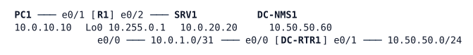

# LAB-036 — Flexible NetFlow for the branch server link

**Module:** 05 Management and segmentation · **Type:** F (Foundation) · **Guidance tier:** G2 (requirements) · **Estimated time:** 60 min · **Blueprint objectives:** 4.2:I (NetFlow and Flexible NetFlow)

## Scenario
The Veridian capacity team wants to know which branch hosts use the link to the branch server LAN and for which applications. Router R1 at the branch must record the flows crossing it and export them to the monitoring station DC-NMS1 in the data centre. You will build the flow definition, send three kinds of traffic, find the top talker from the router alone, and then confirm the same flows on the monitoring station.

## Objectives
- Define what a flow is on a router (key fields and collected counters) and where it is observed.
- Export flow records in NetFlow v9 to a collector from a stable source address.
- Read the flow cache, rank flows by volume and relate exporter statistics to what the collector receives.
- Decode exported records on a host and explain the role of the template.

## Available Information

| Device | Interface | Address |
|---|---|---|
| R1 | Loopback0 | 10.255.0.1/32 |
| R1 | e0/0 (to DC-RTR1) | 10.0.1.0/31 |
| R1 | e0/1 (PC1 LAN) | 10.0.10.1/24 |
| R1 | e0/2 (SRV1 LAN) | 10.0.20.1/24 |
| DC-RTR1 | e0/0 / e0/1 | 10.0.1.1/31 / 10.50.50.1/24 |
| PC1 | eth0 | 10.0.10.10/24 |
| SRV1 | eth0 | 10.0.20.20/24 (HTTP on port 80) |
| DC-NMS1 | eth0 | 10.50.50.60/24 (net-tools: `tshark`) |

Credentials on every router: `admin` / `Cisco123!`, enable secret `Cisco123!` (console is already privileged). PC1 and SRV1 are Alpine hosts with `wget`, `ping` and iperf v2 (`iperf`). SRV1 does not run an iperf server until you start one. DC-NMS1 can capture with `tshark`; UDP 2055 is not decoded as NetFlow unless you tell `tshark` to.

## Starting State
Routing is complete and every host reaches every other host. There is no flow configuration on either router. SRV1 serves a web page on port 80.

## Requirements / Change Requests
R1. R1 records flows keyed by IPv4 source and destination address, protocol, transport source and destination port and input interface, with byte and packet counters and first/last timestamps, for traffic entering R1 from either LAN. Use user-defined names with the prefix `REC-`, `EXP-`, `MON-`.
R2. Exported records are sent to DC-NMS1 as NetFlow v9 over UDP port 2055, sourced from R1's loopback. Read the cache timeouts the router uses (they are not configurable on this image) and confirm an idle flow reaches the NMS within a minute.
R3. From PC1 generate three kinds of traffic towards SRV1: ping, HTTP and an iperf stream of about 10 seconds. Identify the top talker by bytes from the router alone.
R4. Show the same flows decoded as NetFlow on DC-NMS1.

## Reported Problems
Not applicable (implementation lab).

## Verification Criteria
V1. The router shows its exporter with destination 10.50.50.60, UDP 2055, source 10.255.0.1 and version 9.
V2. The flow cache holds separate entries for the ping, the HTTP session and the iperf stream, and the iperf flow ranks first when sorted by bytes (read the cache within the inactive timeout you found in R2, or start the iperf stream first).
V3. The exporter statistics show the number of packets sent increasing while traffic flows.
V4. DC-NMS1 decodes the export as `CFLOW` with a template packet and data packets that contain the iperf addresses, ports and byte count.
V5. Hosts, routing and the DC-NMS1 reachability are unchanged.

## Analysis Questions
Q1. Both LAN interfaces are monitored in the input direction. Why is a flow not counted twice, and what would monitoring input and output on both change?
Q2. Read the active and inactive cache timeouts the router uses. What does each one change for a long-running iperf stream, and when would you want a shorter active timeout?
Q3. What does the exporter send before any data record, why does the collector need it, and how often is it repeated?
Q4. What can NetFlow not tell you that a packet capture can, and the reverse?
