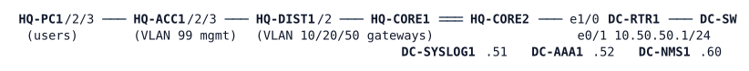

# LAB-037 — Hardening HQ

**Module:** 05 Management and segmentation · **Type:** X/N (expansion/integration) · **Guidance tier:** G2 (behaviour only) · **Estimated time:** 180 min · **Blueprint objectives:** 2.2.a:P, 5.1.a:R, 5.1.b:P, 5.2.a:P, 4.1:R, 3.3.a:R

## Scenario
Veridian's audit is in six weeks. The DC team has delivered the DC block: DC-RTR1 is configured, the log collector, RADIUS server and monitoring station are running, and the block is cabled to HQ-CORE2 Ethernet1/0. Last week a colleague hardened the three HQ access switches as the reference: their management traffic already points at the DC, but it cannot get there yet. Bring the two cores and the two distribution switches to the same standard, build the separate management routing table that carries all of it, and review the management-access ACL an AI assistant has drafted. Finish with a change log of every change and its measured impact.

## Objectives
- Carry all management traffic (SSH, SNMP, syslog, RADIUS, NTP) in its own routing table that users can neither reach nor route into, and make the cores its redundant gateway.
- Move the management VLAN gateway without locking yourself out, and measure the impact.
- Reproduce a reference access standard (central accounts, accounting, break-glass, logging, SNMPv3, authenticated time) on other platforms.
- Test an AI-drafted access policy on live devices and decide approve, amend or reject with evidence.

## Available Information

- HQ is the environment you know from LAB-021 (OSPF 1, area 10 campus, area 50 for the DC). VLAN 99 (10.10.99.0/24) is the management VLAN; the gateway today is a DIST HSRP group at 10.10.99.1.
- New link HQ-CORE2 Ethernet1/0 to DC-RTR1 Ethernet0/0: 10.10.255.128/31 (CORE2 .128, DC-RTR1 .129), currently unconfigured on the CORE2 side. Core-link standard: OSPF point-to-point, cost 10, hello 1 / dead 4.
- DC services (DC-SW): DC-SYSLOG1 10.50.50.51 (UDP 514), DC-AAA1 10.50.50.52 (RADIUS, key RADKEY123), DC-NMS1 10.50.50.60 (net-tools, SSH and SNMP client tools, your test station). DC-RTR1 Lo0 10.255.50.1 is the authenticated time source (key 1, hmac-sha2-256, NTPKEY123).
- Management addresses: CORE1 .2, CORE2 .3, DIST1 .11, DIST2 .12, ACC1-3 .21-.23 (VLAN 99). Reserve 10.10.254.0/24 for point-to-point links in the management table.
- Accounts: local break-glass `admin` / `Cisco123!` (enable secret `Cisco123!`). Central (RADIUS): `netadmin` / `netpass` (privilege 15), `netops` / `opspass` (privilege 1). SNMPv3 user `nmsuser`, SHA `AUTHPASS123`, AES-128 `PRIVPASS123`.
- Reference: HQ-ACC1, HQ-ACC2 and HQ-ACC3 carry the finished access standard; read one and reproduce its behaviour on the other platforms.
- The assistant's proposal for management access, to be applied to every HQ device and DC-RTR1:
```
ip access-list standard MGMT-HOSTS
 10 permit 10.10.99.0 0.0.0.255
 20 permit 10.50.50.0 0.0.0.255
 30 permit host 10.50.50.60
 40 deny any log
ipv6 access-list NO-VTY6
 deny ipv6 any any log
line vty 0 15
 access-class MGMT-HOSTS in vrf-also
 ipv6 access-class NO-VTY6 in
snmp-server group NMSGROUP v3 priv access MGMT-HOSTS   ! "auth" on the switches
```
- The reference standard is only what the access switches carry; it does not repeat every setting of the branch device-access policy you enforced in LAB-032 (for example SSH key size, idle timeout, login block). Note any difference you find in your change log and say whether it should be closed.
- Console access to every device is available from CML. Use the consoles for configuration; use DC-NMS1 and HQ-PC1 as test stations.

## Starting State
Environment HQ H2 plus the DC block (15 nodes, HQ-PC2/PC3 optional). The cores and distribution switches have local `admin` and SSH-only access. The access switches carry the reference standard: they mark the RADIUS server dead (`%RADIUS-4-RADIUS_DEAD`) at the first central login attempt and then accept `admin`. DC-RTR1 is complete except for its access ACL. Nothing in the management table exists yet. NTP needs about 25 minutes from boot to synchronise on the switches.

## Requirements / Change Requests
R1. Management traffic (SSH, SNMP, syslog, RADIUS, NTP) between every HQ device and the DC services travels only in a separate routing table that users can neither reach nor route into. The cores are that VLAN's redundant gateway (same address .1 as today), and the DC link is added under the core-link standard in both routing tables.
R2. Moving the management VLAN gateway leaves the access switches without it for no more than 30 seconds (continuous ping to 10.10.99.1 from an access switch console during the move). Every switch answers DC-NMS1 once the management table is complete.
R3. The cores and distribution switches meet the access standard of the reference switches: central accounts with privilege from the server, accounting, a break-glass local account only when the server is unreachable, and an exemption for the console.
R4. Every device logs informational events to the collector, answers the NMS by SNMPv3 at the strongest level it supports (no v2c anywhere), and takes authenticated time from DC-RTR1.
R5. Test the assistant's proposal on live devices, decide approve, amend or reject with evidence, and apply the result to all seven HQ devices and DC-RTR1.
R6. Write each change and its measured impact in a change log.

## Verification Criteria
V1. From DC-NMS1, SSH with `netadmin` reaches every IOS device (including DC-RTR1) at privilege 15, and `netops` at privilege 1.
V2. DC-AAA1 records accounting for each login, and DC-SYSLOG1 receives a login-success message from every device.
V3. `snmpget` with SNMPv3 for sysName succeeds against all eight devices (authPriv on the routers, authNoPriv on the switches) and v2c is refused.
V4. Every device lists DC-RTR1 as its selected time source (allow time for the switches).
V5. HQ-PC1 cannot ping 10.50.50.0/24 or 10.10.99.0/24 and cannot open SSH to any device, in IPv4 or IPv6; an ACL log line records the attempt; user traffic (HQ-PC1/2/3 to gateways and each other) is unaffected.
V6. With the DC-AAA1 node stopped, `admin` still logs in on every device and central accounts fail; with the node started again central accounts work without any device restart.
V7. With HQ-CORE1 stopped, the management gateway moves to HQ-CORE2, switch management from DC-NMS1 continues and user traffic keeps flowing.
V8. The change log lists each change with a measured impact, including the cut-over interruption.

## Analysis Questions
Q1. Why did the access switches' central login start working the moment the cores routed VLAN 99 in the management table, without any change on the switches?
Q2. Which management services needed a VRF keyword on the devices and which did not? Why does SNMP differ from syslog and NTP?
Q3. The management network now depends on one DC link and on HQ-CORE2. What fails if HQ-CORE2 stops, and what would remove that dependency?
Q4. Your verdict on the proposal, line by line: which lines you kept, amended or rejected, and the live evidence for each.
Q5. Why did moving the distribution switches' VLAN 99 interface into the management table briefly cut your SSH session, and how did you avoid locking yourself out?
