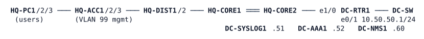

# LAB-038 — The Auditors Can't Log In

**Module:** 05 Management and segmentation · **Type:** T (Troubleshooting) · **Guidance tier:** G2 (behaviour only) · **Estimated time:** 120 min · **Blueprint domains:** 2, 3, 4, 5

## Scenario
It is audit week at Veridian. The external auditors work from the audit workstation in the DC (DC-NMS1) with the read-only account they were issued (`netops`). Friday's change log has one entry, "management clean-up after a configuration compare", with no device list and no details. Three tickets have arrived since.

## Objectives
- Diagnose three independent tickets on a hardened management plane from the evidence on the devices, the servers and the user's side.
- Fix each cause on its own, without weakening the documented management policy.
- Check that the same class of mistake does not exist elsewhere, and prove each repair with evidence.

## Available Information

- Environment HQ (OSPF 1) plus the DC block. VLAN 99 (10.10.99.0/24) is the management VLAN. All management traffic (SSH, SNMP, syslog, RADIUS, NTP) travels in the management routing table `MGMT`; users have no route into it.
- Management addresses (VLAN 99): HQ-CORE1 .2, HQ-CORE2 .3, HQ-DIST1 .11, HQ-DIST2 .12, HQ-ACC1-3 .21-.23. HQ-CORE1 is also reachable by users at 10.255.10.1. HQ-PC1 (10.10.10.101) is the user-network test host.
- DC services: DC-SYSLOG1 10.50.50.51 (UDP 514), DC-AAA1 10.50.50.52 (RADIUS, key RADKEY123), DC-NMS1 10.50.50.60 (SSH and SNMP client tools), DC-RTR1 Lo0 10.255.50.1 (authenticated time source, key 1, hmac-sha2-256, NTPKEY123).
- Accounts: local break-glass `admin` / `Cisco123!`; central (RADIUS) `netadmin` / `netpass` (privilege 15) and `netops` / `opspass` (privilege 1). SNMPv3 user `nmsuser`.
- Documented management policy:
  - Management sessions are accepted only from VLAN 99 and the DC segment, in IPv4 and IPv6; nothing from a user network.
  - Accounts are central, with the privilege assigned by the server and each session accounted. The local account works only when the RADIUS server is unreachable.
  - Every device logs informational events (severity 0-6) to the collector.
  - SNMPv3 at the strongest level the platform supports.
  - Time comes only from DC-RTR1, authenticated.
- Consoles are open at privilege 15. To test an SSH login from DC-NMS1 without an interactive password, use an askpass helper, for example `printf '#!/bin/sh\necho opspass\n' > /tmp/pa; chmod +x /tmp/pa` and then `SSH_ASKPASS=/tmp/pa SSH_ASKPASS_REQUIRE=force DISPLAY=x ssh -o StrictHostKeyChecking=no netops@<address> 'show privilege' < /dev/null`. DC-SYSLOG1 and DC-AAA1 have no CLI: read their output from the CML console log.
- Monitoring station: DC-NMS1 polls with SNMPv3 (`snmpget -v3 -l authPriv -u nmsuser -a SHA -A AUTHPASS123 -x AES -X PRIVPASS123 <address> 1.3.6.1.2.1.1.5.0`).
- Some line settings are not shown by `show line`; the running configuration is authoritative. `send log <severity> <text>` on a device creates a test message.

## Starting State
Environment HQ H3 (hardened management plane) plus the DC block, 15 nodes (HQ-PC2/PC3 optional). Everything was working before Friday's change. NTP on the switches needs about 25 minutes after boot to select its source (allow up to 35), so check time last.

## Requirements / Change Requests
R1. Resolve the three tickets below, one cause at a time.
R2. The repair of each ticket leaves the documented management policy intact (no weaker access control, no extra local account, no weaker logging than the documented policy, no disabled authentication).
R3. After you find one cause, check whether the same mistake exists on any other device or service, and record what that check covered.
R4. For each ticket, keep one piece of evidence from before the fix and one after.

## Reported Problems
**T1 (audit lead):** "We need a read-only session on every network device. HQ-CORE1 refuses our SSH connection outright. HQ-DIST2 asks for the password and then refuses it. Every other device lets us in. The NOC says HQ-CORE1 refuses them too, and their poller has shown HQ-CORE1 as not responding since Friday, although they can ping it; on HQ-DIST2 only the emergency local account works."

**T2 (NOC):** "The log collector has had nothing at all from HQ-CORE2 since the weekend. HQ-CORE2 is up and our SNMP poller reads it without problems."

**T3 (audit lead):** "Audit check 7, 'each device follows the authenticated corporate time source', fails for HQ-ACC3: its association list shows no selected source. The other devices pass."

## Verification Criteria
V1. From the audit workstation, every device accepts the audit account read-only and the administrator account at privilege 15, and each session leaves an accounting record on the AAA server.
V2. The documented management policy holds: no management session from HQ-PC1 to any device, the local account works only while the RADIUS server is unreachable (drill: stop the DC-AAA1 node, then start it again), and time is taken only from the authenticated source.
V3. Every device sends to the collector all the event types the documented logging policy requires, and every device still answers the monitoring station.
V4. For each ticket you hold one piece of toolkit evidence before and after the fix (log line, limited debug, counter or `show` output).
V5. With the DC-AAA1 node stopped, the logins you tested still work (the local account) after the server's timeout; with it started again, central accounts work without any device reload.

## Analysis Questions
Q1. For each ticket, what was the first piece of evidence that ruled out the obvious explanation?
Q2. Once you found one cause, how did you check whether the same mistake existed elsewhere, and what did that check cover?
Q3. Which evidence came from a server rather than a network device, and what could it show that the device could not?
Q4. Which of your tests succeeded before you applied any fix, and why?
Q5. Write the post-change checks that would have caught each problem on Friday.
