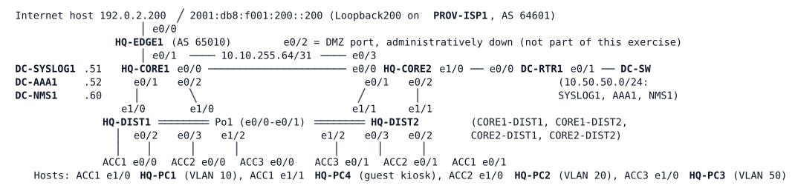

# MS-2 — Campus, Edge and Services

**Module:** 05 Management plane, services and segmentation (closes modules 01–05) · **Type:** M (Milestone) · **Guidance tier:** G1 (business outcomes) · **Estimated time:** 210 min · **Blueprint domains:** 2, 3, 4, 5

> Run this lab alone: it uses 18 of the server's 20 running nodes. The lab needs about 3 minutes after "all nodes booted" before the routing and the server nodes settle; start your work after that.

## Scenario

It is the first week after Veridian Logistics' security audit. The hardened headquarters campus has just been joined to the Internet edge (ISP-A only in this lab). You are the on-shift network engineer. The change manager has queued three change requests and the service desk and the NOC have opened three tickets. Work the queues, record what you do, and prove the network is healthy before the weekend. Nothing in the queues says how to do the work: the constraints and acceptance criteria below are the contract.

## Objectives

- Close tickets on a campus, edge and management-plane network with evidence from before and after each fix.
- Apply layer-2, first-hop, routing, edge and management-plane changes inside a maintenance window, with the outage of each one measured and kept inside the limit.
- Prove with failure drills that users and the management plane survive the loss of an access uplink, the AAA server and a core router, and state what is lost where the design has a single attachment.

## Available Information

### Documentation pack

**Topology and cabling** (every cable is patched; trunks are dot1q, native VLAN 999, `nonegotiate`, explicit allowed lists):

| Link | A | B | Carries / addressing |
|---|---|---|---|
| Core interconnect | HQ-CORE1 e0/0 | HQ-CORE2 e0/0 | routed 10.10.255.0/31; management sub-interface .99 10.10.254.2/31 (.2/.3) |
| CORE1–DIST1 | HQ-CORE1 e0/1 | HQ-DIST1 e1/0 | VLANs 901 (10.10.255.2/31), 20, 50, 99 |
| CORE1–DIST2 | HQ-CORE1 e0/2 | HQ-DIST2 e1/0 | VLAN 902 (10.10.255.4/31) |
| CORE2–DIST1 | HQ-CORE2 e0/1 | HQ-DIST1 e1/1 | VLAN 903 (10.10.255.6/31) |
| CORE2–DIST2 | HQ-CORE2 e0/2 | HQ-DIST2 e1/1 | VLANs 904 (10.10.255.8/31), 20, 50, 99 |
| DIST interconnect | HQ-DIST1 e0/0-e0/1 | HQ-DIST2 e0/0-e0/1 | Po1: VLANs 10, 20, 50, 99 |
| ACC1 uplinks | HQ-DIST1 e0/2, HQ-DIST2 e0/2 | HQ-ACC1 e0/0, e0/1 | VLANs 10, 20, 99 |
| ACC2 uplinks | HQ-DIST1 e0/3, HQ-DIST2 e0/3 | HQ-ACC2 e0/0, e0/1 | VLANs 10, 20, 99 |
| ACC3 uplinks | HQ-DIST1 e1/2, HQ-DIST2 e1/2 | HQ-ACC3 e0/0, e0/1 | VLANs 50, 99 |
| Core to data centre | HQ-CORE2 e1/0 | DC-RTR1 e0/0 | 10.10.255.128/31, OSPF area 50; management sub-interface .99 10.10.254.0/31 |
| Core to edge | HQ-CORE1 e0/3 | HQ-EDGE1 e0/1 | 10.10.255.64/31 (CORE1 .64, EDGE1 .65), OSPF area 0 point-to-point, cost 10, hello 1 / dead 4, IPv4 only today |
| Edge to ISP-A | HQ-EDGE1 e0/0 | PROV-ISP1 e0/0 | 198.51.100.64/31 (ISP1 .64, EDGE1 .65) |

**VLANs and first-hop gateways.**

| VLAN | Subnet | Gateway (VIP .1) | Hosts |
|---|---|---|---|
| 10 (users) | 10.10.10.0/24, 2001:db8:10:10::/64 | HQ-DIST1 .2 / HQ-DIST2 .3, GLBP | HQ-PC1 .101 |
| 20 (OPS) | 10.10.20.0/24, 2001:db8:10:20::/64 | HQ-CORE1 .2 / HQ-CORE2 .3, VRRP (CORE2 preferred) | HQ-PC2 .102 |
| 50 (servers floor) | 10.10.50.0/24, 2001:db8:10:50::/64 | HQ-CORE1 .2 / HQ-CORE2 .3, VRRP (CORE1 preferred) | HQ-PC3 .103 |
| 99 (management) | 10.10.99.0/24, in VRF MGMT | HQ-CORE1 .2 / HQ-CORE2 .3, VRRP (CORE1 preferred) | HQ-DIST1 .11, HQ-DIST2 .12, HQ-ACC1 .21, HQ-ACC2 .22, HQ-ACC3 .23 |
| 999 | native VLAN, unused | | |
| 30 (guest, to be created) | 10.10.30.0/24 | on the distribution pair | HQ-PC4 .104 (kiosk) |

**Management design.** VRF `MGMT` carries all device management on the cores, the distribution switches and the data-centre router, with OSPF process 99 (router IDs: CORE1 10.10.254.2, CORE2 10.10.254.3, DC-RTR1 10.50.50.1). The data-centre services are in 10.50.50.0/24 behind DC-RTR1: DC-SYSLOG1 .51, DC-AAA1 .52 (RADIUS, UDP 1812/1813), DC-NMS1 .60 (management station; login `cisco` / `cisco`); DC-RTR1 is the time source. The management standard is: central accounts through DC-AAA1 with accounting and the local fallback described below, logging to DC-SYSLOG1, SNMPv3 (user `nmsuser`) answering only the management hosts, authenticated NTP from DC-RTR1, SSH only, management sessions accepted only from 10.10.99.0/24 and 10.50.50.0/24, none over IPv6. Reserved for the edge: management link to CORE1 10.10.254.4/31 (CORE1 .4, EDGE1 .5), VLAN 99 sub-interface. HQ-EDGE1 is the only device not yet under this standard.

**Credentials.**

| Item | Value |
|---|---|
| Local account / enable | `admin` / `Cisco123!` (privilege 15); enable secret `Cisco123!` |
| RADIUS (DC-AAA1) | shared key `RADKEY123`; users `netadmin` / `netpass` (privilege 15), `netops` / `opspass` (privilege 1, read-only) |
| SNMPv3 | user `nmsuser`, SHA `AUTHPASS123`, AES-128 `PRIVPASS123` (routers; switches: authNoPriv, SHA only); group `NMSGROUP` |
| NTP | key 1, `hmac-sha2-256`, `NTPKEY123` |
| BGP to ISP-A | AS 65010 to AS 64601, MD5 password `ISPA-64601` (IPv4 and IPv6 sessions) |
| Hosts | Alpine PCs: default console login; HQ-PC4 and DC-NMS1: `cisco` / `cisco` |

**Edge and addressing policy.**
- HQ-EDGE1 (AS 65010) peers with PROV-ISP1 (AS 64601) at 198.51.100.64. Veridian's public pool is 192.0.2.0/26 (user pool A, single NAT address 192.0.2.1).
- NAT policy, revised after the audit: user, server and guest VLANs are translated; nothing else.
- The campus learns its default route from the edge by OSPF; no other router originates one.
- ISP-A letter: "IPv4 service is live. IPv6 service is ready on our side at 2001:db8:f001:ffff::64/127 (ours ::64, yours ::65), same MD5 password. We announce 2001:db8:f001::/48 and a default. We accept 2001:db8:10::/48 from you and nothing else."
- IPv6 core link to the edge: 2001:db8:10:ffff::64/127 (CORE1 ::64, EDGE1 ::65). EDGE1 Loopback0 2001:db8:ffff:10::31/128. The campus link standard is OSPF point-to-point, cost 10, hello 1 / dead 4.
- The Internet host PROV-ISP1 Loopback200: 192.0.2.200/32 and 2001:db8:f001:200::200/128.

**Change log (neutral entries from the change manager).**

| Change | Date | Note |
|---|---|---|
| CHG-2207 | Saturday | Post-audit clean-up on the edge and core routers, details not recorded |
| CHG-2208 | Saturday | Access closet cabling audit |
| CHG-2209 | Sunday | Quarterly security maintenance |

**Monitoring excerpt (Monday 08:00).** HQ-ACC2: red since Saturday. Every other device: green.

## Starting State

- The 18 nodes are running with the configurations above applied at boot; nothing has been saved or changed by you yet.
- HQ-EDGE1 is managed with its local account only (no central AAA, no logging, SNMP or NTP yet). The other HQ devices already follow the management standard.
- ISP-A's IPv6 side is ready and waiting; HQ-EDGE1's IPv6 side is not configured.
- HQ-PC4's switch port (HQ-ACC1 e1/1) is not configured.
- Time (NTP) on a switch can take about 25 minutes to synchronise after boot; check time-dependent items last.
- Failure drills: a **cable pull** means `shutdown` on both ends of the link; a **node stop** (CML) is a silent failure for the neighbours (no resign, no link-down). A one-ended `shutdown` leaves the peer port up and is not a valid cable pull.

## Requirements / Change Requests

R1. **Constraints (all work).** No reloads or wipes; management reachability to every device is kept (the console does not count); changes that affect users happen in the declared window (CR1, CR2), each with **no more than 5 lost pings** for any existing user (1 per second); a NAT list change is followed by a translation clear; every change is recorded with its measured impact; configurations are saved at the end.

R2. **Tickets.** Close TK1, TK2 and TK3 (see Reported Problems), each with before-and-after evidence.

R3. **CR1: guest network (window tonight).** (a) The visitor kiosk (HQ-PC4, HQ-ACC1 e1/1) gets guest VLAN 30, 10.10.30.0/24, gateway .1. (b) The gateway is redundant on the distribution pair, with a single active forwarding gateway and the spanning-tree root for the VLAN on HQ-DIST2 (root priorities follow the campus standard). (c) The VLAN is routed into the campus. (d) Guests reach the Internet over IPv4, translated like users, and nothing internal: no user, server, management or campus device address (EDGE1's own Internet-facing addresses are not a failure), except that they may ping their own gateway. (e) No existing VLAN loses service while trunks are changed.

R4. **CR2: IPv6 to the Internet (window tonight).** (a) Veridian announces only 2001:db8:10::/48 to ISP-A and accepts only ISP-A's /48 and the default. (b) The campus learns an IPv6 default route from the edge by OSPFv3 under the link standard. (c) Dual-stack users reach 2001:db8:f001:200::200. (d) The IPv4 session to ISP-A does not reset.

R5. **CR3: edge under the management standard.** (a) HQ-EDGE1 meets the management standard of the pack, reached from the management station through the existing MGMT design (using the reserved /31). (b) The Internet path and NAT are unaffected, and no user or guest network can reach the edge's management addresses.

## Reported Problems

- **TK1 (service desk):** "Since Monday the OPS team cannot reach anything on the Internet. Office users on the other floors can, and the OPS team can still reach internal servers."
- **TK2 (NOC):** "HQ-ACC2 has been red in monitoring since the weekend's cabling audit. Users on that switch report nothing wrong."
- **TK3 (NOC engineers):** "Since Sunday our personal accounts cannot work on HQ-CORE1; only the emergency local account gets in. Our accounts work everywhere else."

## Verification Criteria

V1. every user and guest host reaches exactly the destinations the documentation allows: the Internet in IPv4 for all, IPv6 for the dual-stack VLANs, internal destinations as today (the user VLANs and the servers floor, no management or data-centre network), and nothing else.
V2. from the management station every device, the edge included, meets the management standard (central accounts with accounting, logs, SNMPv3, authenticated time), and refuses management sessions from user networks.
V3. failure drills on the finished network (save first): a cable pull of each access uplink in turn, a node stop of the AAA server, a node stop of either core. Before each drill, predict the outage from the configured spanning-tree, first-hop redundancy, OSPF and RADIUS timers, then compare your recorded values with the prediction. User and management reachability stay within those timer-based expectations except where the documentation shows a single attachment (state what is lost and until when). Record raw values for each drill.
V4. each ticket is closed with toolkit evidence from before and after; each change has a change-log entry with its measured impact; every constraint above held.

## Analysis Questions

Q1. In which order did you work the queue, and which item depended on which?
Q2. For each ticket, how did you prove the fix closed it completely?
Q3. What outage did each change cause, and how did you keep it inside the constraint?
Q4. The edge router now has two routing tables on one cable: list what it translates, what it routes in each table, and why management traffic is never translated.
