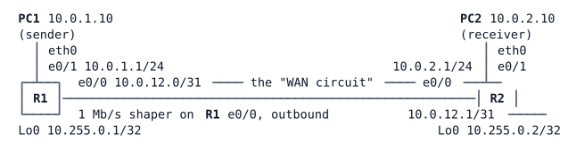

# LAB-039 — Reading QoS on a congested link

**Module:** 06 Protection and QoS · **Type:** F/A (Foundation/Analysis) · **Guidance tier:** G3 (guided) · **Estimated time:** 120 min · **Blueprint objectives:** 1.4:I (QoS: classification, marking, policing, shaping, congestion management)

## Scenario
Veridian will put QoS on the HQ uplink and on the WAN circuits (projects H5 and 052). Before anyone touches production, the network team rehearses on a bench: one 1 Mb/s circuit between two routers, and four kinds of traffic that all want it at once: voice, video, business data and bulk. The endpoint that sends bulk traffic also marks its own packets as voice. You are to measure the congestion first, then build the policy, then read every counter and explain it.

## Objectives
- Measure loss, jitter and throughput per traffic class with and without QoS.
- Classify and mark traffic at the network edge, and decide what the edge trusts.
- Build a hierarchical egress policy: a shaper (parent) with a priority queue, bandwidth guarantees, WRED and fair queuing (child).
- Read `show policy-map interface` and tie each counter to a host measurement.
- Predict and observe what happens when a priority class is offered more than its rate.

## Available Information

| Device | Interface | Peer | Address |
|---|---|---|---|
| R1 | Ethernet0/0 | R2 e0/0 | 10.0.12.0/31 |
| R1 | Ethernet0/1 | PC1 eth0 | 10.0.1.1/24 |
| R1 | Loopback0 | - | 10.255.0.1/32 |
| R2 | Ethernet0/0 | R1 e0/0 | 10.0.12.1/31 |
| R2 | Ethernet0/1 | PC2 eth0 | 10.0.2.1/24 |
| R2 | Loopback0 | - | 10.255.0.2/32 |
| PC1 / PC2 | eth0 | R1 e0/1 / R2 e0/1 | 10.0.1.10/24 / 10.0.2.10/24 (gateway .1) |

Routing is static. Routers: local account `admin` / `Cisco123!`, enable secret `Cisco123!`; consoles open in privileged mode. Hosts: Alpine, login `cisco` / `cisco`, `iperf` (v2) installed, `sudo` and `tcpdump` available.

**Design table (rates are lab-scaled to a 1 Mb/s circuit)**

| Class | Traffic (receiver port) | Offered by PC1 | Ingress marking | Egress treatment (child policy) |
|---|---|---|---|---|
| Voice | UDP 5004 | 250 kb/s, host marks EF | EF | priority, 30 % |
| Video | UDP 5005 | 400 kb/s, host marks AF41 | AF41 | bandwidth 30 % |
| Business data | TCP 5006 | as much as TCP gets, host marks nothing | AF21 | bandwidth 20 %, WRED on DSCP |
| Bulk (default) | UDP 5007 | 3 Mb/s, host wrongly marks EF | DSCP 0 | class-default, fair queuing |

**Traffic recipe (iperf v2, run each stream 20 s).** On PC2 start the receivers, one per port: `iperf -s -u -p 5004 -i 20 &`, the same for 5005 and 5007, and `iperf -s -p 5006 -i 20 &` for TCP (the `-i 20` line is the 0-20 s interval report, so read the first line; the receiver may also print a final whole-flow line, and a TCP flow can report a little late. Read the receiver, PC2, not the sender's own report). On PC1 start the four clients together:
`iperf -c 10.0.2.10 -u -p 5004 -b 250k -S 0xB8 -t 20 &`, `... -p 5005 -b 400k -S 0x88 ...`, `iperf -c 10.0.2.10 -p 5006 -t 20 &` (no `-S` on TCP) and `... -u -p 5007 -b 3m -S 0xB8 ...`. Allow about 10 s after the end for the receivers to print. `killall iperf` between runs. To reset a policy's counters, remove and re-apply the `service-policy` line (`clear policy-map` is not available and `clear counters` prompts).

## Starting State
Routing is complete and every host reaches every other host and both loopbacks. R1 e0/0 carries an outbound policy `WAN-SHAPE` that does only one thing: it shapes everything to 1 Mb/s, the circuit's contracted rate. There are no classes, no marking and no QoS anywhere else.

## Requirements / Change Requests
R1. **baseline.** With the starting configuration, run the four streams and record loss, jitter and throughput per stream at PC2 (run twice).
R2. **edge marking.** On R1 e0/1 inbound, classify the four streams by their documented transport port (using ACLs as classifiers) and set EF, AF41, AF21 and default (DSCP 0). The bulk stream, which PC1 marks EF, must leave R1 as default. Prove the marking downstream: on R2 e0/0 inbound, build a classify-only policy (one class per DSCP, counters only, no actions).
R3. **egress policy.** Extend `WAN-SHAPE` on R1 e0/0 into a hierarchy: keep the 1 Mb/s shaper as parent and attach a child policy with the treatments in the design table.
R4. **re-measure.** Repeat R1's run (twice) and explain every counter that changed, per class, against the iperf results.
R5. **priority overload.** Raise the voice stream to 500 kb/s (`-b 500k`) and run again. Write down your prediction for voice and for the other classes first, then compare.

## Verification Criteria
V1. With the starting configuration all three UDP streams lose between 60 % and 90 % of their datagrams, and the TCP stream moves less than 100 kb/s.
V2. On R1 e0/1 inbound the voice, video and business-data classes count the packets of their own stream only, and on R2 e0/0 inbound the EF class counts the voice stream's packets (about 429 in a 20 s run) and nothing from the bulk stream.
V3. With the policy, voice shows 0 % loss and under 1 ms of jitter; video receives at least 290 kb/s; business data receives at least 190 kb/s; bulk loses more than 85 %; the four receivers together stay at or below about 1 Mb/s. (Builder's values: voice 251 kb/s, video 305-320 kb/s with 12-13 % loss, TCP 205 kb/s, bulk 208 kb/s with 93 % loss; allow a margin of about ±10 %.)
V4. The voice class's packet counter on R1 e0/0 matches the datagrams PC1 sent for voice within a few packets, and the business-data class shows WRED random drops greater than zero.
V5. In the R5 run you can match the voice class's drop counter to the datagrams missing at the receiver, and state each other class's received rate against its guarantee (a class can land slightly under its share; say by how much).
V6. After the policies are in place PC1 and PC2 still reach each other and both loopbacks, and the R5 effect is gone when the offered voice rate returns to 250 kb/s.

## Analysis Questions
Pointers are given: use `show policy-map interface Ethernet0/0 output` (parent and child counters), the same command for e0/1 input, and the iperf receiver lines.
Q1. Which counter and which line show that the shaper, not the link, is the bottleneck, and why does the child policy act only when the parent queues?
Q2. Why does an LLQ class have its own policer, and what did R5 show in the voice and in the other classes?
Q3. Look at the WRED table of the business-data class. Why did WRED act on the TCP stream, and why would it do little for the UDP streams?
Q4. Why re-mark at R1's ingress instead of trusting PC1? Remove the ingress policy for one run and describe what happens to voice and why. Where would the trust boundary sit at HQ?
Q5. (wireless) Map EF, AF41, AF21 and default to the 802.11 WMM access categories and UP values, and say what a WLC or AP does with a DSCP it is not configured to trust.
Q6. What would NBAR (`match protocol`) change in R2 (the edge classification), and what does it cost?
Q7. The video class's packet count on R1 can be larger than the number of datagrams iperf says it sent. Where do the extra packets come from?
