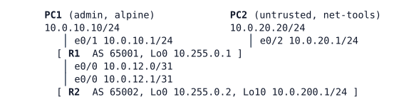

# LAB-040 — Control-plane policing

**Module:** 06 Protection and QoS · **Type:** F (Foundation) · **Guidance tier:** G2 (requirements) · **Estimated time:** 90 min · **Blueprint objectives:** 5.2.b:I (control-plane protection), 1.4:P (QoS grammar reused)

## Scenario
Veridian's Internet-edge routers will be protected against floods and scans aimed at the router itself. The network team rehearses on a bench: R1 is the router to protect, R2 is its routing peer, PC1 is the administrator's workstation and PC2 is a host on an untrusted LAN that can flood and scan R1. Your job is to find out what normal traffic to R1's own CPU looks like, then build a policy that keeps routing and administration alive while PC2 attacks, and explain where each kind of packet ends up.

## Objectives
- Measure control-plane load per traffic type and turn the measurements into a rate table.
- Build a control-plane policy with one class per traffic type, using the same policy grammar as in LAB-039.
- Prove with offered load and counters which class dropped which traffic.
- Explain how a packet that a class ACL denies is treated, and what happens when a routing protocol is policed together with a flood.

## Available Information

| Device | Interface | Peer | Address |
|---|---|---|---|
| R1 | e0/0 | R2 e0/0 | 10.0.12.0/31 |
| R1 | e0/1 | PC1 (admin LAN) | 10.0.10.1/24 |
| R1 | e0/2 | PC2 (untrusted LAN) | 10.0.20.1/24 |
| R1 | Lo0 | - | 10.255.0.1/32 |
| R2 | e0/0 | R1 e0/0 | 10.0.12.1/31 |
| R2 | Lo0 / Lo10 | - | 10.255.0.2/32 / 10.0.200.1/24 |

- Routing: OSPF process 1, area 0, point-to-point link with hello 1 s / dead 4 s, carries the loopbacks and LANs. eBGP between R1 (AS 65001) and R2 (AS 65002) on the link addresses; R2 announces 10.0.200.0/24.
- Management of R1: SSH only (VTY 0-4, local login), SNMPv3 authPriv (user `nms`). Credentials: `admin` / `Cisco123!`. Consoles open in privileged mode; VTY/SSH access keeps normal authentication.
- PC2 is a `net-tools` node (root): `ping -f`, `nmap`, `nc`, `iperf3`, `tshark`, `snmpwalk`. It has no `hping3` and no iperf v2. PC1 is an alpine host (`ssh`, `ping`, `nc`). Use `ssh admin@10.0.10.1` from PC1 and type the password.
- The lab does not use real production rates. All rates here are lab-scaled so that alpine and net-tools traffic makes the counters move. Packet counts of "attack" traffic are small compared with real floods.
- Failure method used in R5: a configuration change on R1 (no link is pulled).

## Control-plane policing in brief

Background for the requirements.

- **Control plane:** the traffic the router CPU itself must process: routing protocol packets, management sessions (SSH, Telnet, SNMP), ICMP addressed to the router, and anything punted to the CPU. Transit traffic is forwarded in hardware or the data plane and is not part of it.
- **Why police it:** the CPU is a shared, limited resource. A flood or scan aimed at the router can starve routing protocols and management. Control-plane policing (CoPP) limits how much of each traffic type reaches the CPU.
- **Building blocks:** the same MQC grammar as before. An ACL classifies a traffic type, a `class-map` references it with `match access-group`, and a `policy-map` lists the classes in order with a `police` action per class. A `permit` entry in the class ACL means "in this class"; a `deny` entry means "not in this class", so the packet is tested against the next class. Traffic that matches no class falls into `class class-default`.
- **Policing:** `police cir <bps>` sets the committed rate, with a burst allowance. Packets within the rate are conformed, the rest exceed. Each is given an action such as `transmit` or `drop`. Choosing the rates and the burst is a design decision based on measured normal load.
- **Attaching it:** enter `control-plane` in global configuration, then `service-policy input POLICYNAME`. It applies only to traffic going to the CPU, and only one input policy can be attached at a time.
- **Show commands:** `show policy-map control-plane` (per-class conformed and exceeded counters), `show access-lists`.

## Starting State
OSPF and eBGP are up between R1 and R2 and SSH from PC1 to R1 works. R1 has no control-plane policy. Allow about 60 s after the nodes are BOOTED for the BGP session to come up.

## Requirements / Change Requests
R1. Measure how much traffic R1's control plane receives from each of these types during about one minute of normal operation: routing protocols from the peer, management from the admin LAN, ICMP addressed to R1, protocols you consider undesirable, and everything else. Include one or more SSH logins and one ping per second from PC1 in the load. Write a rate table (packets and bits per second per type).
R2. Build a control-plane policy on R1 with these classes:
  - routing traffic from the peer (OSPF and BGP) is never dropped;
  - SSH and SNMP are accepted only from the admin LAN and are policed; SSH from PC1 must remain usable (it needs a larger burst than a ping);
  - ICMP addressed to R1 is policed at a low rate;
  - Telnet, TFTP and remote-shell traffic is always dropped;
  - everything else is policed at a low rate in the default class.
  Use rates based on your R1 table.
R3. While PC2 floods R1 with ICMP and scans its ports, OSPF and BGP stay up, SSH from PC1 stays usable, and the counters show which class dropped the attack. Also run a fast scan long enough to push traffic into the default class.
R4. Show with counters where a packet that a class ACL denies ended up: temporarily add a `deny` for SSH at the top of the management ACL, log in from PC1 and observe. Remove it afterwards.
R5. Experiment: make R1 classify ICMP together with the routing protocols and police that class at the ICMP rate. Flood R1 from PC2 for about 60 seconds, first with 500-byte packets, then with minimum-size packets, and observe the OSPF adjacency and the BGP session, then restore the design.

## Verification Criteria
V1. Your rate table exists, with a value per traffic type, and the rates you configured are justified by it.
V2. With the policy in place and PC2 flooding and scanning, the OSPF neighbour and the BGP session on R1 show uninterrupted uptime from before the attack to after it.
V3. SSH from PC1 to R1 succeeds during the flood. SSH from PC2 to R1 does not succeed.
V4. The control-plane counters show exceeded packets for the ICMP class during the ICMP flood and for the default class during the fast scan, and none for routing traffic. A Telnet connection attempt from PC2 gets no answer, while a probe of a closed port is answered.
V5. Toolkit: you can show `show policy-map control-plane` counters before and after a test and state the delta per class.
V6. For R4, the counters show where the SSH packets were counted while the deny was present.
V7. For R5, you recorded the time from the change to the loss of OSPF, the state of BGP after about 60 s, and restored both.

## Analysis Questions
Q1. Why does a control-plane policy not protect R1 against traffic that crosses it?
Q2. How did you choose each rate and burst, and how would you choose them in production?
Q3. A class ACL contains `deny tcp any any eq 22`. What happens to an SSH packet that matches only that line?
Q4. Compare a control-plane policy with a VTY access-class and an interface ACL as ways to protect SSH to the router.
Q5. In R5, what happened to OSPF (hello 1 s, dead 4 s) and to BGP during each flood? Explain each from its timers and transport, and say why the packet size mattered.
