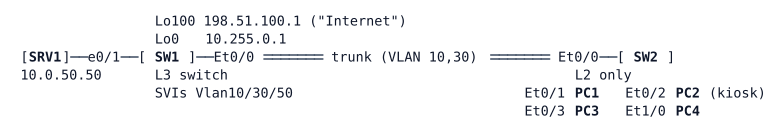

# LAB-041 — Filtering inside the VLAN

**Module:** 06 Protection and QoS · **Type:** F (Foundation) · **Guidance tier:** G2 (requirements) · **Estimated time:** 90 min · **Blueprint objectives:** 5.2.a:P (device access control, ACLs), 3.1.a:R (Layer 2 VLANs)

## Scenario

Veridian Components is rolling out a guest VLAN and a lobby kiosk at HQ. Guests must not see each other, the kiosk may only reach the visitor web server, and users reach the server LAN only for web and ping. The team rehearses on two switches that use HQ's VLAN numbers. You configure the filters and prove, with counters, which filter dropped what.

## Objectives

- Filter traffic between hosts of the same VLAN, at a port, and between VLANs.
- Explain the order in which the filters see a packet and what the end of a filter does to traffic it does not name.
- Keep ARP working under every filter and prove it.
- Choose the right filter for intra-VLAN and inter-VLAN policy.

## Available Information

| VLAN | Name | Subnet | Gateway | Hosts |
|---|---|---|---|---|
| 10 | USERS | 10.0.10.0/24 | SW1 Vlan10 .1 (SW2 management SVI .2) | PC1 .11, PC2 (kiosk) .12 |
| 30 | GUEST | 10.0.30.0/24 | SW1 Vlan30 .1 | PC3 .31, PC4 .32 |
| 50 | SERVERS | 10.0.50.0/24 | SW1 Vlan50 .1 | SRV1 .50 (web on TCP 80) |

- SW1 and SW2 are IOS XE Layer 2 images (ioll2-xe). SW1 routes (`ip routing`); SW2 is a pure Layer 2 switch with no SVI in VLAN 30.
- Credentials: `admin` / `Cisco123!` on both switches; enable secret `Cisco123!`. Hosts: `cisco` / `cisco`. The host user is not root: use `sudo -n` for `ip neigh flush all` and `ip addr` changes on a host.
- Hosts are Alpine Linux (`ping`, `wget`, `nc`). The first ping between a pair can lose one packet to ARP: use `ping -c 3`.

## VLAN maps in brief

Background for the requirements.

- **VLAN map (VACL):** a filter applied to all traffic in a VLAN, bridged or routed, on the switch where it is applied. It is built from an access-map: a named list of numbered sequences. Each sequence has an optional `match` clause that references a named ACL (`match ip address NAME`, `match mac address NAME`) and an `action` of `forward` or `drop`. Sequences are evaluated in ascending order; the first one whose match hits decides.
- **ACL role:** the ACL referenced by a `match` only classifies traffic. A `permit` entry means "matches this sequence", and the sequence's action then forwards or drops it. A `deny` entry means "does not match this sequence", so evaluation moves on to the next sequence.
- **Implicit end:** traffic that matches no sequence is dropped when the map has no final sequence without a `match` clause. A sequence with an action and no `match` matches everything.
- **Applying it:** `vlan filter MAPNAME vlan-list VLANS` in global configuration. The map does nothing until it is applied to a VLAN, and it acts only on the switch where the filter is configured.
- **Reference chain:** `vlan filter` -> access-map -> sequence -> ACL. A missing or misspelled name anywhere in the chain changes the result.
- **Related filters:** a router ACL on an SVI (RACL) acts on routed traffic, and a port ACL (PACL) acts on one Layer 2 port. When several apply, each filters on its own.
- **Show commands:** `show vlan access-map`, `show vlan filter`, `show ip access-lists`.

## Starting State

VLANs, the trunk and the SVIs are up. Every host reaches every other host, the Internet loopback and SRV1's web page. No ACLs, VLAN maps or filters are configured.

## Requirements / Change Requests

R1: Guests (VLAN 30) cannot reach each other (PC3 and PC4 hang off the same switch), but still reach their gateway 10.0.30.1 and the Internet loopback.
R2: The kiosk port (SW2 Et0/2) reaches only SRV1 on TCP 80 (and resolves ARP). Everything else from that port is dropped, whatever IP address the kiosk is given.
R3: Users (VLAN 10) reach the server LAN 10.0.50.0/24 only for web (TCP 80) and ping; other traffic to it is dropped. Guests reach nothing internal (10.0.0.0/8) except their gateway.
R4: Every filter keeps ARP working: prove it after clearing the ARP caches of the hosts involved.
R5: For one blocked flow per filter type (port, VLAN, router), show which filter dropped it, the order in which the filters see a packet, and the counter that proves it.

Use ACL and VLAN map names of your choice. Make no other change to addressing or routing.

## Verification Criteria

V1: PC3 and PC4 cannot ping each other (100% loss) while PC3 and PC4 each still ping 10.0.30.1 and 198.51.100.1.
V2: From the kiosk (PC2), `wget` to SRV1 succeeds; ping to SRV1 and to 198.51.100.1 fail; after adding a second address 10.0.10.77/24 to the kiosk and using it as source, TCP 80 to SRV1 still works and TCP 22 and ping to PC1 still fail.
V3: PC1 pings SRV1 and fetches its web page; TCP 22 to SRV1 from PC1 fails; PC3 cannot reach SRV1.
V4: After `sudo -n ip neigh flush all` on the hosts, every flow allowed above works again and the neighbour table is repopulated.
V5: For each filter type you can show a non-zero match counter on the entry that dropped the flow (the VLAN map has no counters of its own: use the ACL it references), and the filter you chose for R1 is shown applied (`show vlan access-map` / `show vlan filter`, or `show ip access-lists` for the other types) with its counters.

## Analysis Questions

Q1: Which filter types could satisfy R1, and why did you reject the others?
Q2: Remove the final forward sequence of your VLAN map and observe VLAN 30. What happens to IP traffic and to ARP, and why? What additional element changes the ARP result?
Q3: List, in order, every filter a packet from PC1 to SRV1 meets on this platform, and which of them you could prove (with counters) is evaluated.
Q4: Which filter type did you use for R2, and why not the alternatives?
Q5: When would private VLANs replace R1's VLAN map?
Q6: Can a port ACL be applied outbound on a switchport here, and what does that mean for where you place filters?
