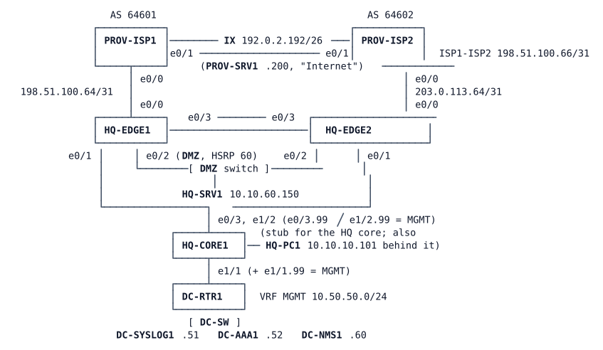

# LAB-042 — Protecting the Edge

**Module:** 06 Protection and QoS · **Type:** X/N (Expansion/Integration) · **Guidance tier:** G2 (requirements: behaviour, no commands) · **Estimated time:** 185 min · **Blueprint objectives:** 5.2.a:R (device access control), 5.2.b:P (control-plane policing), 4.2:P (flow export), 5.1.b:R (AAA), IPv6:R (IPv6 ACLs)

## Scenario

Veridian Systems has two Internet edge routers, HQ-EDGE1 (ISP-A) and HQ-EDGE2 (ISP-B). After the management project, HQ-EDGE1 follows the company management standard, and a contractor brought HQ-EDGE2 to the same standard last week. The security team's edge project now has three open findings:

1. The contractor's work on HQ-EDGE2 is not yet accepted: the security team accepts it only after an audit against the management standard.
2. Nothing filters what the two providers send towards Veridian.
3. Nobody can say what traffic crosses the edge, and the capacity team wants flow records in the data centre.

You protect the edge without breaking it: routing, redundancy, address translation and the reachability tracking that drives the failover must keep working while the protection is in place.

## Objectives

- Audit a router against the management standard with one recorded check per item, and bring it to the standard where it falls short.
- Design a stateless Internet-edge ingress policy for IPv4 and IPv6 from first principles.
- Protect the control plane of a production-like router with classes for routing, management, monitoring and hostile traffic, and size the rates from your own measurements.
- Record flows with two monitor placements and export them from the management interface into the management VRF.
- Prove, from counters, logs and flow records, which control handled which kind of traffic, and document it.

## Available Information

### Topology

HQ-CORE1 is a stub: it stands in for the HQ core, so HQ-PC1 and the data-centre block hang off it. PC1 has no path into the management network (10.50.50.0/24); only the routers' MGMT subinterfaces and DC-NMS1 do.

### Addressing

| Item | EDGE1 | EDGE2 |
|---|---|---|
| Provider link (edge / provider) | 198.51.100.65 / .64 (/31), 2001:db8:f001:ffff::65 / ::64 (/127), AS 64601 | 203.0.113.65 / .64 (/31), 2001:db8:f002:ffff::65 / ::64 (/127), AS 64602 |
| Reachability probe target (pinned) | 198.51.100.1 | 203.0.113.1 |
| NAT pool (overload) | 192.0.2.1 (192.0.2.0/26) | 192.0.2.65 (192.0.2.64/26) |
| DMZ published server | 10.10.60.150 = 192.0.2.130 (192.0.2.128/26); IPv6 2001:db8:10:60::150 | same |
| HSRP (group 60, DMZ segment) | priority 110, 10.10.60.1 virtual | priority 100 |
| MGMT subinterface (VRF MGMT, OSPF 99) | e0/1.99 10.10.254.5/31 | e0/1.99 10.10.254.9/31 |
| Loopback (iBGP, AS 65010) | 10.255.10.31, 2001:db8:ffff:10::31 | 10.255.10.32, 2001:db8:ffff:10::32 |

Veridian's own public space is 192.0.2.0/26, 192.0.2.64/26 and 192.0.2.128/26 (in use) and 2001:db8:10::/48. 192.0.2.192/26 belongs to the Internet exchange and PROV-SRV1 (192.0.2.200, 2001:db8:f001:200::200), not to Veridian. Inside, HQ-PC1 is 10.10.10.101 / 2001:db8:10:10::101 and HQ-SRV1 is 10.10.60.150.

Management services (VRF MGMT, 10.50.50.0/24): DC-SYSLOG1 10.50.50.51, DC-AAA1 10.50.50.52 (RADIUS), DC-NMS1 10.50.50.60 (flow collector on UDP 2055, SNMP manager, NTP source via DC-RTR1 10.50.50.1). Management stations may also come from 10.10.99.0/24.

### Credentials and tools

- Consoles open in privileged mode. SSH to the edges needs an account: central `netadmin` / `netpass` (privilege 15) and `netops` / `opspass` (privilege 1) on DC-AAA1, local fallback `admin` / `Cisco123!`. Linux nodes: `cisco` / `cisco`. SNMPv3 (the standard's credentials): user `nmsuser`, SHA / AES-128, keys `AUTHPASS123` / `PRIVPASS123`; RADIUS key `RADKEY123`; NTP key 1 `NTPKEY123`.
- From DC-NMS1 scripted SSH works with an `SSH_ASKPASS` helper (there is no `sshpass`). `snmpwalk` and `tshark` are installed there. To read exported flows: `tshark -l -i eth0 -f "udp port 2055" -w /tmp/x.pcap`, stop it, then `tshark -2 -r /tmp/x.pcap -d udp.port==2055,cflow -T fields -e cflow.srcaddr -e cflow.dstaddr ...`.
- On PROV-SRV1 (the "hostile" provider-side host) run `hostile.sh flood|probe|spoof|web|all`. It targets HQ-EDGE1's provider-facing address 198.51.100.65: `probe` tries TCP 22, 23, 80, 179 and 443 (`rc=1` means no connection), `spoof` pings with the source 192.0.2.10 (an address inside Veridian's space), `web` requests the DMZ web server 192.0.2.130, `flood` sends a 40-second large-packet ping flood. Do not use `ping -A` on the Alpine hosts (it hangs the console).
- DC-SYSLOG1 and DC-AAA1 are service nodes with no CLI: read their output with `tools/cml-rest.sh log <lab> <node> <lines> <regex>`.
- Provider routers send IPv6 router advertisements to FF02::1; expect some log noise from them once logging is on.

## Starting State

- Routing is up: eBGP to both providers (both address families), iBGP between the edges, OSPF and OSPFv3 to the core stub, OSPF 99 in VRF MGMT on the edges, the stub and DC-RTR1. NAT (overload and the static DMZ translation), HSRP (EDGE1 active) and the reachability tracks (10 on EDGE1, 20 on EDGE2) work. HQ-PC1 reaches PROV-SRV1 over IPv4 and IPv6.
- HQ-EDGE1 is already hardened to the management standard (central accounts with fallback, logging to DC-SYSLOG1, SNMPv3, authenticated NTP, VTY access only from the management networks). Authenticated NTP needs about 25 minutes after boot to select its server.
- HQ-EDGE2 was configured by the contractor for the same management standard (accounts, logging, monitoring access, time, VTY access). Its authenticated NTP also needs about 25 minutes after boot to select its server. The audit is the only acceptance test.
- Neither edge has an ingress ACL, a control-plane policy or flow monitoring. The management network 10.50.50.0/24 is reachable from the routers and DC-NMS1 only.

## Requirements / Change Requests

R1. Audit HQ-EDGE2 against the management standard, using HQ-EDGE1 as the reference, and correct anything that does not meet it. The standard has five items: central accounts with local fallback (console excluded), logging to the DC, monitoring access at the strongest protection the platform supports, authenticated time from the DC, and management sessions only from the management networks. Record one check and its result per item and device, run from DC-NMS1 (for the two logins you can use the consoles' SSH or a helper). Plan for about 10 minutes for the audit itself; the NTP item can only be judged about 25 minutes after boot (until then record "server configured, selection pending"). Differences between the standard and the 032 policy that module 05 documents are part of the standard, not findings.
R2. Both edges filter what the providers send in, for IPv4 and IPv6 (build it so a router can tell its own provider-facing address from transit traffic): no spoofed or bogon sources (private, loopback, link-local IPv4, multicast, ULA and multicast IPv6, and Veridian's own address space as a source); nothing addressed to the routers themselves except the provider's routing session, the reachability-probe replies (from the pinned target only) and pings of the provider-facing address; return traffic for inside users (no stateful inspection is available on this platform, so say in your design what that rule allows); the published DMZ web service (HTTP only); neighbour discovery and what IPv6 needs to work. Denied packets are logged to the collector.
R3. Both edges protect their control plane: routing sessions, HSRP and the probe replies are never dropped; management is accepted only from the management networks; ICMP and everything else addressed to the router is rate-limited, and traffic classes with no business reaching the router are dropped. Choose rates from what you measure on your own edge, not from a guess. The rates in this lab are lab-scaled so that the provider-side scripts move the counters.
R4. Both edges record flows (5-tuple, input interface, bytes, packets, timestamps) for inside traffic using inside addresses and for traffic arriving from the provider, and export them to DC-NMS1 from their management interface so records arrive within a minute of a flow ending. IPv4 flows only on this platform.
R5. Run the hostile-traffic script from PROV-SRV1 and show for each part (flood, probes, spoofed source, web request) which control handled it, from counters, logs and flow records.
R6. Write the edge protection matrix: per traffic type, the control that permits or drops it and the test that proves it.

## Verification Criteria

V1. From DC-NMS1, a central account logs in to both edges (privilege 15 for the administrator account, privilege 1 for the operator account); with DC-AAA1 stopped the local fallback still works on both. SNMPv3 from DC-NMS1 answers on both edges at the level the standard requires, and both edges select the DC as their NTP source (`show ntp associations` marks `10.50.50.1` with `*`, sys.peer). Allow about 25 minutes (up to about 30) after boot: on IOL `show ntp status` can still read `Clock is unsynchronized` for some time after the server is selected.
V2. From PROV-SRV1: TCP 22, 23, 80, 179 and 443 to 198.51.100.65 do not connect; the spoofed-source ping gets no reply; the web request to 192.0.2.130 succeeds; an ordinary ping of 198.51.100.65 is answered; neither 192.0.2.130 nor 192.0.2.1 answers a ping.
V3. During the 40-second flood, both BGP sessions and OSPF adjacencies on HQ-EDGE1 keep their uptime, track 10 stays Up, the probe-reply class has no drops, SSH from DC-NMS1 still works, and the counters show the flood policed by the class meant for it.
V4. DC-SYSLOG1 holds log lines for denied packets from both address families (include the spoofed ping and a denied TCP 179 attempt from the provider-side host).
V5. DC-NMS1 decodes flow records from both edges; a user flow from HQ-PC1 shows the inside address on the inside-facing monitors and the outside address on the provider-facing monitor; the exporter source is the management subinterface and no flow export entry appears in the NAT table.
V6. After the change HQ-PC1 still reaches PROV-SRV1 (IPv4 and IPv6, with `traceroute` through the expected path), the DMZ web service works, both edges keep eBGP and iBGP up in both address families, tracks 10 and 20 are Up, HSRP state is unchanged and PC1 ping/wget still work with NAT in place.
V7. ISP-A cable pull (`shutdown` on both ends of the HQ-EDGE1 / PROV-ISP1 link): track 10 goes Down, PC1 keeps its Internet reachability through HQ-EDGE2 and nothing in the probe-reply class is dropped; after the link returns, HQ-EDGE1 becomes active again. Repeat with a silent failure (`link stop` of that link in CML) and record the detection time, lost pings and recovery.

## Analysis Questions

Q1. Why must the anti-spoofing entry for Veridian's space not be 192.0.2.0/24? Try it and describe what breaks.
Q2. The ingress ACL is stateless: what does your return-traffic rule allow that a stateful firewall would not?
Q3. Which addresses did each flow monitor show for the same user flow, and why?
Q4. Which of your controls would have stopped the flood if the control-plane policy were absent, and which would not?
Q5. Why does a control-plane class for the probe replies matter more on this edge than on a lab bench with no tracked failover?
Q6. Where does the management traffic of the edge leave the router, and why is it neither translated nor filtered by the ingress ACL?
Q7. What happens to flow records and to logs while the data-centre link is down, and what is lost for good?
