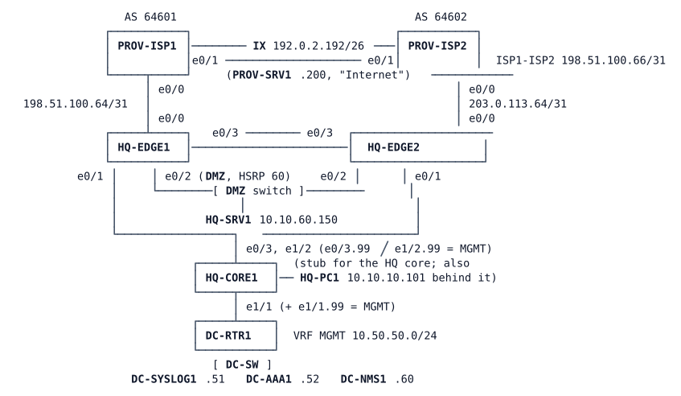

# LAB-043 — Flapping at the Edge

**Module:** 06 Protection and QoS · **Type:** T (Troubleshooting) · **Guidance tier:** G1 (business outcomes and tickets) · **Estimated time:** 150 min · **Blueprint domains:** 3, 4, 5

## Scenario

A week ago the network team applied an "edge configuration tidy-up" to Veridian Systems' two Internet edge routers, HQ-EDGE1 (ISP-A) and HQ-EDGE2 (ISP-B). The change log has one line and no device list. Since then two tickets have arrived (see Reported Problems). You are the on-call engineer: find out what is wrong, fix it without weakening the documented design, and prove the fix.

## Objectives

- Trace an intermittent user-visible failure through routing, redundancy, tracking and protection features to the device and function that causes it.
- Separate the cause of a symptom from its consequences and from things that merely look suspicious.
- Restore the documented design: a fix that only hides a symptom is not accepted.
- Prove the result with counters, logs, flow records and failover drills, and write the post-change test list the change should have had.

## Available Information

### Topology

HQ-CORE1 is a stub that stands in for the HQ core: HQ-PC1 and the data-centre block hang off it. PC1 has no path into the management network (10.50.50.0/24); that is expected.

### Addressing

| Item | EDGE1 | EDGE2 |
|---|---|---|
| Provider link (edge / provider) | 198.51.100.65 / .64 (/31), AS 64601 | 203.0.113.65 / .64 (/31), AS 64602 |
| Reachability probe target (pinned) | 198.51.100.1 | 203.0.113.1 |
| NAT pool (overload) | 192.0.2.1 (192.0.2.0/26) | 192.0.2.65 (192.0.2.64/26) |
| DMZ published server | 10.10.60.150 = 192.0.2.130 (192.0.2.128/26) | same |
| HSRP (group 60, DMZ segment) | priority 110, 10.10.60.1 virtual | priority 100 |
| MGMT subinterface (VRF MGMT, OSPF 99) | e0/1.99 10.10.254.5/31 | e0/1.99 10.10.254.9/31 |
| Default route to the core (OSPF) | metric 10 | metric 30 |

Veridian's own public space is 192.0.2.0/26, 192.0.2.64/26 and 192.0.2.128/26. 192.0.2.192/26 belongs to the Internet exchange and PROV-SRV1 (192.0.2.200, the "Internet" host), not to Veridian. HQ-PC1 is 10.10.10.101. Management services (VRF MGMT, 10.50.50.0/24): DC-SYSLOG1 .51, DC-AAA1 .52, DC-NMS1 .60 (flow collector on UDP 2055, SNMP manager, `tshark` installed).

### Documented design (the "policy statements")

- Outbound Internet traffic prefers ISP-A; ISP-B is the backup. The router at each provider decides with a reachability probe to the pinned target above. Failover happens within the times in the commissioning table below, and the HSRP active role follows ISP-A's health.
- Both providers' BGP sessions and the probe replies are protected: no provider-side traffic may cause a session reset, a track change or an OSPF change.
- The edges are protected as built in the previous project: the provider-facing ports accept only what the ingress policy allows (TCP 22, 23, 80, 179 and 443 to the edge's provider address do not connect; a spoofed source from Veridian's own space gets no reply; the published web server 192.0.2.130 answers HTTP; the provider-facing address answers an ordinary ping; neither 192.0.2.130 nor 192.0.2.1 answers a ping), and the router's control plane is rate-limited per traffic class with ICMP held to a low rate.
- Both edges export flow records to DC-NMS1 (UDP 2055) from their management subinterface, and management traffic uses the management VRF only.

Commissioning results for the failover drills (measured on this design when it was accepted):

| Drill | Documented result |
|---|---|
| Cable pull of the ISP-A link (`shutdown` on both ends) | tracking Down within about 7-15 s; a 1/s ping from HQ-PC1 loses no packets; HSRP active returns to EDGE1 30-60 s after BGP is back up |
| Cable pull of the ISP-B link | tracking Down on EDGE2 within about 7-15 s; user traffic unaffected |
| Silent failure of the ISP-A link (`link stop` in CML) | tracking Down within about 15-25 s; 12-25 lost pings of 100 at 1/s; HSRP active returns 30-60 s after `link start` |

A cable pull means `shutdown` on both ends of the link (the edge port and the provider port). A silent failure means stopping the CML link, which leaves both ports up/up and drops traffic. A one-ended `shutdown` is neither: do not use it for these drills.

### Credentials and tools

- Consoles open in privileged mode. SSH to the edges: central `netadmin` / `netpass` (privilege 15) from DC-NMS1, local fallback `admin` / `Cisco123!`. Linux nodes: `cisco` / `cisco`. Busybox `ping` has `-q -i -s -w -c -I` but no `-f`; do not use `ping -A` on the Alpine hosts.
- On PROV-SRV1 (the provider-side host) the script `hostile.sh flood|swarm|probe|spoof|web|all` targets HQ-EDGE1's provider address 198.51.100.65: `probe` tries TCP 22, 23, 80, 179 and 443 (`rc=1` = no connection), `spoof` pings with the source 192.0.2.10, `web` requests the DMZ web server 192.0.2.130, `flood` sends a 40-second ping flood with large packets, `swarm` sends ten parallel 30-second floods of small packets, `all` runs all five in turn. PROV-SRV1 also runs the provider's own monitoring in the background.
- To read exported flows on DC-NMS1: `tshark -i eth0 -a duration:60 -f "udp port 2055" -d udp.port==2055,cflow -Y cflow -T fields -e ip.src` (this lists the sources of records that arrive on the collector port, UDP 2055). DC-SYSLOG1 and DC-AAA1 are service nodes with no CLI: `tools/cml-rest.sh log <lab> <node> <lines> <regex>`.
- The lab clock is the host's UTC clock. Allow 15 minutes after boot for authenticated NTP.

## Starting State

The lab has been running as built. All routing protocols, NAT, HSRP, the reachability tracks, the edge protection and the flow export are configured and "up" at boot. The problems below need about 5 minutes after boot to show themselves and repeat on a cycle of a few minutes. Start observing at least 5 minutes after boot.

## Requirements / Change Requests

R1. Find and correct whatever causes the reported problems. Corrections must keep the documented design: no feature may be removed or weakened to make a symptom go away.
R2. Show, for each ticket, which device and which function dropped or failed to deliver the traffic you traced, with evidence from the device (counters, logs, tracking history, flow cache or capture).
R3. Prove that the Internet survives the loss of either provider within the commissioning table above, after your corrections.
R4. Prove that the hostile-traffic script leaves routing and tracking undisturbed, and that the protection it exercises is in force.
R5. Write the post-change test list for the edge (answer to Q5).

## Reported Problems

**T1 (service desk, several users).** "Since the middle of last week, calls and big downloads to the Internet drop every few minutes. After a while it works again. Internal applications are fine."

**T2 (capacity team).** "Our flow dashboard has received nothing from one of the two edge routers since the change. The other one is fine."

## Verification Criteria

V1. Over 10 minutes of steady state, starting at least 5 minutes after boot, HQ-PC1 pings 192.0.2.200 at 1/s with no loss, and a repeated HTTP request to 192.0.2.200 (`wget -q -T 5 -O - http://192.0.2.200/`, once per 5 s) never fails.
V2. Drills from the commissioning table: for the ISP-A cable pull, the ISP-B cable pull and the ISP-A silent failure, Internet reachability from HQ-PC1 behaves within the documented result.
V3. `hostile.sh all` from PROV-SRV1 is handled without any change in tracking, any BGP or OSPF session uptime, or HSRP state on the edges, and the flood output shows the ICMP rate still limited (a small fraction of the packets answered).
V4. DC-NMS1 receives flow records from both edges on its collector port, UDP 2055 (two different source addresses in the `tshark` sample with the `-f "udp port 2055"` filter), and management traffic still uses only the management network.
V5. The protection checks listed under Documented design still hold (probes rc=1, spoofed ping unanswered, web request to 192.0.2.130 succeeds, no ping answer from 192.0.2.130 or 192.0.2.1, provider-facing address answers a ping), and the flood and the swarm in V3 are still answered only in a small fraction.

## Analysis Questions

Q1. For each ticket, which evidence first ruled out the most obvious cause?
Q2. How did you prove which device, and which function on it, stopped the traffic you were tracing from being used?
Q3. For each fix, what evidence showed its effect, and how did you check for problems no user had reported yet?
Q4. What monitoring would have caught each problem before the users did?
Q5. Write the post-change test list that should accompany any change to the edge protection policy.
