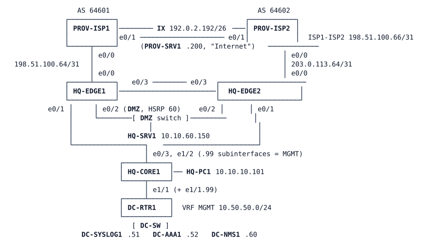

# LAB-044 — Security Architecture Review

**Module:** 06 Protection and QoS · **Type:** A (analysis) · **Guidance tier:** G2 (behaviour, no commands) · **Estimated time:** 90 min · **Blueprint objectives:** 5.4.a:A (threat defence), 5.4.b:A (endpoint security), 5.4.c:A (next-generation firewall), 4.2:R (flow export)

## Scenario

Veridian Systems' CISO is about to budget next year's security spend and asks the network team for a security architecture review. The team has already protected the Internet edge (ingress filtering, control-plane policing, flow export). Before any new product is bought, the CISO wants to know what those controls actually stop, what they cannot see, and where threat defence, endpoint security and a next-generation firewall (NGFW) would fit. The argument must use Veridian's own evidence, not product brochures.

## Objectives

- Generate hostile traffic against the protected edge and collect what each existing control recorded.
- Separate traffic that was stopped, traffic that was only seen, and traffic nobody saw.
- Use flow data as security telemetry (4.2) to find a quiet, compromised-looking endpoint.
- Explain what threat-defence services, endpoint security and an NGFW add to stateless ACLs and control-plane policing.
- Rank three security investments for the CISO and justify them with evidence.

## Available Information

### Topology

The topology is the protected Internet edge of the Veridian lab: two edge routers, two provider routers, a stub core with the HQ client, a DMZ server and a data-centre block with the management services.

### Addressing

| Item | HQ-EDGE1 | HQ-EDGE2 |
|---|---|---|
| Provider link (edge / provider) | 198.51.100.65 / .64 (/31), AS 64601 | 203.0.113.65 / .64 (/31), AS 64602 |
| NAT pool (overload) | 192.0.2.1 (192.0.2.0/26) | 192.0.2.65 (192.0.2.64/26) |
| DMZ published server | 10.10.60.150 = 192.0.2.130 (TCP 80 only) | same |
| HSRP (group 60) | priority 110 (active) | priority 100 |
| MGMT subinterface (VRF MGMT) | e0/1.99 10.10.254.5/31 | e0/1.99 10.10.254.9/31 |

Veridian's own public space is 192.0.2.0/25 and 192.0.2.128/26. 192.0.2.192/26 belongs to the Internet exchange: PROV-SRV1 (192.0.2.200) is "the Internet". HQ-PC1 is 10.10.10.101. Management services (VRF MGMT): DC-SYSLOG1 10.50.50.51, DC-AAA1 10.50.50.52, DC-NMS1 10.50.50.60 (flow collector on UDP 2055).

### Credentials and tools

- Consoles open in privileged mode. Linux nodes: `cisco` / `cisco`. SSH to the edges: `netadmin` / `netpass` (privilege 15), local fallback `admin` / `Cisco123!`. RADIUS key `RADKEY123`.
- **The red team** is a script on PROV-SRV1: `redteam.sh` runs the edge-protection test (`hostile.sh all`: port probe of the provider-facing address, spoofed-source pings, a request to the DMZ web server, a 40-second large-packet ping flood) and then a slow port sweep of 192.0.2.130 (`sweep.sh`, thirteen TCP ports, one every 3 seconds). It takes about 100 seconds and ends by itself. `hostile.sh` and `sweep.sh` can also be run alone. Do not use `ping -A` on the Alpine hosts.
- **The beacon** is a script on one inside host. It starts shortly after the node boots and runs forever; it stands in for a compromised endpoint. It is not disclosed which host, or where it connects. It does not need to be stopped during the review.
- Edge flow export: the routers export IPv4 flows to DC-NMS1 (UDP 2055). A router flow cache entry on this platform expires after a fixed 15 s of inactivity (1800 s active), so read the cache while traffic runs, or read the exported records on DC-NMS1 (`tshark`, `-d udp.port==2055,cflow`). Flow export is IPv4 only here.
- DC-SYSLOG1 and DC-AAA1 are service nodes without CLI: read their output with `tools/cml-rest.sh log <lab> <node> <lines> <regex>`.
- No NGFW, IPS, ISE or endpoint-security product is present in this lab: Q3 and Q4 are design questions answered from the evidence you collect. 802.1X can be configured on the lab's access switch image but does not authenticate anything here.

## Starting State

- This is the EDGE E3 stage (the protected edge as delivered by LAB-042): eBGP to both providers, OSPF to the core stub, HSRP on the DMZ (HQ-EDGE1 active), NAT, an ingress filter on each provider-facing interface, a control-plane policy and IPv4 flow export from both edges, syslog to DC-SYSLOG1. No fault is present.
- HQ-PC1 reaches PROV-SRV1. The beacon has been running since shortly after boot. Nothing has been run from PROV-SRV1 yet; counters of the filter and control-plane policy are untouched.
- Authenticated NTP on the edges needs about 15 minutes after boot to select its server. Wait 3 minutes after boot before collecting evidence.
- You may use your own finished LAB-042 instead of this lab, if you add the two scripts.

## Security product categories in brief

Background for Q2 to Q4.

- **Flow analytics / network detection and response (NDR):** consumes exported flow records (who talked to whom, on which port, how much, how often) and looks for behaviour patterns instead of single packets. It sees metadata, not payload, and decides after the fact.
- **Threat-defence / IPS services:** inspect packet and session content against signatures and anomaly rules inline, and can drop. They need to sit in the traffic path and to see decrypted or decryptable content to judge it.
- **Next-generation firewall (NGFW):** a stateful firewall that tracks sessions in its own table and adds application identification, user identity and IPS in the same device; policy is written in terms of applications and users instead of ports and addresses.
- **Endpoint security:** runs on the host. EDR records process, file and network activity on the host and can isolate it; posture checks decide whether a device meets a standard before it gets access; 802.1X is port-based network access control that authenticates a device or user at the access port with a supplicant, an authenticator and an authentication server.
- Where to read: Cisco Secure Firewall (FTD) configuration guide, Cisco Secure Network Analytics (Stealthwatch) overview, Cisco Secure Endpoint overview and Cisco ISE 802.1X/posture overview, plus the CCNP ENCOR 5.4 section of your study guide.

## Requirements / Change Requests

No configuration changes are requested. The review has these tasks:

R1. Run the red team once and, for each of its four traffic types (probe, spoof, web request, flood) and for the port sweep, record what the existing controls logged or counted.
R2. Record, for the same run, what the edge flow data shows for each type, at the inside and at the provider-facing view.
R3. Using only flow data (the router cache, the export on DC-NMS1, or both), identify the beacon: source, destination, port, size and rhythm.
R4. Prove that no filter or control-plane counter recorded the beacon, and that the beacon and the red team did not disturb routing, HSRP or the reachability tracking.
R5. Produce a one-page recommendation for the CISO: three ranked investments, each with the evidence from R1 to R4.

## Verification Criteria

V1. For each red-team traffic type you can name the control that stopped it (or state that it was permitted), the control that recorded it, and where you read that record.
V2. You can show at least four flow records of the beacon (capture for about 120 s if a 75 s window gives fewer) with identical destination and port and different source ports, and compute its period and per-session size from them.
V3. The deny counters and logs for the review window show no entry for the beacon's destination address and port.
V4. After the scripts have finished, eBGP (both address families), OSPF, HSRP and the reachability track are in the same state as before, and HQ-PC1 still reaches PROV-SRV1.
V5. The published DMZ service still answers during the sweep and the other twelve swept ports do not.
V6. Your recommendation names three investments in rank order, and each is supported by a specific observation from V1 to V5.

## Analysis Questions

Q1. Run the red team. For each traffic type and for the sweep: which Veridian control saw it, which stopped it, and which saw nothing?
Q2. The beacon passed every control. What in the flow data distinguishes it from ordinary user traffic, and which product category would raise it automatically?
Q3. What would an NGFW at this edge do differently from the ingress filter for the beacon, the sweep and the published web service?
Q4. Where in Veridian (HQ access, guest network, DMZ) would endpoint controls (posture, 802.1X, EDR) have stopped or attributed the beacon earlier, and what does 802.1X need that this lab cannot show?
Q5. Rank three investments for the CISO and give the evidence for each.
Q6. What does the control-plane policy protect that none of those products protects?
