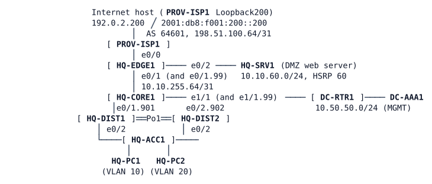

# LAB-045 — Operations Shift 1

**Module:** 06 Protection and QoS · **Type:** T/N (Troubleshooting/Integration, mixed operations) · **Guidance tier:** G1 (business outcomes and tickets) · **Estimated time:** 165 min · **Blueprint domains:** 3, 5

## Scenario

You take the Monday shift in the Veridian Systems network operations centre. The hand-over pack holds the design of the headquarters (HQ) network, a neutral change log and the shift rules. Four tickets are waiting. Work through them, keep the documented design intact, prove each outcome from the user's point of view, and write the hand-over for the next shift.

**Change log (last two weeks, no device list):**

- "Area 10 (distribution block) converted to NSSA (approved design change)."
- "Weekend configuration compare and clean-up on several devices."

**Shift rules**

1. Log in to network devices with your central account `netadmin` (password `netpass`). The local account `admin` is break-glass only.
2. No reboots, wipes or node stops: all fixes are made on the running configuration.
3. Every fix must keep the documented design (see Available Information). A workaround that contradicts the design is not a fix.
4. Save nothing you cannot explain in the hand-over.

## Objectives

- Triage four tickets from different parts of the network and find each root cause with evidence rather than guesses.
- Fix each problem so that it stays fixed and the documented design is unchanged.
- Prove each ticket closed and the design intact.
- Prove the result from the user's point of view, including after an Internet uplink failure.
- Produce a shift hand-over.

## Available Information

### Topology

### Addressing

| Item | Value |
|---|---|
| VLAN 10 (floor users) | 10.10.10.0/24, 2001:db8:10:10::/64, gateway 10.10.10.1 (HQ-DIST1/HQ-DIST2) |
| VLAN 20 (OPS room) | 10.10.20.0/24, 2001:db8:10:20::/64, gateway 10.10.20.1 (HQ-CORE1) |
| VLAN 50 | 10.10.50.0/24 (HQ-CORE1) |
| VLAN 99 (management) | 10.10.99.0/24: HQ-CORE1 .2, HQ-DIST1 .11, HQ-DIST2 .12, HQ-ACC1 .21 |
| DMZ | 10.10.60.0/24, 2001:db8:10:60::/64; HQ-SRV1 10.10.60.150 (web server, TCP 80); HQ-EDGE1 .2 |
| Published DMZ server | 192.0.2.130 (TCP 80 only; ICMP from the Internet is not permitted) |
| Hosts | HQ-PC1 10.10.10.101 (VLAN 10), HQ-PC2 10.10.20.102 (VLAN 20); both dual-stack, user `cisco`/`cisco` |
| Management network (VRF MGMT) | 10.50.50.0/24 in the data centre: DC-RTR1 10.50.50.1, DC-AAA1 (RADIUS) 10.50.50.52 |
| Credentials | `netadmin`/`netpass` (central, privilege 15), `netops`/`opspass` (central, read-only), `admin`/`Cisco123!` (local, break-glass) |

Device management is by SSH only, and only from the management host ranges (10.10.99.0/24 and 10.50.50.0/24). There is no NMS host in this shift: reach a device by opening SSH from the VLAN 99 interface of a switch or HQ-CORE1, where that is needed. Device consoles are open from the CML interface.

### Documented design

- OSPF area 10 (the distribution block) is an NSSA in both OSPFv2 and OSPFv3 and is kept small: the core gives it a default route.
- The core advertises the distribution block's user range as one summary, 10.10.0.0/20.
- The core must never install routes for the lab range 10.10.56.0/22 (unused in Veridian's plan), which a test appliance in the DMZ occasionally advertises. The filter is on the core's routing table.
- HQ-DIST1 and HQ-DIST2 are joined by Port-channel 1 with two members.
- The network is dual-stack, with IPv6 Internet through HQ-EDGE1.
- Floor isolation policy (VLAN 10): floor PCs must not talk to one another (IPv4 10.10.10.0/24 to 10.10.10.0/24 is blocked, the gateway addresses 10.10.10.1 to 10.10.10.3 are exempt); all other traffic is permitted.
- No static routes are used inside HQ (apart from the edge's default towards its provider and the management routes).
- Logging, flow export and edge protection lines on the devices are already in place; read logs and counters on the devices (no collector is deployed in this shift).

## Starting State

The lab is fully built, powered on and every routing neighbour shows as up. The central RADIUS server answers logins. The shift starts with the four tickets below.

## Requirements / Change Requests

R1. Resolve TK1 to TK4 (see Reported Problems) so that the documented design is unchanged.
R2. Every fix is made with a central account (`netadmin`) and on the running configuration only.
R3. Prove each ticket closed from the user's point of view (host-side tests), not only from a device.
R4. Prove that internal HQ destinations, including the DMZ, stay reachable if the Internet uplink fails. If you find a weakness, fix its cause, not the symptom.
R5. Write the shift hand-over (Q5).

## Reported Problems

- **TK1 (office floor users):** "We can't open any Internet site since this morning. Teams calls to colleagues and the intranet work. The OPS room next door says the Internet is fine for them."
- **TK2 (web team):** "Nobody inside HQ can reach the DMZ web server by its internal address. Customers on the Internet reach it fine through the public address."
- **TK3 (NOC capacity alarm):** "The link between the two distribution switches is running at half capacity. No user complaints yet."
- **TK4 (IPv6 monitoring):** "Our IPv6 probes from HQ to the Internet have failed since the weekend, from every HQ subnet. The IPv4 probe from the operations subnet is fine."

## Verification Criteria

V1. Every HQ host reaches the Internet host in IPv4 and in IPv6, and the provider router's address on the Internet link (198.51.100.64) in IPv4.
V2. Every HQ host reaches the DMZ web server by its internal address, and an Internet client reaches the published web service (TCP 80) by the public address.
V3. Internal destinations, including the DMZ, stay reachable from HQ while the Internet uplink is down. Test it with a cable pull of the provider link (`shutdown` on both ends of the link between HQ-EDGE1 and PROV-ISP1 Ethernet0/0). Expect HQ-CORE1's default route to disappear within a few seconds of the pull (the eBGP session to the provider drops with the interface), the IP SLA reachability track on HQ-EDGE1 to go Down 10 to 20 s after the pull, and the default route to return 40 to 55 s after the link is restored (`no shutdown` on both ends).
V4. The routing and access filtering design is as documented: area types, summary, filter, defaults, floor isolation, and no static workarounds. State your evidence for each item.
V5. The distribution interconnect runs at full capacity (both members carrying traffic).
V6. All work was done with central accounts: accounting records for `netadmin` exist on DC-AAA1 and no break-glass login was used. (Admin note: if the RADIUS server is unreachable, the local account is the only way in; use it only then, and record it.)

Notes for testing: the first ping from a host to a new destination can lose one packet (ARP). A one-sided `shutdown` leaves the far end up/up; for a cable pull shut both ends.

## Analysis Questions

Q1. For each ticket, what was the first evidence that ruled out the most obvious cause?
Q2. Did any of your fixes interact? How did you check?
Q3. How did you confirm that each fix left no weakness, including during the uplink drill?
Q4. Which tickets would you escalate or record as a problem record, and why?
Q5. Write the shift hand-over: tickets, causes, fixes and the checks you ran.
Q6. Why must the break-glass account stay unused while the central server is up, and what changes when the central server is down?
Q7. For each ticket, what evidence showed that it was closed, and which of your changes were needed to get there?
