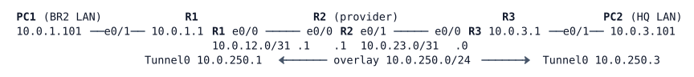

# LAB-046 — GRE Tunnels

**Module:** 07 WAN and Tunnels · **Type:** F (Foundation) · **Guidance tier:** G3 (technology named, goal and constraints given) · **Estimated time:** 120 min · **Blueprint objectives:** 2.2.b:I (GRE tunnel configuration and verification)

## Scenario

Veridian's branch BR2 has only an Internet line. Before the network team builds tunnels across the real Internet, they rehearse on a bench: two sites, one provider router that knows nothing about the sites' private addresses. You will build a GRE tunnel across the provider, route over it, break it in controlled ways and observe what the provider and the tunnel do each time.

## Objectives

- Build a GRE tunnel across a provider that has no route to the site LANs, and show what the provider sees.
- Move from static routes to OSPF over the tunnel.
- Compare tunnel state with and without keepalives when the far end disappears.
- Provoke and recover from recursive routing.
- Size the tunnel for the underlay path: overhead, MTU, TCP MSS and the PMTUD black hole.

## Available Information

| Device | Interface | Address | Connects to |
|---|---|---|---|
| R1 | Ethernet0/0 | 10.0.12.0/31 | R2 Ethernet0/0 |
| R1 | Ethernet0/1 | 10.0.1.1/24 | PC1 |
| R1 | Tunnel0 (you build) | 10.0.250.1/24 | R3 Tunnel0 |
| R2 | Ethernet0/0 | 10.0.12.1/31 | R1 Ethernet0/0 |
| R2 | Ethernet0/1 | 10.0.23.1/31 | R3 Ethernet0/0 |
| R1 | Loopback0 | 10.255.0.1/32 | (router ID) |
| R2 | Loopback0 | 10.255.0.2/32 | (router ID) |
| R3 | Loopback0 | 10.255.0.3/32 | (router ID) |
| R2 | Loopback100 | 10.0.100.1/32 | (provider test address) |
| R3 | Ethernet0/0 | 10.0.23.0/31 | R2 Ethernet0/1 |
| R3 | Ethernet0/1 | 10.0.3.1/24 | PC2 |
| R3 | Tunnel0 (you build) | 10.0.250.3/24 | R1 Tunnel0 |
| PC1 / PC2 | eth0 | 10.0.1.101/24 / 10.0.3.101/24 | gateway .1 of the LAN |

Credentials: console is privileged on every node. Routers `admin` / `Cisco123!`, enable secret `Cisco123!`. Hosts (Alpine Linux) `cisco` / `cisco`; `sudo` works without a password.

Notes for the tools you have:
- The Alpine `ping` has no do-not-fragment option. Run do-not-fragment tests on R1, sourcing from the LAN interface (`ping <PC2> source Ethernet0/1 size <N> df-bit`). On the router, `size` is the whole IP packet; on the host, `-s` is the payload (packet size minus 28).
- Capture with the CML packet capture on a link (right-click the link). The provider link R2-R3 is the one to watch.
- Linux caches a learned path MTU per destination for 10 minutes. Between MTU trials run `sudo ip route flush cache` on PC1.
- For TCP tests, create a file with `head -c 100000 /dev/zero > /tmp/f`, start a listener on PC2 with `nc -l -p <port> > /tmp/rx &`, send with `timeout 20 nc 10.0.3.101 <port> < /tmp/f`, then count the bytes that arrived with `wc -c /tmp/rx`. Use a new port for each trial. (This `nc` returns success even when the data is stuck, so judge by the byte count.)

## Starting State

Addressing and the three routers' baseline management configuration are in place. R1 and R3 each have a static default route towards R2. R2 is the provider: it has only its connected networks and no route to 10.0.1.0/24, 10.0.3.0/24 or the overlay. There are no tunnels, no routing protocol and no MTU customisation. PC1 reaches its gateway; PC1 cannot reach PC2.

## Requirements / Change Requests

Work in order; each step builds on the previous one.

**R1 GRE tunnel.** Build Tunnel0 between R1 and R3, sourced from each router's provider-facing interface, using the overlay addresses in the table. Add static routes so each site reaches the other's LAN through the tunnel. Capture on the R2-R3 link while PC1 pings PC2 and keep the capture summary.
**R2 OSPF over the tunnel.** Remove the static LAN routes. Run OSPF process 1, area 0, on the tunnel and the two site LANs only (LANs passive). Note the OSPF network type and the cost of the tunnel.
**R3 Tunnel state without and with keepalives.** With the tunnel up and no keepalive configured, shut down Tunnel0 on R3 only. Record R1's tunnel line protocol and OSPF neighbour state, and how long R1 takes to lose the OSPF neighbour. Restore, then configure `keepalive 5 3` on both tunnel ends, repeat and record the same. Leave `keepalive 5 3` in place.
**R4 Recursive routing.** Advertise the two underlay /31 networks (R1 and R3 Ethernet0/0) into OSPF as well. Watch the logs on R1 and R3 for at least two minutes. Remove the change and confirm the tunnel recovers. State the design rule this teaches.
**R5 MTU and the PMTUD black hole.**
   1. With the default tunnel MTU, find the largest packet PC1 can send to PC2 without fragmentation (do-not-fragment ping from R1).
   2. On R2 set `ip mtu 1300` on Ethernet0/1 (the link to R3). Capture on the R2-R3 link and observe what R2 does to the GRE packets while PC1 sends a large ping.
   3. Enable `tunnel path-mtu-discovery` on both tunnel ends. Find the new largest working do-not-fragment size, then test again after clearing the PC1 route cache.
   4. The provider now filters ICMP: configure `no ip unreachables` on the R2 interface on which the oversized packets arrive. R1 and R3 have already learned the 1300-byte path and keep it for 10 minutes, so reset that knowledge by removing and re-adding `tunnel path-mtu-discovery` on both, and run `sudo ip route flush cache` on PC1. Show that small pings work while large pings and a 100 kB TCP transfer fail.
   5. Fix it on the tunnel interfaces only, for the 1300-byte path: set the tunnel IP MTU and the TCP MSS clamp so that both the TCP transfer works and a large non-DF ping from PC1 works. Test whether a clamp alone fixes TCP, the ping, or both.
   6. Clean up: remove the changes you made on R2 and remove `tunnel path-mtu-discovery`. Set the final tunnel values for the real 1500-byte underlay: an `ip mtu` that leaves 100 bytes of headroom, and the matching `ip tcp adjust-mss`.

## Verification Criteria

V1: PC1 pings PC2 across the tunnel and a traceroute from PC1 shows the overlay as a single hop (the provider R2 does not appear).
V2: The capture of R1 traffic on the provider link shows IP protocol 47 between the underlay addresses only, with the PC addresses visible only inside the GRE payload.
V3: With OSPF, R1 has an OSPF route to 10.0.3.0/24 via the tunnel and the neighbour is FULL.
V4: After R3 Tunnel0 is shut, the line protocol and the OSPF neighbour state on R1 differ between the no-keepalive and `keepalive 5 3` cases, and your recorded detection times are consistent with the configured timers.
V5: During R4, the log shows the two messages that name the recursion, and after removal the tunnel and OSPF neighbour return to normal.
V6: R5.4 shows pings that fit the path working and larger ones failing silently, and a 100 kB transfer that does not complete.
V7: At the end of R5.5 the TCP transfer completes and a 1400-byte non-DF ping from PC1 works.
V8: Final state: Tunnel0 on both routers has `keepalive 5 3`, `ip mtu 1400`, `ip tcp adjust-mss 1360`; OSPF runs on the tunnel and LANs only; R2 carries none of your lab-step changes; `tunnel path-mtu-discovery` is not configured.

## Analysis Questions

Q1: From your capture, what can the provider see of the site traffic, and what can it not see?
Q2: Why does a GRE tunnel stay up/up when the far end is gone and no keepalive is configured? What does that do to a static route over the tunnel compared with OSPF?
Q3: Describe the recursion cycle step by step, and name two designs that prevent it.
Q4: How many bytes does GRE over IP add here, and what tunnel MTU and TCP MSS follow from a 1500-byte underlay? Which values did you need for the 1300-byte path, and why?
Q5: Why does MSS clamping recover the TCP transfer but not the large do-not-fragment ping?
Q6: Which of the behaviours you observed would differ if the tunnel were protected with IPsec?
