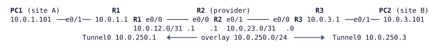

# LAB-047 — IPsec: Crypto Map and Tunnel Protection

**Module:** 07 WAN and Tunnels · **Type:** F (Foundation) · **Guidance tier:** G3 (technology named, goal and constraints given) · **Estimated time:** 120 min · **Blueprint objectives:** 2.2.b:P (tunnel configuration and verification), 3.3.b:R (PAT)

## Scenario

The bench from LAB-046 now has to be encrypted. Site A (the BR2 bench) already reaches the provider's test address through PAT on R1's provider-facing interface. The team compares the two ways Veridian can use IPsec between R1 and R3: a crypto map that encrypts matched traffic on the physical interface, and an IPsec-protected tunnel interface that routing can use. You will also find out how encryption coexists with the PAT that site A uses for Internet access.

## Objectives

- Build an IKEv1 site-to-site VPN with a crypto map and read both IKE phases from the show commands and a capture.
- Find out why correct IPsec configuration can still carry no traffic, and fix it.
- See why a crypto map and a routing protocol do not mix.
- Replace the crypto map with an IKEv2-negotiated, IPsec-protected tunnel interface running OSPF.
- Compare what a one-parameter mismatch does to IKEv1 and IKEv2, and measure how failure detection works.

## Available Information

| Device | Interface | Address | Connects to |
|---|---|---|---|
| R1 | Ethernet0/0 | 10.0.12.0/31 | R2 Ethernet0/0 (PAT outside) |
| R1 | Ethernet0/1 | 10.0.1.1/24 | PC1 (PAT inside) |
| R1 | Loopback0 | 10.255.0.1/32 | (router ID) |
| R1 | Tunnel0 (you build) | 10.0.250.1/24 | R3 Tunnel0 |
| R2 | Ethernet0/0 | 10.0.12.1/31 | R1 Ethernet0/0 |
| R2 | Ethernet0/1 | 10.0.23.1/31 | R3 Ethernet0/0 |
| R2 | Loopback0 / Loopback100 | 10.255.0.2/32 / 10.0.100.1/32 | router ID / provider test address |
| R3 | Ethernet0/0 | 10.0.23.0/31 | R2 Ethernet0/1 |
| R3 | Ethernet0/1 | 10.0.3.1/24 | PC2 |
| R3 | Loopback0 | 10.255.0.3/32 | (router ID) |
| R3 | Tunnel0 (you build) | 10.0.250.3/24 | R1 Tunnel0 |
| PC1 / PC2 | eth0 | 10.0.1.101/24 / 10.0.3.101/24 | gateway .1 of the LAN |

IPsec parameters to use: pre-shared key `VERIDIAN-VPN-KEY`; IKE encryption AES-256, hash SHA-256, DH group 14; IPsec transform set `TS-AES` = ESP AES-256 with SHA-256 HMAC, tunnel mode. Use OSPF process 1, area 0 on the routed tunnel.

Credentials: console is privileged on every node. Routers `admin` / `Cisco123!`, enable secret `Cisco123!`. Hosts (Alpine Linux) `cisco` / `cisco`; `sudo` works without a password.

Platform notes for the tools you have:
- The routers are IOL (iol-xe) images. On this platform a tunnel in the pure IPsec mode (`tunnel mode ipsec ipv4`) negotiates its IKE and IPsec SAs and carries traffic that the router itself generates, but it does not forward traffic from the LAN hosts (the router's CEF drops it as unsupported). This is a limit of the image, not of your configuration. Build your routed tunnel as a GRE tunnel with tunnel protection; R4 asks you to observe the pure IPsec mode so you know the limit.
- Capture with the CML packet capture on a link (right-click the link). The provider links R1-R2 and R2-R3 show what the provider sees.
- The Alpine `ping` loses the first packet after an idle period or a cleared session while IKE negotiates; judge by the rest.
- Do not run `clear ip ospf process` or `clear logging`: both ask for a confirmation that stalls the console tools used here.
- Failure test: the link is stopped in CML (a silent failure: the router interfaces stay up/up).

## Starting State

The addressing and baseline management configuration are in place (LAB-046's bench, without the GRE tunnel and without OSPF). R1 and R3 have static default routes towards R2. R1 performs PAT for 10.0.1.0/24 behind its provider-facing interface Ethernet0/0 (ACL 10 selects the inside addresses). R2 is the provider and knows only its connected networks. PC1 reaches R2's Loopback100 through PAT; PC1 cannot reach PC2. There is no IPsec configuration anywhere.

## IKE and IPsec in brief

Concepts only; the parameters you need are above.

- **Two layers.** IKE negotiates and authenticates; IPsec (ESP) carries the protected traffic. IKE builds the IKE SA (called phase 1 in IKEv1) first, and then a child SA (phase 2, the IPsec SA) that protects the user traffic. An SA is one-way; each IPsec child SA is a pair identified by SPIs.
- **IKEv1 and IKEv2.** IKEv1 uses main mode for phase 1 and quick mode for phase 2. IKEv2 uses IKE_SA_INIT and IKE_AUTH. IKEv2 also has informational exchanges (for example dead-peer detection and deletes).
- **IPsec mode.** Tunnel mode wraps the whole original packet in a new IP header; transport mode keeps the original IP header and protects only the payload. An IPsec SA protects a *traffic selector*: the address pair (or ACL) it was negotiated for.
- **Anti-replay.** ESP numbers its packets; the receiver discards a packet that arrives too far out of order (the replay window).
- **IKEv1 on IOS** is a crypto map: an ISAKMP policy (`crypto isakmp policy`) plus a key, a transform set, a crypto ACL that selects the traffic, and a crypto map applied to the outgoing interface.
- **IKEv2 on IOS** is built from named objects that refer to each other: a *proposal* (algorithms) is referenced by a *policy*; a *keyring* holds the keys; a *profile* names the identity match, the authentication and the keyring; an *IPsec profile* names the transform set and the IKEv2 profile; a tunnel interface applies the IPsec profile with `tunnel protection`.
- **Entry `show` commands.** `show crypto isakmp sa`, `show crypto ikev2 sa`, `show crypto session`, `show crypto ipsec sa`, `show crypto ipsec transform-set`, `show crypto map`.

## Requirements / Change Requests

Work in order; each step builds on the previous one.

**R1 IKEv1 crypto map.** Protect 10.0.1.0/24 to 10.0.3.0/24 (both directions) between R1 and R3 with an IKEv1 crypto map on each provider-facing interface, using the parameters above and static routes so each router reaches the remote LAN through the provider. Ping from PC1 to PC2. If it fails although the IKE and IPsec configuration is correct, find the reason from the NAT translation table and the crypto counters, then fix it so that PC1 reaches PC2 through the VPN and still reaches R2's Loopback100 through PAT.
**R2 Phases and capture.** With the VPN working, show IKE phase 1 and phase 2 state and the IPsec packet counters on R1 and R3. Run `clear crypto session` on both routers, capture on the R1-R2 link while PC1 pings PC2, and keep the capture summary: which protocols and exchange types appear, in which order.
**R3 Routing over the crypto map.** Enable OSPF on the R1 and R3 provider-facing and LAN interfaces while the crypto map is in place. Record whether a neighbour forms, and use the counters to explain the result. Remove the OSPF change afterwards.
**R4 Routed tunnel with IKEv2.** Replace the crypto map with an IKEv2-negotiated, IPsec-protected tunnel interface Tunnel0 (overlay 10.0.250.0/24, sourced from Ethernet0/0, GRE encapsulation protected by an IPsec profile), with `ip mtu 1400` and `ip tcp adjust-mss 1360`. Remove the crypto map, the crypto ACL, the IKEv1 key and the remote-LAN static routes. Run OSPF process 1, area 0 on Tunnel0 and the LAN only (point-to-point, hello 5, dead 20, cost 100 on the tunnel), and configure IKEv2 dead-peer detection `10 2 on-demand`. Show that PC1 still reaches PC2 and R2's Loopback100, and how each is translated or not. Then, as an observation only, change the tunnel mode to pure IPsec on both ends (shut and re-enable the tunnel after the change), note which SAs come up, what a router-sourced ping and a PC1 ping each do, and what `show cef drop` shows. Return to the working mode. Capture again on the R1-R2 link and keep the summary. Then stop the R3-R2 link in CML (a silent failure), record when OSPF and the tunnel go down, and restart the link.
**R5 One-parameter mismatch.** On R3 only, change the transform set encryption to ESP AES-128, then clear the crypto session on both routers. Record what each phase and the logs show. Do the IKEv1 half while the crypto map is still in place (after R3, before R4) and the IKEv2 half after R4, with `debug crypto ikev2 error` and `debug crypto ikev2 internal` on R1. Restore the original transform set.

## Verification Criteria

V1: Before your fix, you recorded the NAT table, the ISAKMP table and the IPsec counters for a PC1-to-PC2 ping.
V2: After the fix, PC1 reaches PC2 (the first ping may be lost), `show crypto isakmp sa` on both routers shows `QM_IDLE ACTIVE`, and encaps and decaps counters are non-zero and increase with the pings. PC1 to 10.0.100.1 still works and is translated.
V3: The R1-R2 capture shows UDP 500 packets (IKE) followed only by ESP (IP protocol 50) between 10.0.12.0 and 10.0.23.0; no ICMP or LAN address is visible.
V4: With the crypto map and OSPF, no OSPF neighbour forms and the IPsec encaps counter does not rise with the OSPF hello interval.
V5: With the routed tunnel, the IKEv2 SA is READY on both routers, `show crypto session` shows Tunnel0 up, R1 has an OSPF route to 10.0.3.0/24 via Tunnel0, and PC1 reaches PC2 with no NAT translation entry for that traffic.
V6: The IKEv2 capture shows IKE_SA_INIT and IKE_AUTH (UDP 500) and then ESP only; once the SAs are up, no plaintext ICMP crosses the R1-R2 link and the tunnel pings are larger on the wire than the plain ICMP. Judge this on packets sent after negotiation completes; note anything that crosses while the SA is being renegotiated.
V7: In the pure IPsec mode observation, the SAs are up and the router-sourced ping works, while PC1 to PC2 fails and a CEF drop counter rises.
V8: R5 results are recorded for both IKE versions, and the original transform set is restored.
V9: Silent failure of R3's provider link (link stop): your recorded times for the OSPF neighbour loss and the tunnel going down are consistent with the configured timers; after the link returns the tunnel and OSPF recover without manual intervention.
V10: Final state: Tunnel0 with IKEv2 and IPsec protection on R1 and R3, OSPF on Tunnel0 and the LANs only, PAT still in place for Internet traffic, no crypto map and no remote-LAN static routes.

## Analysis Questions

Q1: Compare the crypto map and the routed protected tunnel: what traffic is protected, how routing and multicast behave, and how each scales with more sites.
Q2: What does IKE phase 1 protect, and what does phase 2 protect? Which show output belongs to each?
Q3: Compare IKEv1 and IKEv2 as you saw them in the captures: how many messages, which exchanges, where the IPsec child SA is negotiated.
Q4: What made the crypto map fail before your fix, and why does the routed tunnel not have the problem?
Q5: How many bytes did ESP (with and without GRE) add to a small packet in your captures? How do the final tunnel values `ip mtu 1400` and `ip tcp adjust-mss 1360` compare with LAB-046's 1476/1436 baseline?
Q6: A crypto-map SA idles out. Why is the first ping after the idle period lost, and why is that not the case for traffic in the routed tunnel once it is up?
Q7: Why does an OSPF neighbour not form across a crypto map, and what do GRE or a tunnel interface provide that the crypto ACL does not?
Q8: In R5, what did each IKE version keep and lose, and where did you see it?
Q9: Which timer detected the silent failure first, and why? What does DPD add?
