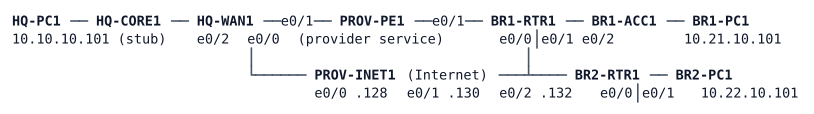

# LAB-048 — Branch VPNs

**Module:** 07 WAN and Tunnels · **Type:** X (Expansion) · **Guidance tier:** G2 (behaviour stated, technology not named) · **Estimated time:** 180 min · **Blueprint objectives:** 2.2.b:P (tunnel configuration and verification), 3.2.b:R (OSPF areas and route types), 5.2.a:R (access control lists)

## Scenario

Veridian's provider service reaches only HQ and the BR1 depot. The new BR2 depot has nothing but an Internet line, and the security audit wants every Veridian site-to-site flow encrypted. The network team must connect both branches to HQ over the Internet, keep BR1's provider line as a standby only, protect the headend's dedicated Internet circuit, and be able to show how the design behaves when an Internet line fails.

## Objectives

- Connect BR1 and BR2 to HQ over the Internet with routed overlays and a dynamic routing protocol, so a new branch subnet needs no static route anywhere.
- Make the provider service a less-specific backup for BR1 that takes over, and gives way again, without manual action and without a floating route.
- Encrypt the overlays without rebuilding the routing design.
- Restrict HQ-WAN1's Internet-facing interface to what the VPN design needs, and log what it refuses.
- Size the overlay for the underlay, prove the size with a do-not-fragment test, and document the WAN.

## Available Information

(HQ-WAN1 e0/0, BR1-RTR1 e0/0 and BR2-RTR1 e0/0 each connect to the PROV-INET1 port shown; BR1-RTR1 e0/1 connects to PROV-PE1 e0/1.)

| Link | Subnet | Addresses |
|---|---|---|
| HQ-CORE1 e1/0 -- HQ-WAN1 e0/2 | 10.10.255.96/31 | CORE1 .96, WAN1 .97 |
| HQ-WAN1 e0/0 -- PROV-INET1 e0/0 (Internet) | 203.0.113.128/31 | INET1 .128, WAN1 .129 |
| HQ-WAN1 e0/1 -- PROV-PE1 e0/0 (provider service) | 100.64.10.0/31 | PE1 .0, WAN1 .1 |
| BR1-RTR1 e0/0 -- PROV-INET1 e0/1 (Internet) | 203.0.113.130/31 | INET1 .130, BR1 .131 |
| BR1-RTR1 e0/1 -- PROV-PE1 e0/1 (provider service) | 100.64.21.0/31 | PE1 .0, BR1 .1 |
| BR2-RTR1 e0/0 -- PROV-INET1 e0/2 (Internet) | 203.0.113.132/31 | INET1 .132, BR2 .133 |
| BR1-RTR1 e0/2 -- BR1-ACC1 e0/0 | 802.1Q trunk, native VLAN 999 | e0/2.10 10.21.10.1/24 (users), e0/2.99 10.21.99.1/24 (management) |
| LANs | HQ 10.10.10.0/24, BR1 10.21.10.0/24, BR2 10.22.10.0/24 | gateways .1, hosts .101; BR1-ACC1 management 10.21.99.11 |

Router loopbacks (router IDs): HQ-CORE1 10.255.10.1, HQ-WAN1 10.255.10.41, BR1-RTR1 10.255.21.1, BR2-RTR1 10.255.22.1. HQ-CORE1 also carries 10.10.20.2, 10.10.50.2 and 10.10.99.2 as stand-ins for the HQ campus.

Overlay design values (use exactly these):

| Item | Value |
|---|---|
| Overlay to BR1 | Tunnel21, 10.250.21.0/24: HQ-WAN1 .1, BR1-RTR1 .21 |
| Overlay to BR2 | Tunnel22, 10.250.22.0/24: HQ-WAN1 .1, BR2-RTR1 .22 |
| Tunnel endpoints | The Internet-facing interface (Ethernet0/0) of each router and the peer's Internet address |
| OSPF | Process 1. HQ stays in area 0. BR1 (LAN, management VLAN, loopback, tunnel) is area 21, BR2 area 22; HQ-WAN1 is the area border router. Overlay links are point-to-point, hello 5 s, dead 20 s, cost 100. Branch LAN-facing interfaces are passive |
| Overlay IP MTU / TCP MSS clamp | 1400 / 1360 |
| Pre-shared key | `VERIDIAN-VPN-KEY` (one key for all peers) |
| IKE | encryption AES-256 (CBC), integrity SHA-256, DH group 14, keys by name `PROP`, `POL`, `KR`, `IKEV2-PROF`; dead-peer detection every 10 s, 2 retries, only when traffic needs it |
| IPsec | transform set `TS-AES` = ESP AES-256 with SHA-256 HMAC; IPsec profile `VPN-PROF` |
| Internet ingress list | `WAN1-INET-IN`, applied inbound on HQ-WAN1's Internet-facing interface |

Credentials: every console is privileged. Routers and BR1-ACC1: `admin` / `Cisco123!`, enable secret `Cisco123!`. Hosts (Alpine Linux): `cisco` / `cisco`, `sudo` works without a password.

Platform notes and test tools:
- PROV-PE1 and PROV-INET1 belong to the providers. They are unhardened, do not change, and you must not configure them. PROV-INET1 is your outside observer: its Loopback0 (198.51.100.200) also stands for "the Internet".
- The routers are IOL images. A tunnel in the pure IPsec mode (`tunnel mode ipsec ipv4`) negotiates its security associations but does not forward LAN traffic on this platform. Use GRE tunnels with tunnel protection.
- Do not configure a GRE `keepalive` on a tunnel that is IPsec-protected: on this image the keepalive reply leaves the router unencrypted, the peer discards it and the tunnel line protocol goes down although the security associations are up. Failure detection on the protected tunnels comes from the routing protocol and from dead-peer detection.
- Do not use `clear crypto session` on one end only to test the tunnel: the two ends keep restarting negotiations and the tunnel flaps for about 80 seconds. Use `shutdown` and `no shutdown` on the tunnel interface instead, or wait for the settle time.
- Adding protection to a running tunnel drops its routing adjacency for a short time while the security associations come up; this is expected.
- The CML underlay carries 1500-byte packets. Judge MTU work by do-not-fragment tests and by the TCP options in the first packet of a connection, not by waiting for a stall. The Alpine `ping` cannot set the DF bit: run DF pings on a router (`ping <dest> source <interface> size <N> df-bit`; N is the whole IP packet). Capture with `sudo tcpdump -ni eth0 -c 5 'tcp[tcpflags] & tcp-syn != 0'` on a host, or use the CML link capture.
- For a TCP transfer: `head -c 300000 /dev/zero > /tmp/f`; on the receiver `nc -l -p <port> > /tmp/rx &`; on the sender `timeout 30 nc <receiver> <port> < /tmp/f`; count with `wc -c /tmp/rx`. Use a new port for each trial.
- Failure tests. A cable pull of BR1's Internet line is `shutdown` of BR1-RTR1 Ethernet0/0: it downs only that end, so HQ-WAN1 (whose port stays up) learns of the loss only through its routing protocol. A silent failure is a CML link stop on the BR2-INET1 link (the interfaces stay up/up). Name the method in your notes and do not mix them. Restore with `no shutdown` or `link start`.
- Allow 15 to 30 minutes after a cold start for the time service to reach `sys.peer` on the branch clients; check it last. Repeated `shutdown` of BR1-RTR1 Ethernet0/0 resets that router's polling.
- Do not run commands that ask for a confirmation (`clear ip ospf process`, `clear logging`): they stall the console tools.

## Starting State

This is the WAN environment stage W0 (`environments/WAN/W0/`). The provider service is live. HQ-WAN1 and BR1-RTR1 are connected to PROV-PE1 with static routes: PE1 reaches 10.10.0.0/16 and 10.50.0.0/16 through HQ-WAN1 and 10.21.0.0/16 through BR1; BR1 reaches 10.10.0.0/16 and 10.50.0.0/16 through PE1; HQ-WAN1 reaches 10.21.0.0/16 through PE1 and passes that route to HQ-CORE1 in OSPF (area 0, only HQ-WAN1 and HQ-CORE1 take part). Every router has a static default route into PROV-INET1, and both branches translate their user addresses to their Internet address (PAT), so all three PCs reach 198.51.100.200. BR1-PC1 and HQ-PC1 reach each other through the provider service. BR2-PC1 reaches nothing at HQ or BR1. The hardened management baseline is in place on HQ-WAN1, BR1-RTR1, BR2-RTR1 and BR1-ACC1 (local AAA, SSH only from the management ranges, SNMPv3, authenticated NTP with HQ-WAN1 as the server and the branch devices as clients). There is no overlay, no IPsec and no Internet filtering yet.

## Requirements / Change Requests

**R1 Branches over the Internet.** Users at BR2 reach HQ (HQ-PC1 and the HQ loopbacks) and BR1; users at BR1 reach HQ and BR2; HQ reaches both branches. Use routed overlays over the Internet and the design values above. Routes are learned dynamically: a new subnet created on a branch LAN (for example a loopback with a /24 on BR2-RTR1) is reachable from HQ-PC1 with no static route added anywhere. Stay within the routers you own (HQ-WAN1, BR1-RTR1, BR2-RTR1); HQ-CORE1 is the campus and stays as it is.

**R2 Provider service as a backup.** While the Internet path works, traffic between BR1 and HQ uses the overlay in both directions. When BR1's Internet line is down, the same traffic uses the provider service in both directions, and it returns to the overlay when the line is restored. No manual action, no floating route and no change to the existing static routes.

**R3 Encrypt the overlays.** Everything the two overlays carry between the sites is encrypted. Tunnel numbers, addresses, OSPF areas and timers from R1 do not change, no new tunnel interface is added, and the routing adjacencies return on their own after the change. Do not add a GRE keepalive. Add the protection in the order that disturbs the running design least.

**R4 Protect the headend's Internet circuit.** On HQ-WAN1's Internet-facing interface only the following is accepted from the Internet: from the two branch Internet addresses (203.0.113.131 and 203.0.113.133) to HQ-WAN1's own Internet address, the key exchange (both UDP ports it uses, including the one for NAT traversal), the encrypted traffic itself, the time service, and the ICMP messages needed for pings and for path-MTU discovery (echo, echo-reply, unreachable, time-exceeded, packet-too-big); and from the provider's link address 203.0.113.128, echo-reply, unreachable and time-exceeded, so that HQ-WAN1 can ping its own provider. Every other packet is dropped and logged. The overlays, the routing and the branch Internet access must keep working with the list applied.

**R5 Overlay MTU.** The overlay IP MTU and the TCP MSS clamp are set to the design values on all tunnel ends. A 300000-byte TCP transfer from BR2-PC1 to HQ-PC1 completes with every byte received, the first packet of that connection as seen at HQ-PC1 advertises an MSS no larger than the clamp, and a do-not-fragment ping through the overlay shows exactly where the MTU you set ends.

**R6 Document the WAN.** Write a short WAN document in your own notes: a table of both tunnels (ends, addresses, mode, protection), the routing per site (areas, what each site learns and how), the backup behaviour of R2 (what happens in each direction and why no extra configuration is needed), and what the R4 list permits and why each entry is there.

## Verification Criteria

**V1** BR2-PC1 pings HQ-PC1, BR1-PC1 and the HQ loopbacks, and the reverse, 100 percent; BR1-PC1 pings HQ-PC1 and BR2-PC1. A traceroute from BR2-PC1 to HQ-PC1 shows an overlay hop (10.250.22.x) and no provider (100.64.x.x) or Internet hop.

**V2** Both overlay adjacencies are FULL on HQ-WAN1 and each branch router; HQ-WAN1's table shows the branch /24s as OSPF routes (`O`, learned through its own tunnel interfaces) while the branches show the HQ /24s differently (think about why); a new /24 on a BR2-RTR1 loopback in area 22 is reachable from HQ-PC1 with no static route.

**V3** With the Internet line up, a traceroute from BR1-PC1 to HQ-PC1 and one from HQ-PC1 to BR1-PC1 show no 100.64.x.x hop. After the cable pull of BR1's Internet line (and with the adjacency gone) both traceroutes show the provider hops, pings succeed, and BR1's route to 10.10.10.0/24 comes from the static route to the provider. After the restore both return to the overlay. You can state how long each step took.

**V4** Both IKE security associations are READY, the IPsec counters between the GRE endpoints (protocol 47) rise with traffic, the overlay interfaces report that they are protected, a capture on a branch Internet link shows ESP and no GRE, and no tunnel interface other than Tunnel21 and Tunnel22 exists.

**V5** From PROV-INET1, pings to 203.0.113.129 from Loopback0 and from the link address fail with administratively-prohibited replies and HQ-WAN1 logs each refusal; pings from BR1-RTR1 and BR2-RTR1 to 203.0.113.129 (sourced from their Internet interfaces) succeed, and the overlays stay up with the list applied.

**V6** A DF ping from BR2-RTR1 (sourced from its LAN interface) to HQ-PC1 succeeds at 1400 bytes and fails at 1401; the 300000-byte transfer arrives complete; the SYN seen at HQ-PC1 carries MSS 1360 or less.

**V7** With the Internet line of BR2 silently failed, the overlay adjacency of BR2 drops by itself within the dead interval plus a few seconds; after the restore it returns without commands on the routers. You can state the measured values for the pulled and the silent failure.

**V8** BR2-RTR1 and BR1-ACC1 report HQ-WAN1 as their synchronised time source (check last).

**V9** Your WAN document covers R6.

## Analysis Questions

**Q1** BR1 has a static /16 to the provider and learns the HQ /24s over the overlay. Why does the backup work without a floating static route and without any tracking, and what single change to the existing design would break it?

**Q2** Which prefixes must HQ-WAN1 and the branch routers never learn through the overlay, and what happens when one of them is learned that way?

**Q3** In what order did you add IPsec to the running GRE tunnels, why did the routing design survive, and what would a pure IPsec tunnel interface have changed compared with GRE protected by IPsec (overhead, keepalives, what you saw on this platform)?

**Q4** Why must the R4 list permit ICMP error messages, and what does the single shared pre-shared key cost in security terms?

**Q5** What changes for BR2 when HQ-WAN1's Internet circuit fails, and what would it take for BR2 to keep working?

**Q6** Which traffic between the sites still crosses the Internet unencrypted in your finished design, and how would you change that?

**Q7** From the measurements you took, which mechanism detected each kind of failure first, and how long did each take?
